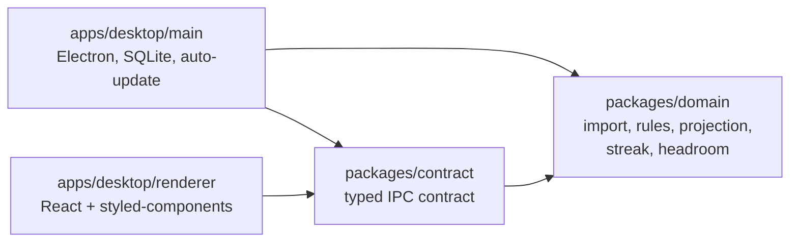

# DashCash

> Horizon showed what's ahead. DashCash shows the whole line: where your money came from, where it is today, and where it's heading.

DashCash is a local-only desktop app for personal finances. It imports bank CSVs, rebuilds the history of every account from one known balance, and projects each account forward month by month until the mortgage is paid off. A monthly savings goal, a streak and a live "headroom" for the current month turn saving into something you can see.

No cloud, no account, no AI features. Your bank data never leaves your machine.

<!-- Screenshot: dashboard with balance graph, today marker and payoff month -->

## Features

- **One timeline:** actual balances (solid) and projected balances (dashed) for every account in one graph, with a today marker and the mortgage payoff month.
- **CSV import:** a five-step wizard with saved bank profiles, rules that categorise known merchants, duplicate detection, recurring items and transfers between your own accounts.
- **Five account types:** income, spending, savings, credit card and mortgage, each projected in its own way.
- **Saving:** a monthly goal per account, a streak of months met, and the headroom left this month before the streak breaks.
- **Compare:** spending per category across up to four months or years, with fixed and variable costs separated.

What is shipped and what is planned, in build order: [docs/feature-checklist.md](docs/feature-checklist.md).

## How it's built

DashCash is built around **quality gates and continuous delivery**. The idea: quality is not a habit of individuals, it is something the pipeline proves, for humans and AI agents alike.

Every change goes through the same gate, whether I wrote it or an AI agent did. Nothing is done until `npm run verify` is green locally and the pipeline is green on the pull request. Releases are built once in CI and promoted, never built on a laptop.

### Quality gates

| Gate | Tool | Runs | Feature |
| --- | --- | --- | --- |
| One entry point for all checks | `npm run verify` | locally, CI, agent | 01 |
| Formatting | Prettier (`--check`) | CI | 01 |
| Linting, zero warnings | ESLint (`--max-warnings 0`) | CI | 01 |
| Strict types | TypeScript `strict`, `noUncheckedIndexedAccess` | CI | 01 |
| Money is never a plain number | `Cents` branded type + lint rule | CI | 07 |
| Architecture layers | dependency-cruiser | CI | 01 |
| Unit tests | Vitest | CI | 01 |
| Dependency audit, all severities | `npm audit` + exceptions file with expiry | CI, daily | 02 |
| Secrets | GitHub push protection, gitleaks | push, CI | 02 |
| Reproducible installs | pinned Node, committed lockfile, `npm ci` | CI | 01 |
| Supply chain | Actions pinned by commit SHA, Renovate | CI | 02 |
| No data files in git | script: no `*.db`, `*.sqlite`, `*.csv` outside `fixtures/` | CI | 01 |
| Every commit follows the commit convention | commitlint | CI | 01 |
| Commits name an existing ticket or refactor step; a PR into `main` needs all of them done | script | CI | 01 |
| Component tests | Storybook stories as tests (interaction + accessibility) | CI | 05 |
| Every component has a story | script | CI | 05 |
| Coverage on changed lines | Vitest coverage | CI | 05 |
| End-to-end tests | Playwright driving the Electron app | CI | 04 |
| Visual regression | Playwright screenshots of Storybook | CI | 20 |
| Release from CI only | tag → build once → draft release → publish | CI | 20 |
| SBOM per release | `npm sbom` | release | 20 |
| Flaky tests quarantined with expiry | quarantine file + expiry check | CI, daily | 04 |
| License allowlist | script: lockfile licences against `quality/license-allowlist.json` | CI | 02 |
| Mutation testing | StrykerJS on `packages/domain`, `scripts/` and `gates/` | pull request and nightly, ratchet | 03 |
| Docs drift | paths named in docs must exist | CI | 01 |

Each gate arrives with the feature in [docs/feature-checklist.md](docs/feature-checklist.md) that first needs it; the rollout rules are in [docs/quality-gates.md](docs/quality-gates.md).

## Architecture



- **domain** is pure TypeScript: no React, no Electron, no I/O. All money math lives here, which is why unit and mutation tests focus here.
- **renderer** follows the layers of the design handoff: tokens → primitives → components → features → layouts → pages. A level only imports from levels below it.
- Every layer rule is enforced by dependency-cruiser in CI, not by convention.
- Money is stored and calculated as integer cents everywhere.

The design handoff (spec, prototype, tokens, logo) lives in [docs/design/](docs/design/), the product concept in [docs/concept.md](docs/concept.md).

## Development workflow

Every feature starts with a grill-me session that resolves each design decision. From the resulting design log follow the PRD, the plan and the tickets, all in the feature's folder in [docs/features/](docs/features/). Then an agent loop builds the tickets one by one on the feature branch: one agent writes the failing tests, another makes them pass, and a third reviews the result with a fresh context before CI runs. The finished feature lands on `main` through one reviewed pull request; its refactor follows in a second one.

Folder structure, file naming and commit rules are in [docs/conventions.md](docs/conventions.md).

## Getting started

Requirements: Node (version in `.nvmrc`), npm.

```bash
npm ci
npm run dev          # start the app with hot reload
npm run storybook    # browse every component in isolation
npm run verify       # everything CI checks, except end-to-end tests
npm run verify:full  # verify + build + end-to-end tests
```

Tests never use real bank data. Fixtures in `fixtures/` are invented, and the app's clock is fixed in tests, so results don't depend on the day they run.

## Releases

Releases are made only by CI, from a version tag:

1. A tag `v*` triggers the release workflow.
2. The installer is built once and attached to a draft GitHub release, together with an SBOM.
3. A smoke test runs against that exact installer.
4. Publishing the draft is the promotion. Installed apps pick it up through auto-update.

## History

DashCash replaces [Horizon](https://github.com/carlos-rezai/Horizon), which started as a mortgage payoff projector and grew through several concept changes while I explored what an AI-assisted workflow can do. DashCash is the redesign, with a new concept, a new design and the quality gates in place from the first commit.

## License

MIT, see [LICENSE](LICENSE).
