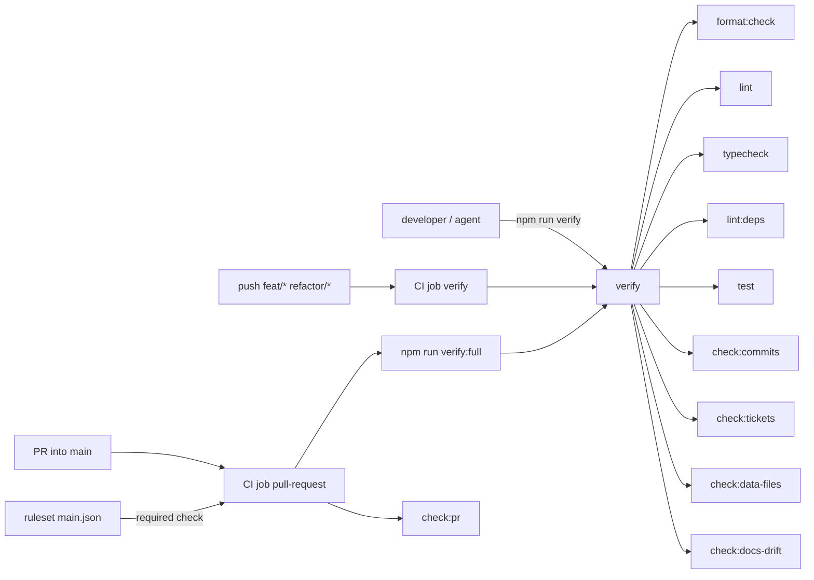

# 01 quality-gates: design log

## Grill-me, 2026-10-31

### Background

DashCash is built around quality gates: "the gates matter as much as the
features" (`CLAUDE.md`). Today the repository holds only folders with
`.gitkeep`, the docs and the design handoff: no `package.json`, no tooling,
no CI, and `main` has no ruleset (`gh api .../rulesets` returns `[]`).

This feature has no prototype part. Its source text is its row in
`docs/feature-checklist.md` (row 01), with `docs/quality-gates.md` and
`docs/conventions.md` as the specification, the **(enforced)** marks naming
what must be enforced, and the gate table in `README.md` naming the tool per
gate. `docs/quality-gates.md` (Rollout) assigns everything else to later
features: audit, gitleaks, Renovate and SHA pinning (02), Playwright and
flaky quarantine (03), Storybook, the story check and coverage (04), `Cents`
and its lint rule (06), Stryker (07), releases (20).

### Problem

Build the binding core of the pipeline: one `npm run verify` that runs the
same checks locally, for the agents and in CI, a CI workflow on every push
to `feat/*` and `refactor/*` and every pull request into `main`, and a
ruleset that makes `main` accept changes only through a green pull request.
Every **(enforced)** rule of `docs/conventions.md` that belongs to 01 must be
checked by a tool or script, and each check must itself be tested.

### Questions and Answers

**Scope and naming**

1. *Feature name and number?* `quality-gates`, row 01 of
   `docs/feature-checklist.md`; folder `docs/features/01-quality-gates/`,
   branch `feat/01-quality-gates`.
2. *Which gates are in, which wait?* In: exactly the row's Contents.
   Out: everything `docs/quality-gates.md` (Rollout) gives to 02, 03, 04,
   06, 07 and 20. A gate arrives "with the first feature that needs it, so
   nothing is checked before there is something to check".
3. *Do the checks themselves get tests?* Yes. `docs/conventions.md` (Test
   layers): every rule gets a test; the gates are rules. Each custom script
   and each **(enforced)** rule configured in a tool has Vitest tests.
4. *End-to-end tests?* None. Playwright arrives with 03
   (`docs/quality-gates.md`, Rollout); this feature has no app user flow.

**Workspace, Node, npm**

5. *Workspace layout?* npm workspaces in the root `package.json`:
   `"workspaces": ["apps/*", "packages/*"]`, `"private": true`,
   `"type": "module"`, licence MIT (`LICENSE`). Folders from
   `docs/conventions.md` (Folder structure).
6. *Do `packages/domain`, `packages/contract` and `apps/desktop` get a
   `package.json` now?* **Assumption:** no. Each workspace member gets its
   `package.json` and `tsconfig.json` with its first code (contract and
   desktop in 03, domain with its first module). Reason: an empty package
   has nothing to typecheck (`tsc` fails on a project with no inputs), and
   `docs/quality-gates.md` (Rollout) says nothing is checked before there is
   something to check. The layer rules are still written and tested now
   (Q40, Q44).
7. *Workspace package names?* **Assumption:** `@dashcash/<folder>`
   (`@dashcash/domain`, `@dashcash/contract`, `@dashcash/desktop`), all
   `private`. Reason: no source names them; one scope keeps imports
   readable. The root package is `dashcash`.
8. *How is Node pinned?* `.nvmrc` (named in `README.md`, Getting started)
   holds an exact version; CI reads it with `node-version-file: .nvmrc`;
   `engines.node` in the root `package.json` holds the same version.
   **Assumption:** `24.14.0`, the Node 24 LTS installed on the development
   machine. Reason: no source names a version; Electron brings its own Node,
   so this one runs only the tooling.
9. *What goes into `.npmrc`?* **Assumption:** `engine-strict=true` (a wrong
   Node fails `npm ci` instead of running) and `save-exact=true` (new
   dependencies are pinned, matching "reproducible installs" in the
   `README.md` gate table). Audit settings are 02's.
10. *Lockfile and installs?* `package-lock.json` is committed; CI installs
    with `npm ci` (`README.md` gate table: "pinned Node, committed lockfile,
    `npm ci`").

**TypeScript**

11. *Which compiler options?* `tsconfig.base.json` with `strict` and
    `noUncheckedIndexedAccess` (`README.md` gate table), plus what the
    toolchain needs: `module`/`moduleResolution` `nodenext`, `target`
    ES2023, `noEmit`, `isolatedModules`, `verbatimModuleSyntax`,
    `erasableSyntaxOnly`, `allowImportingTsExtensions`. No further
    strictness flags: the sources name two.
12. *How are the gate scripts run?* As TypeScript with plain
    `node scripts/<name>/<name>.ts`: Node 24 strips types natively (checked
    on 24.14.0), so no loader dependency. `erasableSyntaxOnly` keeps the
    scripts in the syntax Node can strip.
13. *Typecheck command?* `npm run typecheck`: `tsc` on the root
    `tsconfig.json` (scripts, root configs and their tests); members added
    later extend `tsconfig.base.json` and join through project references.
14. *Cross-platform scripts?* Development is on Windows (`docs/design/SPEC.md`
    header: "Electron, Windows"), CI on Linux, and npm runs scripts through
    `cmd.exe` on Windows. So `package.json` scripts hold no shell syntax
    (`$(...)`, globs, pipes); anything with logic is a Node script in
    `scripts/`.

**Formatting and linting**

15. *Prettier configuration?* `.prettierrc.json` with Prettier's defaults
    except `singleQuote: true`. **Assumption:** single quotes, because the
    TypeScript in `docs/design/SPEC.md` §1 uses them; otherwise defaults.
    `npm run format:check` runs `prettier --check .`; `npm run format`
    writes.
16. *Does Prettier check Markdown?* **Assumption:** no. `.prettierignore`
    excludes `*.md`, `docs/design/` and generated output. Reason: the docs
    are prose with hand-written tables that Prettier would rewrite, and the
    design handoff is verbatim source text (`CLAUDE.md`, Design).
17. *ESLint setup?* Flat config `eslint.config.js`, `npm run lint` =
    `eslint . --max-warnings 0` (`README.md` gate table), typed linting with
    typescript-eslint, `eslint-config-prettier` last so ESLint never fights
    Prettier. Ignored: `docs/` (the prototype holds JavaScript), build and
    test output.
18. *Which rules beyond the presets?* **Assumption:** typescript-eslint
    `strictTypeChecked` as the base, plus rules that turn written project
    rules into checks: no `any` and no `console.log` (`build` skill, Hard
    rules), `@typescript-eslint/ban-ts-comment` for `@ts-ignore` and
    `@ts-expect-error`, no focused or skipped tests (`.only`, `.skip`) and
    reported unused disable directives (`CLAUDE.md`, Ask first: an approved
    exception then shows as an explicit `eslint-disable` in review), and in
    `packages/domain` a ban on `Date.now()` and argument-less `new Date()`
    (`CLAUDE.md`, Architecture). Reason: the sources state these rules but
    not which preset; `strictTypeChecked` matches "TypeScript strict" and
    "zero warnings". React and Storybook rules arrive with the first React
    code (04), the `Cents` rule with 06.
19. *Where do configs live, and in which language?* **Assumption:** tool
    configs at the repository root where the tools look for them, as
    JavaScript ES modules (`eslint.config.js`, `commitlint.config.js`,
    `.dependency-cruiser.js`), except `vitest.config.ts`, which Vitest loads
    natively. Reason: avoids a TypeScript config loader dependency for
    ESLint and commitlint.

**Unit tests**

20. *Vitest setup?* One root `vitest.config.ts`; `npm test` =
    `vitest run`; tests sit next to their module (`docs/conventions.md`,
    Module filing). Per-project configs (jsdom, Storybook) come with 04.
    Deterministic: no network, temporary folders per test, no dependence on
    the clock (`docs/quality-gates.md`, Rules that keep tests trustworthy).
21. *Where do the gate scripts live?* `scripts/<name>/<name>.ts` with
    `<name>.test.ts` beside it, camelCase and verb first
    (`docs/conventions.md`, Module filing and Naming): `checkCommits`,
    `checkTickets`, `checkPullRequest`, `checkDataFiles`, `checkDocsDrift`.
    Each splits into a pure core (inputs in, violations out) that the tests
    exercise, and a thin entry that reads git and the file system and sets
    the exit code.
22. *How are the tool configs tested?* **Assumption:** each config's test
    sits next to it at the root (`eslint.config.test.ts`,
    `commitlint.config.test.ts`, `dependency-cruiser.test.ts`) and drives
    the real config through the tool's Node API (ESLint `lintText`,
    `@commitlint/lint`, dependency-cruiser `cruise`). Code that must violate
    a rule is written to a temporary folder inside the test, never committed,
    because committed violations would fail the gates themselves. Reason:
    "tests sit next to their module", and the configs must live where the
    tools find them.

**`npm run verify`**

23. *What does `verify` run?* In order, failing fast:
    `format:check`, `lint`, `typecheck`, `lint:deps` (dependency-cruiser),
    `test`, `check:commits`, `check:tickets`, `check:data-files`,
    `check:docs-drift`. One entry point, "same steps locally, in CI and for
    the agent" (`docs/quality-gates.md`, table).
24. *Do the commit checks belong in `verify` although they read git?* Yes:
    `verify` is the one entry point. They check the commits of the current
    branch, `git merge-base origin/main HEAD`..`HEAD`, so on `main` the
    range is empty and they pass.
25. *And `verify:full`?* `verify` + build + end-to-end tests (`README.md`,
    Getting started). In 01 there is nothing to build or drive, so
    `verify:full` runs `verify`; 03 adds build and Playwright
    (`docs/quality-gates.md`, Rollout).
26. *Does the pull-request check (every ticket done) go into `verify:full`?*
    No. The issue-loop builder runs `verify:full` for tickets that change a
    user flow, mid-feature, when tickets are still open; the check would
    always fail there. It runs only in CI's pull-request job (Q36, Q45).

**Commit convention (commitlint)**

27. *What does commitlint enforce?* The header
    `<type>: [<feature>] <ticket no> <description>` from
    `docs/conventions.md` (Commit messages), through a custom parser preset:
    - `type` one of `feat`, `fix`, `refactor`, `test`, `docs`, `chore`,
      `ci`;
    - `[<feature>]` kebab-case;
    - optional two-digit number (ticket or refactor step);
    - description lower case, no full stop at the end. The literal suffix
      `, RED` is allowed on `test:` commits only, as in the conventions'
      example `test: [csv-import] 02 add duplicate detection, RED`;
    - no `@` and no `#` anywhere in the message, header, body and trailers
      alike (custom plugin rule). "Imperative" is left to review: no tool
      checks mood reliably.
28. *Does the `@` rule cover trailers such as `Co-Authored-By: ... <a@b>`?*
    Yes: "No `@` or `#` anywhere in commit messages"
    (`docs/conventions.md`). Commits carry no e-mail trailers; the existing
    commits on `main` carry none either.
29. *Is a body allowed?* **Assumption:** no; the whole message is one line
    (`body-empty`, `footer-empty`). Reason: `docs/conventions.md` says "one
    line. If it doesn't fit, split the ticket", and with the `@` rule there
    is no trailer left that would need a body.
30. *Maximum length?* **Assumption:** the description is at most 50
    characters, not counting the `, RED` suffix. Reason: the issue-loop
    prompts and the refactor-plan template ask for "a description under 50
    characters"; the gate makes that binding.
31. *Which commits are ignored?* **Assumption:** commitlint's default
    ignores (merge commits, `Revert`, `fixup!`/`squash!`). Reason: GitHub's
    merge commits ("Merge pull request #12 ...") and merges of `main` into
    a feature branch are generated text the author does not write.
32. *PR titles?* The same header grammar without a number
    (`docs/conventions.md`: "Planning commits and PR titles have none"), the
    same `@`/`#` rule. Checked in the pull-request job from the event's
    title, passed to the script through an environment variable, never
    interpolated into the shell (script injection).

**Ticket check**

33. *What does `check:tickets` check, per commit in the branch range?*
    - `[<feature>]` names an existing folder `docs/features/<NN>-<feature>/`;
    - a ticket number names an existing ticket file
      `docs/features/<NN>-<feature>/<nn>-*.md`;
    - on `refactor:` commits the number names a step `- [ ] <nn> ...` or
      `- [x] <nn> ...` in that folder's `refactor-plan.md`
      (`.claude/skills/request-refactor-plan/SKILL.md`, template).
    Existence is checked against the tree at `HEAD`, where the planning
    commits have already added the tickets.
34. *Which commits must carry a number?* **Assumption:** `feat`, `fix` and
    `test` must carry a ticket number, `refactor` a step number; `docs`,
    `chore` and `ci` may carry one, and if they do it must exist. Reason:
    "Every change belongs to a ticket" and "Ticket commits carry the ticket
    number" (`docs/conventions.md`), while the planning commits
    (`docs: [<feature>] add prd`) and `docs: [<feature>] mark feature done`
    carry none.
35. *Must the commit's feature match the branch?* **Assumption:** yes, on
    `feat/<NN>-<feature>` and `refactor/<NN>-<feature>` branches every
    commit names that branch's feature. Reason: "One branch per feature"
    (`docs/conventions.md`); a stray commit for another feature would
    otherwise reach `main` in the wrong PR. The branch name comes from
    `GITHUB_HEAD_REF`, then `GITHUB_REF_NAME`, then
    `git branch --show-current`.

**Pull-request check**

36. *What does `check:pr` check?* For the head branch:
    - `feat/<NN>-<feature>`: the folder exists, holds at least one ticket,
      and every ticket file (`<nn>-<name>.md`) reads `status: done`;
    - `refactor/<NN>-<feature>`: `refactor-plan.md` exists and has no
      unticked step;
    - the PR title (Q32).
    Source: "A PR into `main` needs every ticket in its folder at
    `status: done`, and a refactor PR every step of `refactor-plan.md`
    ticked **(enforced)**" (`docs/conventions.md`).
37. *A PR from any other branch?* **Assumption:** fails `check:pr`. Reason:
    "Every change belongs to a ticket in `docs/features/`". 02 (Renovate)
    revisits this for dependency PRs.

**Data-file check**

38. *What does `check:data-files` reject?* Tracked files (`git ls-files`)
    matching `*.db`, `*.sqlite` or `*.csv` outside `fixtures/` (`README.md`
    gate table), case-insensitive. **Assumption:** also `*.db-*` and
    `*.sqlite-*` (journal and WAL files) and `.env` / `.env.*` except
    `.env.example`, mirroring the "Secrets" and "Personal finance data"
    sections of `.gitignore` and `CLAUDE.md` (Never: "commit `.env`, `*.db`,
    real CSVs or app data"). It catches what `git add -f` forces past
    `.gitignore`.

**Docs-drift check**

39. *Which docs, and what is a "path named in docs"?* **Assumption:** the
    check reads `README.md`, `CLAUDE.md` and `docs/*.md` (top level only),
    and checks
    - every relative Markdown link target, and
    - every inline-code span that starts with a top-level folder of
      `docs/conventions.md` (Folder structure) followed by `/`: `.claude/`,
      `.github/`, `apps/`, `packages/`, `e2e/`, `fixtures/`, `quality/`,
      `scripts/`, `docs/`,
    skipping fenced code blocks, URLs and spans with placeholders (`<`,
    `>`, `*`, `{`, `…`, spaces). A path exists when `git ls-files` lists it
    or a file under it. Reason: `docs/features/` names files that later
    tickets create, `docs/design/` is the verbatim handoff, and `.claude/`
    skills use example paths such as `docs/features/01-csv-import/`. On
    today's docs this rule finds no false alarm (checked by grep).

**Layer rules (dependency-cruiser)**

40. *Which rules does `.dependency-cruiser.js` hold in 01?*
    - `packages/domain` imports only itself: no other workspace, no npm
      package, no Node built-in (`CLAUDE.md`: "imports nothing else, no
      I/O").
    - `packages/contract` imports only `packages/domain` (`README.md`,
      Architecture diagram).
    - The renderer imports no Node built-in, no `electron`, nothing from
      `main/` or `preload/` (`CLAUDE.md`, Architecture).
    - The preload imports only `electron` and `packages/contract`
      (`docs/conventions.md`: "exposes the contract, nothing else").
    - Renderer layers import only downwards: tokens → primitives →
      components → features → layouts → pages, with `App/` on top
      (`CLAUDE.md` **(enforced)**). Same-layer imports are allowed.
    - Nothing imports from inside another feature: a path under
      `features/<x>/` is reachable from outside `features/<x>/` only as
      `features/<x>/index.ts` (`docs/conventions.md` **(enforced)**).
    - `test-support/` is imported only by tests, stories, other
      `test-support/` files and `e2e/` (`docs/conventions.md`
      **(enforced)**).
41. *May the renderer import `packages/domain`?* **Assumption:** yes.
    Reason: `CLAUDE.md` (Money) formats money "only for display, via
    `domain/src/money/`", which the renderer does; the `README.md` diagram
    draws the IPC path only. Domain is pure, so the import carries no I/O.
42. *Where do the renderer's shared folders sit in the ladder?*
    **Assumption:** `api/`, `hooks/`, `utils/`, `types/`, `assets/` and
    `styles/` sit beside the ladder: every layer may import them, and they
    import only each other, `tokens/`, `packages/contract` and
    `packages/domain`. Reason: `docs/conventions.md` lists them as shared
    ("IPC calls shared by 2+ features", "cross-feature hooks"), and no
    source ranks them.
43. *The rule "SQLite access only in `main/db/`"?* **Assumption:** arrives
    with 03, which picks the SQLite driver the rule names. Reason: the
    module to forbid is not known until then.
44. *How are layer rules tested while the folders hold no code?* By the
    config test of Q22: small trees written to a temporary folder, one
    allowed and one forbidden import per rule, cruised with the real
    config.

**CI**

45. *Workflow shape?* `.github/workflows/ci.yml`, replacing
    `.github/.gitkeep`:
    - on `push` to `feat/**` and `refactor/**`: job `verify` runs
      `npm run verify`;
    - on `pull_request` into `main`: job `pull-request` runs
      `npm run verify:full`, then `check:pr`.
    Both: `actions/checkout` with `fetch-depth: 0` (the commit checks need
    `origin/main`), `actions/setup-node` with `node-version-file: .nvmrc`
    and the npm cache, then `npm ci`. Source: `docs/conventions.md`
    (Branches and pull requests).
46. *Runner?* **Assumption:** `ubuntu-latest`. Reason:
    `docs/quality-gates.md` puts screenshots in "CI's container" (Linux);
    nothing in 01 needs Windows. 20 adds the Windows installer build.
47. *Actions pinned by SHA?* Not yet: version tags now, SHA pinning with
    02 (`docs/quality-gates.md`, Rollout).

**Branch protection**

48. *How is `main` protected?* A repository ruleset on `main`, kept as code
    in `.github/rulesets/main.json`:
    - pull request required, 0 approvals (the PR author is the only
      maintainer and GitHub forbids self-approval;
      `.claude/skills/pr-review/SKILL.md` says the review is comment-only);
    - required status check `pull-request` (Q45);
    - allowed merge method `merge` only ("PRs land as merge commits, never
      squashed", `docs/conventions.md`);
    - no deletion, no force push;
    - no bypass actors: "The same rule applies to me and to any AI agent"
      (`docs/quality-gates.md`).
49. *Must the branch be up to date before merging?* **Assumption:** yes
    (strict status checks). Reason: "green" then means green against the
    current `main`; with one feature in flight at a time it costs at most a
    merge of `main` into the branch, which commitlint ignores (Q31).
50. *Who applies the ruleset?* **Assumption:** the human, once, with
    `scripts/applyBranchProtection/applyBranchProtection.ts`, which sends
    the JSON with `gh api` (creates or updates the ruleset and sets the
    repository to merge commits only). Reason: the token the agents use
    gets HTTP 403 on the branch-protection API (checked 2026-10-31), so no
    ticket can apply it unattended. The tickets build and test the file and
    the script; applying it is a manual step after the first green PR run,
    recorded in the PRD.
51. *How do the ruleset and the workflow stay consistent?* A test reads
    `.github/rulesets/main.json` and `.github/workflows/ci.yml` and checks
    that the required status check names the pull-request job, and that
    `merge` is the only merge method. No live check of the remote ruleset:
    out of scope.

**CODEOWNERS and the PR template**

52. *What does CODEOWNERS say?* `.github/CODEOWNERS` assigns the repository
    owner to `*` and, explicitly, to the gate files of `CLAUDE.md` (Ask
    first). **Assumption:** the ruleset does not require code-owner review.
    Reason: the owner opens every PR (the agents use his account) and
    cannot approve his own; a required owner review would block every merge.
    CODEOWNERS documents ownership and requests the review.
53. *Is the PR template in 01?* **Assumption:** yes,
    `.github/pull_request_template.md` with the sections
    `docs/conventions.md` asks for: the feature folder, one line per ticket,
    and "Assumptions" for feature PRs. Reason: `docs/conventions.md` (Folder
    structure) lists it under `.github/` and no other checklist row
    delivers it.

**Local hooks**

54. *Git hooks (husky, lint-staged)?* No. `docs/quality-gates.md` moves the
    gates from local hooks to CI ("Where gates run"); `npm run verify` is the
    local entry point.

### Design



Files:

| Path | Purpose |
| --- | --- |
| `package.json`, `package-lock.json` | workspace root, scripts, `engines` ✅ |
| `.nvmrc`, `.npmrc` | Node `24.14.0`; `engine-strict`, `save-exact` ✅ |
| `tsconfig.base.json`, `tsconfig.json` | strict base; root project for scripts and configs ✅ |
| `.prettierrc.json`, `.prettierignore` | single quotes; Markdown and handoff excluded ✅ |
| `eslint.config.js` (+ `eslint.config.test.ts`) | typed, zero warnings, project rules ✅ |
| `vitest.config.ts` | one root config ✅ |
| `commitlint.config.js` (+ `commitlint.config.test.ts`) | header grammar, `@`/`#` rule ✅ |
| `.dependency-cruiser.js` (+ `dependency-cruiser.test.ts`) | layer rules ✅ |
| `scripts/checkCommits/` | runs commitlint over the branch range ✅ |
| `scripts/checkTickets/` | feature, ticket and step references ✅ |
| `scripts/checkPullRequest/` | tickets done, steps ticked, PR title ✅ |
| `scripts/checkDataFiles/` | no data files outside `fixtures/` ✅ |
| `scripts/checkDocsDrift/` | named paths exist ✅ |
| `scripts/applyBranchProtection/` | sends the ruleset with `gh api` ✅ |
| `.github/workflows/ci.yml` | jobs `verify` and `pull-request` ✅ |
| `.github/rulesets/main.json` | ruleset as code ✅ |
| `.github/CODEOWNERS`, `.github/pull_request_template.md` | ownership, PR body ✅ |

Commit header grammar (commitlint parser preset):

```ts
// <type>: [<feature>] <nn> <description>
const HEADER = /^(feat|fix|refactor|test|docs|chore|ci): \[([a-z0-9]+(?:-[a-z0-9]+)*)\](?: (\d{2}))? (.+)$/;
```

Script cores (pure, tested), shapes for the PRD to refine:

```ts
type Violation = { subject: string; reason: string };

function findDataFiles(trackedPaths: string[]): string[];
function findDocsDrift(docs: { path: string; text: string }[], trackedPaths: string[]): Violation[];
function checkTicketReferences(commits: string[], trackedPaths: string[], readFile: (path: string) => string, branch: string | undefined): Violation[];
function checkPullRequest(branch: string, title: string, trackedPaths: string[], readFile: (path: string) => string): Violation[];
```

Alternatives:

- ✅ One `npm run verify` with the commit checks inside. ❌ Commit checks as
  CI-only steps: the agent would learn of a bad commit only after pushing.
- ✅ Gate scripts in TypeScript run by Node's type stripping. ❌ `tsx` or
  `ts-node`: an extra dependency for what Node 24 does natively. ❌ Shell
  scripts: break on Windows.
- ✅ Ruleset as committed JSON, applied by a script. ❌ Clicking it in the
  GitHub UI: not reviewable, not reproducible.
- ✅ Tool configs tested through the tools' APIs on temporary trees.
  ❌ Committed violating fixtures: they would fail the gates they test.
- ❌ Husky and lint-staged: the pipeline decides, not the local machine.
- ❌ Empty `package.json` for domain, contract and desktop now: nothing to
  check yet (Q6).

### Implementation Plan

1. **Verify skeleton and CI.** Root `package.json` with workspaces,
   `.nvmrc`, `.npmrc`, lockfile, `tsconfig.base.json`/`tsconfig.json`,
   Prettier, `npm run verify` = `format:check` + `typecheck`, `verify:full`
   = `verify`, `ci.yml` with the `verify` and `pull-request` jobs. Thinnest
   path: a push runs `verify` in CI and it is green.
2. **Vitest and the data-file check.** `vitest.config.ts`, `npm test`,
   `scripts/checkDataFiles/` with tests, both in `verify`.
3. **ESLint.** `eslint.config.js` with its config test, `npm run lint` in
   `verify`, existing code clean.
4. **Docs drift.** `scripts/checkDocsDrift/` with tests, in `verify`.
5. **Commit convention.** `commitlint.config.js` with the parser preset and
   the `@`/`#` rule, its config test, `scripts/checkCommits/`, in `verify`.
6. **Ticket references.** `scripts/checkTickets/` with tests, in `verify`.
7. **Pull-request check.** `scripts/checkPullRequest/` with tests, run by
   the `pull-request` job with the PR title.
8. **Layer rules.** `.dependency-cruiser.js` with its config test,
   `npm run lint:deps` in `verify`.
9. **Branch protection and ownership.** `.github/rulesets/main.json`, the
   consistency test, `scripts/applyBranchProtection/`, `CODEOWNERS`, PR
   template. Then, by hand: apply the ruleset after the first green
   `pull-request` run.

### Trade-offs

- Easier: one command answers "is this done?" for humans, agents and CI;
  every **(enforced)** rule of 01 has a test that fails if the rule stops
  enforcing; later gates slot into `verify` as one more script.
- Harder: `verify` needs `origin/main` locally for the commit checks; the
  strict commit grammar (one line, at most 50 characters, lower case) leaves
  no room for explanations in commits, which belong in tickets and the
  design log instead; strict up-to-date checks can force a merge of `main`
  into a branch.
- The ruleset needs one manual application; nothing checks that the live
  ruleset still matches the file.
- Out of scope, by `docs/quality-gates.md` (Rollout): audit, licence
  allowlist, gitleaks, Renovate, SHA pinning (02); Playwright, `verify:full`
  build and e2e, flaky quarantine, the SQLite layer rule (03); Storybook,
  story check, accessibility, coverage, React lint rules (04); `Cents` and
  its lint rule (06); Stryker (07); release, SBOM, visual regression (20).
- Out of scope, by decision: local git hooks (Q54); changes to `CLAUDE.md`'s
  "Ask first" list (for example adding `commitlint.config.*` and
  `scripts/check*`), which is the human's file to change.

### Assumptions from write-a-prd

- **A1. Missing `origin/main`.** **Assumption:** when `origin/main` cannot
  be resolved, the commit and ticket checks fail with a message telling the
  caller to fetch `origin/main`; they never pass. Reason: a gate that passes
  when it cannot run is a skipped gate; the sources only say `verify` needs
  `origin/main` (Trade-offs).
- **A2. Ignored commits in the ticket check.** **Assumption:** the ticket
  check skips exactly the commits commitlint's default ignores skip, using
  commitlint's own ignore function. Reason: Q31 ignores merge, revert and
  fixup commits for the grammar; the same generated commits carry no
  feature, so Q33 would otherwise fail on every merge of `main` (Q49) and on
  the PR job's merge commit.
- **A3. Pull-request job ref.** **Assumption:** the `pull-request` job runs
  on GitHub's default merge ref (the branch merged into the current
  `main`), with the branch name from `GITHUB_HEAD_REF`. Reason: Q49 wants
  "green against the current `main`"; the synthetic merge commit is covered
  by A2.
- **A4. Gate wiring test.** **Assumption:** the consistency test of Q51
  also checks that `verify` runs Q23's nine gates in order, `verify:full`
  runs `verify`, the `verify` job runs `npm run verify`, the `pull-request`
  job runs `npm run verify:full` and `npm run check:pr`, and `.nvmrc`
  equals `engines.node`. Reason: Q3 wants every check tested, and a gate
  dropped from the wiring would stop enforcing without any test failing.
- **A5. Chaining in `verify`.** **Assumption:** `verify` chains the gate
  scripts with `&&` in `package.json`. Reason: `&&` behaves the same in
  `cmd.exe` and POSIX sh (Q14 rules out `$(...)`, globs and pipes, not
  `&&`), fails fast as Q23 asks, and needs no runner dependency.
- **A6. JavaScript configs in the typecheck.** **Assumption:** the root
  TypeScript project sets `allowJs` and `checkJs` so the JavaScript tool
  configs (Q19) are type-checked and linted with type information. Reason:
  Q13 puts "root configs" in the root project, and Q19 writes most of them
  in JavaScript.
- **A7. One source for the header grammar.** **Assumption:** the header
  pattern lives only in the commitlint config's parser preset, with the
  `, RED` suffix captured as its own part; the ticket check and the
  pull-request check read the pattern from there. Reason: commits, ticket
  references and PR titles share one grammar (Q27, Q32, Q33); a second copy
  could drift.
- **A8. Shared `readBranchRange` module.** **Assumption:** the commit and
  ticket checks share one module that resolves the branch name (Q35 order)
  and reads the branch range (Q24). Reason: two gates read the same range;
  one tested module keeps them identical. It is the only module beyond the
  Files table.
- **A9. Gate script output.** **Assumption:** each gate script prints one
  line per violation, `<subject>: <reason>`, with `console.error`, exits 1
  on any violation and exits 0 silently otherwise; ESLint's `no-console`
  allows only `warn` and `error`. Reason: the build skill bans
  `console.log` (Q18), and a gate must still explain its failure.
- **A10. Ask-first for the gate files of 01.** **Assumption:** the tickets
  of this feature are the human's go for creating the gate files `CLAUDE.md`
  lists under "Ask first"; changing them after 01 still needs the human's
  go. Reason: the files do not exist yet and creating them is the feature's
  scope; `docs/conventions.md` (Workflow) makes the ticket the go in the
  issue-loop.

### Assumptions from prd-to-plan

- **P1. Vitest and the wiring test in the first phase.** **Assumption:**
  the first phase brings Vitest and the gate wiring test with the
  workspace, the typecheck and CI, ahead of Prettier and the data-file
  check, unlike the order in the Implementation Plan above. Reason: `tsc`
  fails on a project without inputs and `vitest run` fails without tests
  (Q6), so the first green **Verify** needs a config and a test; the
  wiring test (A4) is the natural first test.
- **P2. The wiring test grows phase by phase.** **Assumption:** each phase
  inserts its gate into `verify` at its Q23 place and extends the wiring
  test's expected list, so the test always pins exactly the gates present
  and their relative order; it checks the **Ruleset** from the phase that
  adds it. Reason: A4 describes the final state only; a test that expected
  all nine gates from the start would be red until the last phase.
- **P3. Commit history before the commit gate.** **Assumption:** the
  commit and ticket gates check the whole **Branch range** when they land,
  so every commit made before them already keeps the grammar, the
  50-character limit included; a violation is fixed by a new commit, never
  by rewriting pushed history. Reason: PRD Further Notes says every commit
  on the branch must satisfy the gates; force pushes are what the
  **Ruleset** blocks on `main` and what the conventions never ask for.

### Assumptions from prd-to-issues

- **I1. The RED step of the first ticket.** **Assumption:** the RED
  commit of `01-workspace-and-verify.md` brings the root `package.json`
  with the test tooling (`vitest`, `yaml`) and the lockfile, so the gate
  wiring test runs and fails on the missing wiring; the GREEN step adds
  the rest. Reason: no test runner exists yet, and a test that cannot run
  is not RED for the right reason (`.claude/skills/tdd/SKILL.md`).
- **I2. Shared violation output.** **Assumption:** the type `Violation`
  and the A9 output (one `<subject>: <reason>` line per violation on
  standard error, exit 1, or exit 0 silently) live in one module,
  `scripts/reportViolations/`, created by `03-data-file-check.md` and used
  by every later gate entry. This adds a second module beyond the Files
  table to A8's `readBranchRange`. Reason: A9 fixes one output for five
  gate scripts; five copies could drift, the same reason A7 and A8 give.
- **I3. The docs-drift ticket last.** **Assumption:** the docs-drift
  check (plan Phase 5) is the last ticket, `13-docs-drift-check.md`,
  after the **Ruleset** ticket, and carries the PRD's handover note as
  the final ticket (user story 95). Reason: `docs/ubiquitous-language.md`
  names `.github/rulesets/main.json`, which only the **Ruleset** ticket
  creates, so the gate could not pass on today's docs any earlier; its
  place in **Verify** (last, Q23) does not change.
- **I4. Place of the gate wiring test.** **Assumption:** the gate wiring
  test is `gateWiring.test.ts` at the repository root. Reason: it tests
  root files (`package.json`, `.nvmrc`, the workflow, the **Ruleset**)
  and has no module of its own; Q22 puts the tests of root configs at the
  root beside them.
