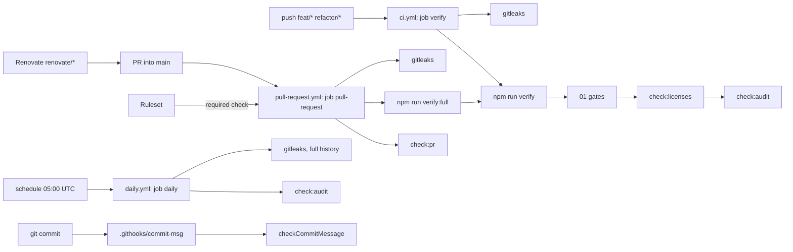

# 02 supply-chain: design log

## Grill-me, 2026-11-02

### Background

Feature 01 (`docs/features/01-quality-gates/`) built the binding core:
`npm run verify` with nine gates, `.github/workflows/ci.yml` with a `verify`
job on push and a `pull-request` job on pull requests into `main`, the
**Ruleset** with the one **Required check** `pull-request`, and the Claude
folder guard (`.claude/hooks/block-claude-edits.sh`, ticket
`01-quality-gates/14-claude-folder-guard.md`). It left to 02 exactly what
`docs/quality-gates.md` (Rollout) gives it: "audit with an exceptions file
and expiry, license allowlist, gitleaks, Renovate, pinned actions, a daily
run on `main`" (01 design log, Q2, Q47 and Trade-offs).

This feature has no prototype part. Its source text is row 02 of
`docs/feature-checklist.md`, extended by the human's description with three
items: the pull-request job in its own workflow triggered only by
`pull_request`; a local commit-msg hook that runs commitlint on the message
only; and the Claude folder guard extended to `~/.claude/settings.json`,
built by the human. The specification is `docs/quality-gates.md`,
`docs/conventions.md`, the gate table in `README.md` and the decisions of
the 01 design log.

State of the repository on 2026-11-02 (checked):

- `npm audit` reports one advisory, `GHSA-g3hv-75wg-m249` (minimatch
  `<11.0.1`, moderate), reaching 13 packages through `eslint` and
  `typescript-eslint`. Every dependent declares `minimatch@^10`, so the fix
  (11.0.1) is outside their ranges: `fixAvailable: false`.
- `package-lock.json` (lockfile version 3) has 240 packages, all `dev`, each
  with a `license` field: MIT (191), Apache-2.0 (15), MPL-2.0 (12,
  `lightningcss` and its platform builds), ISC (11), BSD-2-Clause (6),
  BSD-3-Clause (3), Python-2.0 (`argparse`), BlueOak-1.0.0 (`minimatch`).
- The repository `carlos-rezai/DashCash` is public, owned by a user account.
- Every `uses:` in `ci.yml` is a version tag (`actions/checkout@v7`,
  `actions/setup-node@v7`).
- `.claude/hooks/block-dangerous-git.sh` already blocks `--no-verify`.

### Problem

Add the supply-chain gates on top of 01's core, so that a vulnerable or
badly licensed dependency, a leaked secret or a moved action tag cannot
reach `main` unnoticed, and so that dependencies stay current through
pull requests that pass the same gates as any other change. Close a gap in
the CI wiring (the pull-request job sharing a workflow with the push job),
give commit authors and agents feedback on a bad commit message before the
push, and stop agents from editing the user-level Claude Code settings.

### Questions and Answers

**Scope and naming**

1. *Feature name and number?* `supply-chain`, row 02 of
   `docs/feature-checklist.md`; folder `docs/features/02-supply-chain/`,
   branch `feat/02-supply-chain`. The row's Contents gain the three items
   of the human's description.
2. *Which gates are in, which wait?* In: the row's Contents and the three
   added items. Out: everything `docs/quality-gates.md` (Rollout) gives to
   03 and later (flaky quarantine and its daily expiry check, SBOM,
   releases).
3. *End-to-end tests?* None: no app user flow exists or changes (as 01,
   Q4).
4. *Do the new checks get tests?* Yes, as 01 Q3: every script core and
   every configuration gate has Vitest tests, deterministic and offline
   (`CLAUDE.md`, Tests: "no network").

**Pull-request workflow (human's description)**

5. *What changes?* The `pull-request` job moves verbatim from
   `.github/workflows/ci.yml` into its own workflow
   `.github/workflows/pull-request.yml`, whose only trigger is
   `pull_request` into `main`. `ci.yml` keeps the `verify` job and only the
   `push` trigger (`feat/**`, `refactor/**`). Both lose their `if:`
   conditions, which no longer select anything.
6. *Why?* GitHub reports a job skipped by its `if:` as successful under its
   name. In the shared workflow every push run carries a skipped
   `pull-request` job on the head commit, which can stand in for the
   **Required check** of the same name. With one trigger per workflow no
   run ever reports a `pull-request` job it did not run.
7. *Does the **Ruleset** change?* No: the required context stays
   `pull-request`, the job's name. The tests that read `ci.yml` for the
   pull-request job (`gates/gateWiring/`, `gates/ruleset/`) read the new
   workflow instead, and gain two checks: `pull-request.yml` is triggered
   by `pull_request` only, and no other workflow has a job that reports as
   `pull-request`.
8. *Workflow names?* **Assumption:** `name: CI` stays on `ci.yml`, the new
   file is `name: Pull request`, the daily one (Q31) `name: Daily`. Reason:
   no source names them; the job names, which the **Ruleset** reads, are
   unchanged.

**Actions pinned by SHA**

9. *Which `uses:` are pinned?* Every `uses:` of a remote action in every
   workflow under `.github/workflows/`, to its full 40-character commit SHA
   (`README.md` gate table: "Actions pinned by commit SHA"; 01 Q47).
10. *Version visible?* **Assumption:** each pin carries the release it
    stands for as a trailing comment, `uses: actions/checkout@<sha> #
    v7.x.y`, the exact release the tag pointed to when pinned. Reason: a
    bare SHA is unreadable in review, and this is the format Renovate's
    `helpers:pinGitHubActionDigests` writes and keeps current (Q37).
11. *How is the pinning enforced?* A gate test,
    `gates/pinnedActions/pinnedActions.test.ts`, reads every workflow file
    as text and fails on any `uses:` that is not `<owner>/<repo>[/<path>]@`
    followed by 40 hex digits and a `# v…` comment. Local actions
    (`./…`) would pass; none exist. It runs in `npm test`, so in **Verify**.
    Source: `docs/conventions.md` (Module filing): "A test that proves a
    configuration gate lives in `gates/<gate>/`".

**Dependency audit**

12. *Which tool?* `npm audit` (`README.md` gate table), run as
    `npm audit --json` by a gate script `scripts/checkAudit/checkAudit.ts`
    that compares the report with the exceptions file. npm's own exit code
    cannot honour exceptions.
13. *Which severities and dependencies?* All severities ("Dependency audit,
    all severities", `README.md`) and all dependencies, dev included
    (`npm audit`'s default). Reason: today every package is a dev
    dependency (Background), so an audit of production dependencies only
    would check nothing.
14. *Where does the exceptions file live, and in which format?*
    `quality/audit-exceptions.json` (`docs/conventions.md`, Folder
    structure: "`quality/` audit exceptions, flaky quarantine, license
    allowlist"). **Assumption:** a JSON array of
    `{ "advisory": "GHSA-…", "reason": "…", "expires": "YYYY-MM-DD" }`.
    Reason: an exception names the advisory, not a package, because one
    advisory reaches many packages (13 for minimatch today); JSON like the
    **Ruleset** file, no YAML loader in the gate.
15. *How is an advisory identified in the report?* By its GHSA id, the last
    segment of the `url` of each advisory object in a vulnerability's `via`
    list (`npm audit --json`, report version 2). String entries in `via`
    point to another vulnerable package and carry no advisory of their own.
16. *When does an exception expire?* It is valid through its `expires` date
    and fails the day after. Source: `docs/quality-gates.md` (flaky
    quarantine, the same idea): "When the date passes, the build fails".
    The gate script takes today as an ISO date parameter in its core; the
    entry passes today's UTC date. Tests use fixed dates (`CLAUDE.md`,
    Tests: "fixed clock").
17. *What fails the gate?* **Assumption:** (a) an advisory with no valid
    exception, (b) an expired exception, (c) an exception whose advisory
    the report no longer lists, (d) a malformed exceptions file or entry,
    (e) `npm audit` failing to produce a report (no network, registry
    error). Reason: (c) keeps the file a list of live risks for the monthly
    review of "open exceptions" (`docs/quality-gates.md`, Rollout); (e) is
    01's rule that a gate which cannot run must not pass (01, A1).
18. *Is there a maximum expiry?* **Assumption:** no. Reason: no source sets
    one; the monthly review of open exceptions (`docs/quality-gates.md`)
    is the control, and adding an exception is a gate-file change under
    `quality/`, which needs asking (`CLAUDE.md`, Ask first).
19. *The advisory open today?* **Assumption:** the audit ticket lands with
    one exception, `GHSA-g3hv-75wg-m249`, expiring `2027-02-02` (three
    months), with the reason that minimatch is reached only through the
    lint tooling, where it matches glob patterns from the repository's own
    configuration, and that no fix exists inside the dependents'
    `minimatch@^10` range. The builder
    re-runs `npm audit` and records an exception of the same kind for any
    further advisory open on the day of building. Reason: the fix is a
    major bump outside the dependents' ranges, so an `overrides` entry
    would run eslint against an unsupported major; without an exception
    the gate blocks every branch from the first run, which
    `docs/quality-gates.md` (Rollout: "starts informative where it could
    block existing work") rules out.
20. *Is the audit in **Verify**?* Yes, as `check:audit`. The `README.md`
    gate table marks it "CI, daily", and every 01 gate marked "CI" runs
    through `verify`; "Blocking audit" (`docs/quality-gates.md`, table).

**License allowlist**

21. *Which tool?* **Assumption:** a gate script
    `scripts/checkLicenses/checkLicenses.ts` that reads the `license` field
    of every package in `package-lock.json`, no license-checker dependency.
    Reason: lockfile version 3 records every package's license (checked:
    all 240 have one), so the check runs offline and deterministically from
    a committed file, and it adds no dependency to audit and allow.
22. *Which packages?* Every entry of the lockfile's `packages` except the
    root (`""`) and workspace links (`link: true`), dev included; same
    reason as Q13.
23. *Where does the allowlist live, and what is on it?*
    `quality/license-allowlist.json` (`docs/conventions.md`, Folder
    structure). **Assumption:** a JSON array of SPDX ids, exactly the
    licences in the lockfile today: `MIT`, `ISC`, `Apache-2.0`,
    `BSD-2-Clause`, `BSD-3-Clause`, `BlueOak-1.0.0`, `Python-2.0`,
    `MPL-2.0`. Reason: no source names a policy; each is permissive or,
    for MPL-2.0, file-level copyleft that allows shipping the MIT app
    (`LICENSE`); a new licence is a deliberate gate-file change.
24. *SPDX expressions and missing licences?* **Assumption:** `A OR B`
    passes when one side is allowed, `A AND B` when both are, parentheses
    group; any other value is compared as a whole. A package without a
    `license` field fails. No per-package exceptions until one is needed.
    Reason: "nothing is checked before there is something to check"
    (`docs/quality-gates.md`, Rollout) applies to exception machinery too.
25. *In **Verify**?* Yes, as `check:licenses` ("License allowlist |
    license checker | CI", `README.md`).
26. *Order in **Verify**?* **Assumption:** the 01 gates unchanged, then
    `check:licenses`, then `check:audit` last. Reason: the audit is the one
    gate that needs the network and is the slowest; the offline gates fail
    first. The gate wiring test pins the new order.

**Secrets**

27. *gitleaks how?* **Assumption:** the official `gitleaks/gitleaks-action`,
    pinned by SHA (Q9), as a step after checkout in the `verify` job, the
    `pull-request` job and the daily job, with `GITHUB_TOKEN` and
    `GITLEAKS_ENABLE_COMMENTS: false`, default rules, no config file.
    Reason: gitleaks is a native binary, not an npm package, so it cannot
    run through `npm run` or `node_modules/.bin` (`CLAUDE.md`, Commands);
    the action is the maintained way to run it in CI and needs no licence
    key on a user-owned repository. The `README.md` gate table marks
    secrets "push, CI", not locally. Comments off: PR comments need write
    access and add nothing to a red check.
28. *Is gitleaks in **Verify**?* No (Q27). It runs inside the `pull-request`
    job, so the **Required check** covers it.
29. *What does each run scan?* The action scans the pushed commits on
    `push`, the PR's commits on `pull_request`, and the whole history on
    `schedule`. **Assumption:** the daily run (Q31) carries gitleaks too,
    so the history that predates the gate (01) is scanned. A false positive
    goes into a `.gitleaksignore` fingerprint list when it first appears,
    not before.
30. *Push protection?* GitHub secret scanning with push protection, a
    repository setting (`docs/quality-gates.md`: "Push protection,
    gitleaks"). **Assumption:** `scripts/applyBranchProtection/` adds
    `security_and_analysis.secret_scanning` and
    `secret_scanning_push_protection`, both `enabled`, to the repository
    `PATCH` it already sends (merge settings), keeping its name; the human
    runs it again after the merge. Reason: the agents' token cannot change
    repository settings (01, Q50); one script already owns the repository
    settings as code, and renaming it is refactor work.

**Daily run**

31. *What runs daily, and where?* A workflow `.github/workflows/daily.yml`
    with one job `daily` on `schedule` (and `workflow_dispatch`), which
    GitHub runs on the default branch, so on `main`
    (`docs/quality-gates.md`: "a daily run on `main`"). Steps: checkout
    (full history), Node from `.nvmrc`, `npm ci`, `npm run check:audit`,
    gitleaks (Q29). **Assumption:** the audit and gitleaks only, not all of
    **Verify**. Reason: the `README.md` table marks only the audit (and
    03's quarantine) "daily": the things that change without a commit, a
    new advisory or an exception passing its date.
32. *When?* **Assumption:** `cron: '0 5 * * *'` (05:00 UTC), plus
    `workflow_dispatch` so the human can run it once by hand after the
    merge. Reason: no source names a time; early morning in Europe puts a
    red run in the morning's mail.

**Renovate**

33. *Where and who installs it?* `renovate.json` at the repository root
    ("Tool configuration stays at the repository root",
    `docs/conventions.md`). The human installs the Renovate GitHub App on
    the repository after the merge; because `renovate.json` is then on
    `main`, Renovate skips its onboarding PR. A manual step like the
    **Ruleset** (01, Q50).
34. *How do Renovate's commits pass the commit gate?* Renovate branches are
    `renovate/*`; their commits run through `check:commits` and
    `check:tickets` in the pull-request job. **Assumption:** every commit
    message is fixed text `chore: [supply-chain] <description>`, with no
    template variables. Reason: the header needs a `[<feature>]` that names
    an existing **Feature folder** (01, Q33); dependency updates belong to
    this feature; and a package name in the message would break the
    `@` rule (`@types/node`, `@commitlint/lint`) and often the 50-character
    limit (01, Q27, Q30).
35. *And the PR titles?* `chore: <description>` without feature and
    number, the rule 01 settled for `renovate/*` (01, Q37;
    `scripts/checkPullRequest/`). So every `prTitle` is set explicitly,
    never derived from the commit message.
36. *Which groups?* **Assumption:** one group per kind, each with fixed
    messages:
    - npm packages: `chore: [supply-chain] update npm dependencies` /
      `chore: update npm dependencies`;
    - GitHub Actions: `chore: [supply-chain] update github actions` /
      `chore: update github actions`;
    - Node (`.nvmrc` and `engines.node` together, which the gate wiring
      test keeps equal): `chore: [supply-chain] update node` /
      `chore: update node`;
    - lockfile maintenance: `chore: [supply-chain] refresh the lockfile` /
      `chore: refresh the lockfile`;
    - vulnerability alerts: `chore: [supply-chain] fix vulnerable
      dependencies` / `chore: fix vulnerable dependencies`, without
      Renovate's `[SECURITY]` suffix.
    Reason: fixed text is the only way to meet Q34; lockfile maintenance
    brings the transitive fixes the audit asks for (minimatch today).
37. *Other settings?* **Assumption:** `extends` `config:recommended`,
    `helpers:pinGitHubActionDigests` (keeps Q9's pins and comments current)
    and `:disableDependencyDashboard`; `semanticCommits: disabled`; no
    `commitBody`; no automerge; `minimumReleaseAge: "3 days"`; schedule
    `before 6am on monday`, timezone `Europe/Berlin`. Reason: the dashboard
    is a GitHub issue, and GitHub issues are not used
    (`docs/ubiquitous-language.md`, Flagged ambiguities); the human merges
    every PR (`docs/conventions.md`, Workflow); a release age gives the
    registry time to pull a compromised release; weekly keeps the PRs few.
38. *How is the config tested?* A gate test
    `gates/renovate/renovate.test.ts` reads `renovate.json` and checks that
    every commit message passes the commitlint config and names
    `supply-chain`, that every PR title passes the Pull-request check's
    renovate rule (through `checkPullRequest` with a `renovate/*` branch),
    that no message holds a template (`{{`), and the settings of Q37.

**Local commit-msg hook (human's description)**

39. *Does this overturn 01's "no git hooks" (01, Q54)?* No. The hook is
    feedback, not a gate: CI still decides, and the hook only fails a
    commit earlier than the push would. 01 rejected hooks *as* gates and
    husky with them; this hook adds no dependency.
40. *What does it check?* The message being committed, with the
    commitlint config: header grammar, `@`/`#`, 50 characters, one line
    (01, Q27–Q30). Only the message: no **Ticket check**, no **Branch
    range**, no git history (human's description: "on the message only").
41. *How is it installed?* **Assumption:** a committed hooks folder
    `.githooks/` with one file `commit-msg` (`#!/bin/sh`, executable), and
    an npm `prepare` script `git config core.hooksPath .githooks`, which
    `npm ci` and `npm install` run. Reason: no hook manager dependency
    (01, Q54); `prepare` runs on every install, so every clone and every
    agent's checkout gets the hook; Git for Windows runs `sh` hooks
    (01, Q14). `docs/conventions.md` (Folder structure) gains the
    `.githooks/` line.
42. *What does the hook run?* `node scripts/checkCommitMessage/checkCommitMessage.ts "$1"`:
    a new entry that reads the message file, lints it through the existing
    `scripts/lintCommitMessages/` module and reports through
    `scripts/reportViolations/` (one line per violation, exit 1). Not
    `npm run`, which adds start-up time to every commit.
43. *Comment lines from the editor?* **Assumption:** before linting, the
    entry drops every line starting with `#` and everything from git's
    scissors line (`# ------------------------ >8 ------------------------`)
    on. Reason: git passes the hook the message file before it strips the
    editor's comments, and the `@`/`#` rule reads the raw message; the
    stripped text is what git stores with its default cleanup. A `#` line
    kept by `--cleanup=verbatim` is left to CI.
44. *Can it be skipped?* By a human with `--no-verify`; agents cannot,
    because `.claude/hooks/block-dangerous-git.sh` blocks `--no-verify`.
    CI catches whatever the hook missed.

**Claude folder guard for `~/.claude/settings.json` (human's description)**

45. *What is blocked?* `Edit` and `Write` of the user-level settings file
    `<home>/.claude/settings.json`, in addition to everything under the
    project's `.claude/`. Only that file: agents keep writing their
    auto-memory under `<home>/.claude/projects/`. Bash commands that name a
    `.claude/` path are already blocked by the existing rule (checked: the
    pattern matches `~/.claude/…`, `$HOME/.claude/…` and absolute home
    paths); the extension adds tests that pin it.
46. *How does the hook know the home folder?* **Assumption:** from `$HOME`,
    else `$USERPROFILE`, passed to `node` on standard input like the
    project root (the hook's comment: Git Bash rewrites POSIX paths in the
    environment), normalised the same way (`\` and `/`, Git Bash `/c/…`,
    case). A `file_path` starting with `~/` or `~\` resolves against it.
    With neither variable set, the home rule is skipped and the project
    rule still applies. Reason: Git Bash on Windows sets `HOME` to
    `/c/Users/<name>`, Claude Code passes `C:\Users\<name>\…`; failing
    closed on a missing home would block every edit.
47. *Who builds it?* The human. It changes `.claude/hooks/` and is under
    `.claude/`, which a ticket never approves (`CLAUDE.md`, Ask first). Its
    ticket says so, as 01's `14-claude-folder-guard.md` did, and the
    issue-loop stops there. The tests extend
    `gates/claudeFolderGuard/claudeFolderGuard.test.ts`, with invented home
    folders (`/home/sample`, `C:\Users\Sample`).
48. *Acceptance cases?* `Edit`/`Write` of the home settings as a POSIX,
    Windows, Git Bash and `~/` path exit 2; `<home>/.claude/projects/sample/memory/MEMORY.md`,
    `<home>/.claude/settings.json.bak` and `<home>/other/.claude/settings.json`
    exit 0 (the last is not the home settings and lies outside the
    project); Bash commands naming `~/.claude/settings.json` and
    `$HOME/.claude/settings.json` exit 2; every existing case keeps its
    exit code.

**Gate files and approval**

49. *Which gate files do the tickets name?* `.github/workflows/*`,
    `quality/*`, the `verify` script in `package.json`, and the tests under
    `gates/`. A ticket that names them is the approval for exactly those
    files (`CLAUDE.md`, Ask first), so `/feature-pipeline` pauses for the
    human's `go` before the build. `renovate.json`, `.githooks/` and the
    `prepare` script are not on the "Ask first" list; adding them there is
    the human's call (as in 01, Trade-offs).
50. *Docs?* The glossary names files that tickets create later only in
    plain text, never in code spans, because the docs-drift gate checks
    code-span paths in `docs/*.md` (01, Q39) and must stay green on every
    planning commit.

### Design



Files:

| Path | Purpose |
| --- | --- |
| `.github/workflows/ci.yml` | `push` only, job `verify`, gitleaks step, pinned ✅ |
| `.github/workflows/pull-request.yml` | `pull_request` only, job `pull-request`, gitleaks step, pinned ✅ |
| `.github/workflows/daily.yml` | `schedule` + `workflow_dispatch`, job `daily`: audit, gitleaks ✅ |
| `gates/pinnedActions/pinnedActions.test.ts` | every `uses:` pinned by SHA with a version comment ✅ |
| `quality/audit-exceptions.json` | advisory exceptions with expiry ✅ |
| `scripts/checkAudit/` | `check:audit` ✅ |
| `quality/license-allowlist.json` | allowed SPDX ids ✅ |
| `scripts/checkLicenses/` | `check:licenses` ✅ |
| `scripts/applyBranchProtection/` | adds secret scanning and push protection ✅ |
| `renovate.json` + `gates/renovate/renovate.test.ts` | dependency updates through gated PRs ✅ |
| `.githooks/commit-msg`, `prepare` script | local commit-msg hook ✅ |
| `scripts/checkCommitMessage/` | lints one message file ✅ |
| `.claude/hooks/block-claude-edits.sh` (human) | also blocks `<home>/.claude/settings.json` ✅ |
| `gates/gateWiring/`, `gates/ruleset/`, `gates/claudeFolderGuard/` | extended tests ✅ |

Script cores (pure, tested), shapes for the PRD to refine:

```ts
type AuditException = { advisory: string; reason: string; expires: string };

// report: the parsed `npm audit --json` output; today: 'YYYY-MM-DD'
function findAuditViolations(report: unknown, exceptions: unknown, today: string): Violation[];

// lockfile: the parsed package-lock.json; allowlist: SPDX ids
function findLicenseViolations(lockfile: unknown, allowlist: unknown): Violation[];

// message: the raw message file; returns the text git will store
function stripCommentLines(message: string): string;
```

Alternatives:

- ✅ Pull-request job in its own workflow. ❌ One workflow with `if:` per
  job: a skipped job reports success under its name (Q6).
- ✅ License check from the lockfile. ❌ `license-checker` and its forks:
  an extra dependency reading `node_modules`, which `npm ci` must fill
  first.
- ✅ Audit exceptions by advisory. ❌ By package: one advisory reaches many
  packages. ❌ `overrides` for minimatch: forces an unsupported major on
  eslint.
- ✅ gitleaks through its action in CI. ❌ In **Verify**: a native binary,
  not runnable through npm. ❌ Downloading the binary in a `run` step: a
  checksum to maintain by hand, which Renovate does not update.
- ✅ Fixed Renovate messages naming `supply-chain`. ❌ Renovate's default
  messages: upper case, package names with `@`, no `[<feature>]`.
- ✅ `core.hooksPath` set by `prepare`. ❌ husky: a dependency for one
  hook (01, Q54).

### Implementation Plan

1. **Pull-request workflow.** Move the `pull-request` job into
   `pull-request.yml`, `ci.yml` push only, `if:` removed; gate wiring and
   ruleset tests read both files and check the single trigger. Thinnest
   path: a push runs `verify`, a PR runs `pull-request`, both green.
2. **Pinned actions.** Pin every `uses:` by SHA with its version comment;
   `gates/pinnedActions/` test.
3. **License allowlist.** `quality/license-allowlist.json`,
   `scripts/checkLicenses/`, `check:licenses` in **Verify**.
4. **Audit.** `quality/audit-exceptions.json` with today's exception,
   `scripts/checkAudit/`, `check:audit` last in **Verify**.
5. **Daily run.** `daily.yml` running `check:audit`, pinned.
6. **Secrets.** gitleaks in the three workflows; push protection in
   `applyBranchProtection`. Then, by hand: run the script.
7. **Renovate.** `renovate.json` and its gate test. Then, by hand: install
   the Renovate app after the merge.
8. **Commit-msg hook.** `scripts/checkCommitMessage/`, `.githooks/commit-msg`,
   `prepare`, the conventions' folder line.
9. **Claude folder guard for home settings.** Built by the human: hook and
   tests.

### Trade-offs

- Easier: a new advisory, a disallowed licence, a leaked secret or a moved
  action tag fails a check before `main`; dependency updates arrive as PRs
  that pass every gate; a bad commit message fails at `git commit`, not
  after the push; the required check can only be satisfied by a run that
  actually ran.
- Harder: **Verify** needs the network for the audit, and a new advisory
  can turn every branch red overnight until an exception or a fix lands;
  each exception is a gate-file change that needs asking; Renovate's fixed
  messages say nothing about which packages changed (the PR body does);
  GitHub disables scheduled workflows after 60 days without repository
  activity.
- Manual steps, recorded for the PRD: run `applyBranchProtection` again
  (push protection), install the Renovate app, run `daily.yml` once by
  hand.
- Out of scope: flaky quarantine and its daily check (03); SBOM and release
  signing (20); `npm audit signatures`, workflow `permissions:` blocks and
  GitHub's repository-level SHA-pinning policy, which no source asks for;
  blocking `~/.claude.json` or other home files beyond
  `~/.claude/settings.json`; changes to `CLAUDE.md`'s "Ask first" list.

### Assumptions from write-a-prd

- **A1. Audit violations, one per cause.** **Assumption:** the audit core
  reports one violation per unexcepted **Advisory** (subject the GHSA id,
  reason its severity, title and every package it reaches), and at most
  one per exception: expired first (`expires` before today), otherwise
  stale (the report does not list it). Two exceptions naming one advisory
  are one violation on the exceptions file. Reason: Q17 lists the failures
  but not their output; one line per cause keeps 01's output (01, A9)
  readable; the duplicate rule follows the glossary ("exactly one **Audit
  exception**").
- **A2. Advisory without a GHSA id.** **Assumption:** an advisory object
  whose `url` does not end in a GHSA id fails the audit and cannot be
  excepted. Reason: Q15 identifies advisories by GHSA id only; an unknown
  report shape must not pass (01, A1).
- **A3. Exceptions file validation.** **Assumption:** the file must exist
  and hold a JSON array (`[]` when there are no exceptions); each entry
  needs `advisory` matching `GHSA-xxxx-xxxx-xxxx`, a non-empty `reason` and
  `expires` as a real calendar date `YYYY-MM-DD`; other keys are ignored. A
  report that is not a version-2 report (no `vulnerabilities` object, or an
  `error`) is a violation with the subject `npm audit`. Reason: Q17 (d)
  and (e) say malformed input fails but not what counts as malformed; a
  typo such as `expiry` already fails through the missing `expires`.
- **A4. How the entry runs npm.** **Assumption:** `checkAudit` runs
  `npm audit --json` as `node <npm_execpath>`, the npm that runs the
  script, accepts exit codes 0 and 1 (npm exits 1 when it finds
  vulnerabilities) and throws when the output is not JSON or
  `npm_execpath` is unset, with a message to run `npm run check:audit`.
  Reason: on Windows `npm` is `npm.cmd`, which `execFileSync` cannot start
  without a shell, and 01's gate entries start tools without one
  (`scripts/runGit/`); every caller (**Verify**, the **Daily run**) goes
  through `npm run`.
- **A5. Licence check skips workspace members.** **Assumption:** the
  licence check judges only lockfile entries whose key holds a
  `node_modules/` segment and that are not `link: true`; the root and the
  **Workspace member** entries (`apps/desktop`, `packages/domain`, …) are
  skipped. Reason: Q22 skips the root and links, but from 03 on the
  lockfile also holds an entry per member without its own `license`, which
  would fail; members are the repository's own code under the root's MIT
  licence.
- **A6. Licence values the check cannot read.** **Assumption:** a
  `license` that is missing, not a string or empty fails as "has no
  licence"; an expression with unbalanced parentheses or a dangling
  operator fails as unreadable; `OR` and `AND` are matched in upper case
  only, as SPDX writes them; a `WITH` term is compared as a whole. The
  subject is `<name>@<version>`, the name taken from the key after its last
  `node_modules/`. Reason: Q24 settles valid expressions only; an unknown
  licence must never pass.
- **A7. Allowlist validation, no stale check.** **Assumption:** the
  allowlist must be a non-empty JSON array of non-empty strings, or the
  check fails; an allowed licence no package uses does not fail. Reason:
  unlike an **Audit exception** (Q17 c), the allowlist is policy, not a
  list of live risks; a Renovate PR that drops the last `Python-2.0`
  package should not turn red.
- **A8. Wiring tests for the new workflows.** **Assumption:** the gate
  wiring test also checks each workflow's triggers (push: `feat/**` and
  `refactor/**` only; pull request: `pull_request` into `main` only;
  daily: `schedule` `0 5 * * *` and `workflow_dispatch`), that each of the
  three jobs runs gitleaks after checkout with `GITLEAKS_ENABLE_COMMENTS`
  `false`, and that the daily job checks out full history and runs
  `npm run check:audit`. Reason: Q4 wants every configuration gate tested,
  and a gitleaks step or a trigger dropped from a workflow would stop
  enforcing without any test failing (01, A4).
- **A9. `cleanCommitMessage` instead of `stripCommentLines`.**
  **Assumption:** the hook core is `cleanCommitMessage(raw): string` and
  applies git's whole default `strip` cleanup: CRLF to LF, the scissors
  line and everything after it dropped, `#` lines dropped, trailing
  whitespace stripped, consecutive blank lines collapsed, leading and
  trailing blank lines removed. An empty result exits 0, so git aborts the
  commit with its own message. Reason: Q43 names comment lines only, but a
  Windows editor writes CRLF, and `\r` breaks the header pattern on a
  message git would store clean; commitlint on an empty message would
  report a misleading grammar error.
- **A10. Commit-msg hook test.** **Assumption:** a gate test in
  `gates/commitMsgHook/` checks that the hook is tracked with mode
  `100755`, starts with `#!/bin/sh` and runs the entry with `"$1"`, that
  `prepare` is `git config core.hooksPath .githooks`, and that the hook,
  run with `sh` from the repository root on a temporary message file,
  exits 0 for a valid header and 1, printing the violation, for an invalid
  one. Reason: the hook is not a gate (glossary), but it is configuration
  that can stop working silently; `docs/conventions.md` (Module filing)
  puts tests of configuration in `gates/<name>/`.
- **A11. Hook entry errors.** **Assumption:** the entry exits 1 with one
  line when it gets no argument or cannot read the file, through
  `runGate`. Reason: 01's rule that a check which cannot run must not pass
  (01, A1); a human can still skip the hook (Q44) and CI decides.
- **A12. No Renovate validator.** **Assumption:** no `renovate` package
  and no `renovate-config-validator` in **Verify**; the gate test reads the
  JSON only, and Renovate's first run after the human installs the app
  shows whether it accepts the config. Reason: the `renovate` package
  brings hundreds of dependencies to audit and allow, the reason Q21 gives
  for no licence-checker; Q38 names the test's checks and no validator.
- **A13. Node group and branch prefix.** **Assumption:** the Node rule
  matches the dependency `node` in both the `nvm` manager (`.nvmrc`) and
  the npm manager's `engines`, enabling the `engines` update explicitly if
  Renovate's defaults skip it, and the gate test checks both are covered;
  `branchPrefix` stays Renovate's default `renovate/`, which the test pins.
  Reason: Q36 groups `.nvmrc` with `engines.node` but not how; the
  **Pull-request check** accepts only `renovate/*` branches (01, Q37).

### Assumptions from prd-to-issues

- **A14. The human's ticket last.** **Assumption:** the **Home settings**
  guard is ticket 14, the last, although nothing blocks it, and it carries
  the plan's handover note. Reason: the issue-loop grabs the
  lowest-numbered open ticket and stops at one that binds the project's
  Claude folder, so any lower number would stop the loop before the
  tickets agents can build; the skill orders by blockers only and leaves
  this open.
- **A15. Four phases split in two.** **Assumption:** plan Phases 3, 4, 8
  and 9 each become two tickets (licence ids, then SPDX expressions; the
  audit with exception validation, then the stale, duplicate and non-GHSA
  rules; Renovate's base and two groups, then the other three groups; the
  commit-message script, then the hook and its installation). Between the
  two, the first ticket's gate fails closed on what it does not yet judge:
  an SPDX expression is compared whole and fails, an advisory without a
  GHSA id fails as unexcepted. Reason: each issue-loop step has a 100k
  budget and the skill prefers thin slices; no source sets the interim
  behaviour, and 01's rule that a gate must not pass what it cannot judge
  (01, A1) decides it.
