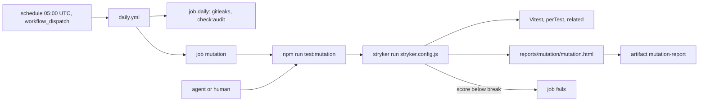

# 03 mutation-testing: design log

## Grill-me, 2026-11-07

### Background

Features 01 and 02 (`docs/features/01-quality-gates/`,
`docs/features/02-supply-chain/`) built **Verify** with eleven gates, the
push, pull-request and daily workflows, the **Audit** with its exceptions
file and the **License allowlist**. Both features' reviews kept finding
untested branches by hand; `docs/quality-gates.md` (Rollout) gives 03 the
tool that finds them: "StrykerJS on `packages/domain` and `scripts/`, right
after the first two features … From here on, every feature with real logic,
and every gate script, is checked by a tool rather than by review rounds."

This feature has no prototype part. Its source text is row 03 of
`docs/feature-checklist.md` ("StrykerJS on `packages/domain` and
`scripts/`, informative first, then a break threshold that only goes up"),
extended by the human's description with one item: the licence check fails
open on a lockfile that is not an object or has no `packages` object, to be
fixed with a failing test first. The specification is
`docs/quality-gates.md`, `docs/conventions.md`, the gate table in
`README.md` ("Mutation testing | StrykerJS on `packages/domain` and
`scripts/` | nightly, ratchet | 03") and the 01 and 02 design logs.

State of the repository on 2026-11-07 (checked):

- `packages/domain/src/` holds only `.gitkeep` folders and no
  `package.json` (01, Q6): there is no domain code to mutate yet.
- `scripts/` holds 1,595 lines of shipping TypeScript in 19 modules, each
  with its test beside it, plus `scripts/test-support/`.
- `findLicenseViolations` in `scripts/checkLicenses/checkLicenses.ts`
  returns `[]` when the lockfile is not a plain object or its `packages` is
  not a plain object: the check passes without judging any package.
- `@stryker-mutator/core` and `@stryker-mutator/vitest-runner` are at
  10.1.1 (published 2026-10-23; core needs Node `>=22`, the runner Vitest
  `>=2`; the repository runs Node 24.14.0 and Vitest 5.0.5).
- Installed into an empty folder with Vitest 5.0.5, the two packages bring
  two licences not on the allowlist, `CC-BY-4.0` (`caniuse-lite`, through
  Stryker's Babel) and `0BSD` (`tslib`), and these advisories:
  `GHSA-g3hv-75wg-m249` (minimatch, already excepted) and four for
  `qs@6.15.1`, which `typed-rest-client@2.3.1` (a Stryker core dependency)
  pins exactly: `GHSA-q8mj-m7cp-5q26`, `GHSA-x5fp-wj9c-mxmx`,
  `GHSA-4mjr-xmp4-gh2g`, `GHSA-6pq8-jhm2-2vcw`.
- `.gitignore`, `.prettierignore` and `eslint.config.js` already ignore
  `.stryker-tmp/` and `reports/`; `.github/CODEOWNERS` and `CLAUDE.md`
  (Ask first) already list `stryker.config.*`. `vitest.config.ts` includes
  `**/*.test.ts` and excludes nothing beyond Vitest's defaults.

### Problem

Measure how well the tests of `scripts/` (and, from its first module, of
`packages/domain`) catch changed behaviour, with a tool instead of review
rounds. Start without blocking existing work, then fail when the score
drops below a threshold that is only ever raised. Close the fail-open gap
in the licence check that a mutation tool is meant to surface, test first.

### Questions and Answers

**Scope and naming**

1. *Feature name and number?* `mutation-testing`, row 03 of
   `docs/feature-checklist.md`; folder `docs/features/03-mutation-testing/`,
   branch `feat/03-mutation-testing`. The row's Contents gain the human's
   item: the licence check fails closed on a malformed lockfile.
2. *Which gates are in, which wait?* In: Stryker on `packages/domain` and
   `scripts/`, its nightly run, the break threshold, and the licence fix.
   Out: everything `docs/quality-gates.md` (Rollout) gives to 04 and later
   (Playwright, flaky quarantine, stories, coverage on changed lines,
   `Cents`, releases).
3. *End-to-end tests?* None: no app user flow exists or changes (01 Q4, 02
   Q3).
4. *Domain tests?* None: there is no domain code yet (Background). Every
   new piece gets Vitest tests as in 01 Q3: the licence fix in
   `scripts/checkLicenses/`, the Stryker configuration and the workflow
   wiring in tests under `gates/` (`docs/conventions.md`, Module filing: "A
   test that proves a configuration gate lives in `gates/<gate>/`").

**Licence check fails closed (human's description)**

5. *What is wrong today?* `findLicenseViolations(lockfile, allowlist)`
   returns no violation when `lockfile` is not a plain object (`null`, an
   array, a string, a number) or when its `packages` is missing or not a
   plain object, so `check:licenses` passes without judging a package.
   01's rule: a gate that cannot judge its input must not pass (01, A1;
   02, A6 "an unknown licence must never pass").
6. *What does it report instead?* One violation with the subject
   `package-lock.json`. **Assumption:** the reason reads `must be an object
   with a packages object`. Reason: it mirrors the allowlist's malformed
   violation (`quality/license-allowlist.json: must be a non-empty array of
   licence ids`); one `<subject>: <reason>` line per cause (01, A9; 02,
   A1).
7. *And when the allowlist is malformed as well?* **Assumption:** both
   violations are reported, the allowlist's first, then the lockfile's; a
   valid allowlist with a malformed lockfile gives only the lockfile's.
   Reason: one line per cause, so one run names every broken input; the
   existing tests of a malformed allowlist with a valid lockfile keep their
   single violation.
8. *Which cases does the RED test cover?* A lockfile that is `null`, an
   array, a string and a number, and an object whose `packages` is missing,
   `null`, an array and a string; each yields exactly the one lockfile
   violation. Written first and committed RED, as the human asks and
   `docs/conventions.md` (Workflow) prescribes.
9. *Does an empty `packages` object fail?* No. A lockfile npm writes always
   holds the root entry `""`, and an object with no package entries is a
   valid tree with nothing to judge. Not part of the human's item.
10. *Does the entry change?* No: `readJson` already throws on a missing or
    unparsable file, and `runGate` turns the throw into one line and exit 1
    (`scripts/reportViolations/`).

**Tool and installation**

11. *Which tool?* StrykerJS (`README.md` gate table; `docs/quality-gates.md`
    Rollout): `@stryker-mutator/core` with `@stryker-mutator/vitest-runner`,
    the runner for the repository's one test runner (01, Q20). Both as exact
    dev dependencies of the root package (`.npmrc` `save-exact`, 01 Q9),
    10.1.1, older than the 14 days 02 D3 sets for a new release.
12. *A TypeScript checker plugin?* **Assumption:** no
    `@stryker-mutator/typescript-checker`. Reason: no source names it; Vitest
    runs the scripts with their types stripped (01, Q12), so every mutant
    runs; the checker adds a dependency to audit and allow and a full type
    check per mutant batch.
13. *Where does the configuration live, and in which language?*
    `stryker.config.js` at the repository root, an ES module with a JSDoc
    type, type-checked and linted like the other root configs (01, Q19 and
    A6; `docs/conventions.md`: "Tool configuration stays at the repository
    root"). The name is on `CLAUDE.md`'s "Ask first" list and in
    `.github/CODEOWNERS` already.
14. *How is it run?* An npm script `test:mutation` = `stryker run
    stryker.config.js`, naming the file so Stryker's lookup of default names
    does not matter. `test*` scripts are gate files (`CLAUDE.md`, Ask
    first); the ticket that adds it names it. Run through `npm run`, never
    `npx` (`CLAUDE.md`, Commands).
15. *Is it part of **Verify** or **Verify full**?* No. The `README.md` gate
    table marks it "nightly, ratchet", unlike every gate marked "CI"; a full
    run is far slower than **Verify**. Agents and the human run
    `npm run test:mutation` by hand when they want the score before a merge.

**What Stryker mutates and which tests it runs**

16. *Which files are mutated?* `packages/domain/src/**/*.ts` and
    `scripts/**/*.ts`, without `**/*.test.ts` and without `**/test-support/**`
    (the row; the glossary's **Shipping code**). Not `gates/`: the row names
    two folders, and `docs/conventions.md` (Folder structure) makes `gates/`
    the home of tests that prove configuration, not of gate scripts.
17. *Domain has no code yet: keep its pattern?* **Assumption:** yes, so the
    first domain module is mutated from the ticket that adds it, without a
    change to the gate file. Should Stryker refuse a pattern that matches no
    file, the builder records it in the ticket's Notes and keeps the domain
    pattern in a form Stryker accepts. Reason: the row names
    `packages/domain`; leaving it out would need a later gate-file change
    nobody is scheduled to make.
18. *Which tests run?* The root `vitest.config.ts`, through the Vitest
    runner with its defaults: `perTest` coverage analysis and `related`
    mode, so the dry run runs only the tests whose imports reach a mutated
    file, and each mutant only the tests that cover it. **Assumption:** no
    second Vitest config for Stryker. Reason: one root config (01, Q20); the
    tests that matter sit next to their module (`docs/conventions.md`,
    Module filing), and `related` mode leaves out the `gates/` tests that
    import no mutated module.
19. *Mutants that only a spawned process reaches?* The entry blocks
    (`if (import.meta.main)`) run only in the child processes of the entry
    tests, which Stryker's in-process coverage does not see, so they count as
    they come out (typically "no coverage"). **Assumption:** no
    `// Stryker disable` comments and no exclusion of entry blocks. Reason:
    a disable comment is the kind of exception `CLAUDE.md` (Ask first) wants
    asked; the break threshold (Q26) starts from the measured score, so they
    block nothing, and the report shows them for later tickets.
20. *Can Vitest pick up Stryker's sandbox?* Yes: Stryker copies every test
    into `.stryker-tmp/sandbox-*`, which stays behind after an interrupted
    run, and `vitest.config.ts` does not exclude it, so `npm test` would run
    the copies. **Assumption:** `vitest.config.ts` adds `.stryker-tmp/**`
    to Vitest's default excludes (named by the ticket, a gate file).
    Reason: ESLint and Prettier ignore the folder already (01); a stale
    sandbox must not turn **Verify** red or slow.
21. *Reporters and other options?* **Assumption:** reporters `clear-text`
    (the score in the log), `progress` and `html` (written to Stryker's
    default `reports/mutation/mutation.html`, ignored by git, Prettier and
    ESLint already); `thresholds.high` and `thresholds.low` at Stryker's
    defaults 80 and 60 (they only colour the report); concurrency, timeouts
    and temp folder at Stryker's defaults; no incremental mode (the nightly
    run starts from a clean checkout); no dashboard reporter (it sends
    results over the network). Reason: no source names them; defaults keep
    the gate file short.

**Supply-chain fallout of the new dependencies**

22. *New licences?* **Assumption:** the ticket that installs Stryker adds
    `0BSD` and `CC-BY-4.0` to `quality/license-allowlist.json` (a gate file
    it names), and any further licence the install brings on the day of
    building after the same review. Reason: `check:licenses` judges every
    lockfile entry (02, Q22) and would fail; 02 Q23 makes a new licence a
    deliberate gate-file change; `0BSD` is more permissive than MIT, and
    `CC-BY-4.0` covers `caniuse-lite`'s browser data in a dev-only tool that
    the app never ships.
23. *New advisories?* **Assumption:** the same ticket adds one **Audit
    exception** per open `qs` advisory (four on 2026-11-07, Background),
    `added` on the day of building and expiring 90 days later (02, D2), with
    the reason that `qs` is reached only through Stryker's
    `typed-rest-client`, which serves the dashboard reporter DashCash does
    not use, and that `typed-rest-client` pins `qs` exactly, so no fix
    exists inside its range. The builder re-runs `npm audit` and records an
    exception of the same kind for any further advisory open that day.
    Reason: 02 Q19, D2: the **Audit** must stay green, and an `overrides`
    entry would force a version its dependent does not declare (02,
    Alternatives).
24. *And the existing minimatch exception?* **Assumption:** its `reason`
    is updated to name Stryker beside the lint tooling (Stryker matches the
    repository's own `mutate` patterns with it); `added` and `expires` stay.
    Reason: the reason must stay true for the monthly review of open
    exceptions (`docs/quality-gates.md`); the advisory and its risk are
    unchanged, so the 90 days do not restart.

**Nightly run**

25. *Where does it run?* **Assumption:** a second job `mutation` in
    `.github/workflows/daily.yml`, beside the job `daily`, on the same
    `schedule` and `workflow_dispatch`, so on `main`. Steps: checkout,
    Node from `.nvmrc` with the npm cache, `npm ci`,
    `npm run test:mutation`, then the HTML report uploaded as the artifact
    `mutation-report` with `actions/upload-artifact`, pinned by SHA with
    its version comment (02, Q9–Q10), on every outcome (`if: always()` on
    the step, not the job). Reason: `README.md` says "nightly", and the
    **Daily run** is the one scheduled workflow on `main`; a job of its own
    keeps a red mutation score from hiding the audit's result and runs in
    parallel; the uploaded report is how "informative" informs. Checkout
    needs no full history and the job runs no gitleaks: the `daily` job
    scans the history already. The gate wiring test, which today expects
    `daily` as the only job, checks both jobs.

**Informative first, then a break threshold**

26. *What does "informative first" mean here?* The first Stryker ticket
    sets `thresholds.break` to `null`: the run reports its score and fails
    only when Stryker cannot run (a failing dry run, a broken config), never
    on the score (`docs/quality-gates.md`, Rollout: "starts informative where
    it could block existing work, then blocks"; 01, A1). A later ticket of
    this feature sets the break threshold; the feature merges with it in
    place.
27. *Which value?* **Assumption:** the mutation score of the builder's
    `npm run test:mutation` on the day of the threshold ticket, rounded down
    to a whole percent, recorded with the measured score in the ticket's
    Notes. Reason: no source names a number; the current score cannot block
    existing work; rounding down absorbs small differences between the
    builder's Windows run and the nightly Linux run.
28. *How does it "only go up"?* **Assumption:** by the rules that already
    guard gate files, not by a new check: `stryker.config.js` changes only
    through a ticket that names it or by asking the human (`CLAUDE.md`, Ask
    first), the human reviews every gate file (`.github/CODEOWNERS`), the
    monthly review raises it, and lowering it needs a written decision
    (`docs/quality-gates.md`, Rollout). The gate test checks that
    `thresholds.break` is a whole number from 1 to 100 once the threshold
    ticket lands. Reason: a check against the value on `origin/main` would
    make the written-decision lowering that `docs/quality-gates.md` allows
    impossible without changing the gate itself; easy to add later if the
    human wants the ratchet in code.
29. *What does "blocks" mean for a nightly run?* A score below the break
    threshold makes Stryker exit non-zero, so the `mutation` job and the
    **Daily run** go red on `main`; nothing blocks a merge, because the
    **Required check** does not run Stryker (Q15). The fix is a ticket that
    adds the missing tests.

**Gate tests and files**

30. *Which tests prove the configuration?* **Assumption:** a gate test in
    `gates/mutationTesting/` imports `stryker.config.js` and checks the
    runner (`vitest`), the `mutate` patterns of Q16, the reporters of Q21
    and the break threshold (Q26, then Q28); the gate wiring test checks
    `test:mutation`'s command, that **Verify** still runs exactly its eleven
    gates (no Stryker), the `mutation` job of Q25 and that `daily` keeps its
    steps; `vitest.config.ts`'s exclude is checked by a test that a
    `.stryker-tmp/` test file is not collected. The pinned-actions gate
    covers the new action unchanged. Reason: 01 Q3 and 02 Q4: a
    configuration gate that can stop enforcing silently gets a test.
31. *Which gate files do the tickets name?* `package.json` (the
    `test:mutation` script and the two dev dependencies), `package-lock.json`,
    `stryker.config.js`, `vitest.config.ts`, `.github/workflows/daily.yml`,
    `quality/license-allowlist.json`, `quality/audit-exceptions.json` and
    the tests under `gates/`. A ticket that names them is the approval for
    exactly those files (`CLAUDE.md`, Ask first), so `/feature-pipeline`
    pauses for the human's `go` before the build.
32. *Docs?* `docs/feature-checklist.md` row 03 (Q1). **Assumption:** no
    change to `CLAUDE.md` (its Commands line and "Ask first" list are the
    human's, as in 01 and 02 Trade-offs) and none to `README.md`, whose gate
    row already reads "nightly, ratchet". The glossary names files that
    tickets create later only in plain text (02, Q50).

### Design



Files:

| Path | Purpose |
| --- | --- |
| `scripts/checkLicenses/` | lockfile not an object, or no `packages` object: one violation ✅ |
| `package.json`, `package-lock.json` | Stryker dev dependencies, `test:mutation` ✅ |
| `stryker.config.js` | runner, `mutate`, reporters, thresholds ✅ |
| `vitest.config.ts` | excludes `.stryker-tmp/**` ✅ |
| `quality/license-allowlist.json` | adds `0BSD`, `CC-BY-4.0` ✅ |
| `quality/audit-exceptions.json` | `qs` exceptions; minimatch reason names Stryker ✅ |
| `.github/workflows/daily.yml` | job `mutation` with the report artifact ✅ |
| `gates/mutationTesting/` | Stryker configuration test ✅ |
| `gates/gateWiring/` | `test:mutation`, the `mutation` job ✅ |

Configuration shape, for the PRD to refine:

```js
/** @type {import('@stryker-mutator/api/core').PartialStrykerOptions} */
export default {
  testRunner: 'vitest',
  coverageAnalysis: 'perTest',
  mutate: [
    'packages/domain/src/**/*.ts',
    'scripts/**/*.ts',
    '!**/*.test.ts',
    '!**/test-support/**',
  ],
  reporters: ['clear-text', 'progress', 'html'],
  thresholds: { high: 80, low: 60, break: null }, // break: the measured score, later
};
```

Licence core after the fix (signature unchanged):

```ts
// A malformed allowlist and a lockfile that is not an object with a
// packages object are one violation each, allowlist first.
function findLicenseViolations(lockfile: unknown, allowlist: unknown): Violation[];
```

Alternatives:

- ✅ Nightly, as a job in the **Daily run**. ❌ In **Verify** or the
  pull-request job: the `README.md` table says nightly, and a full run is
  far slower than every other gate. ❌ A workflow of its own: a second
  schedule for the same nightly slot.
- ✅ Vitest runner with `perTest` and `related`. ❌ Command runner over
  `npm test`: every mutant would run every test, gates included.
- ✅ No TypeScript checker. ❌ The checker: one more dependency and a type
  check per batch for mutants Vitest runs anyway.
- ✅ Audit exceptions for `qs`. ❌ `overrides`: forces a `qs` that
  `typed-rest-client` does not declare.
- ✅ Ratchet by the gate-file rules and the monthly review. ❌ A check
  against `origin/main`: blocks the written-decision lowering too.

### Implementation Plan

1. **Licence check fails closed.** RED test for a non-object lockfile and a
   missing or non-object `packages`, then the fix in
   `scripts/checkLicenses/`. Thinnest path: `check:licenses` exits 1 with
   one `package-lock.json` line on such a lockfile.
2. **Stryker, informative.** Dev dependencies, `stryker.config.js` with
   `break: null`, `test:mutation`, the `.stryker-tmp/**` exclude, the new
   licences and audit exceptions, the configuration gate test. Thinnest
   path: `npm run test:mutation` mutates `scripts/`, prints a score and
   exits 0; **Verify** stays green.
3. **Nightly run.** Job `mutation` in `daily.yml` with the pinned upload
   action; gate wiring test.
4. **Break threshold.** `thresholds.break` set to the measured score
   rounded down; the gate test requires a whole number.

### Trade-offs

- Easier: untested branches in gate scripts and, from its first module, in
  the domain show up as surviving mutants in a report instead of in review
  rounds; a drop below the threshold turns the **Daily run** red on `main`.
- Harder: the score arrives the morning after a merge, not on the pull
  request, so a feature can merge with weaker tests and the fix is a
  follow-up ticket; Stryker brings about 200 packages, two licences and
  four advisories into the supply-chain gates; mutants in entry blocks stay
  uncovered, so the score understates the entry tests; a red nightly run
  says "score too low" without naming the change that lowered it.
- Manual steps, recorded for the PRD: run `daily.yml` once by hand after
  the merge to confirm the Linux score clears the threshold.
- Out of scope: running Stryker in **Verify**, on pull requests or in the
  issue-loop's review (the latter is under `.claude/`, the human's);
  mutating `gates/`; an automatic ratchet that raises the threshold; the
  Stryker dashboard; changes to `CLAUDE.md`.

### Assumptions from write-a-prd

- **A1. The Stryker configuration holds exactly five keys.**
  **Assumption:** `testRunner`, `coverageAnalysis`, `mutate`, `reporters`
  and `thresholds`, and the gate test asserts that key set. Reason: Q12 and
  Q21 reject a checker, incremental mode and the dashboard, but a `plugins`,
  `incremental`, `dashboard`, `ignoreStatic` or mutator-exclusion key would
  each weaken or change the run without touching the keys Q30 checks; a
  configuration gate that can stop enforcing silently gets a test (01, Q3).
- **A2. How the Vitest exclude is written and tested.** **Assumption:**
  `exclude` is Vitest's `configDefaults.exclude` plus `.stryker-tmp/**`,
  anchored at the repository root; the test lives in
  `gates/mutationTesting/` beside the Stryker configuration test, imports
  the Vitest config, checks that every default exclude is kept and, with
  Node's `path.matchesGlob`, that a sandbox test path
  (`.stryker-tmp/sandbox-1a2b3c/scripts/runGit/runGit.test.ts`) matches an
  exclude pattern while `scripts/runGit/runGit.test.ts` matches none.
  Reason: the root-anchored form names only Stryker's default temp folder,
  so Stryker's own Vitest run inside a sandbox still collects the sandbox's
  tests; matching the patterns proves Q30's "not collected" without writing
  into the repository or starting a second Vitest inside `npm test`; the
  exclude exists only because of Stryker.
- **A3. An entry test for the malformed lockfile.** **Assumption:** besides
  Q8's core table, one test in the existing `check:licenses` entry suite
  writes a lockfile without `packages` and expects exit 1 and the line
  `package-lock.json: must be an object with a packages object`, committed
  RED with the core tests. Reason: the Implementation Plan's thinnest path
  is the entry's behaviour, which Q8's core cases do not show; the entry
  suite already exists.
- **A4. The `mutation` job's details.** **Assumption:** checkout with no
  `with` (default depth), `actions/upload-artifact` at its newest release
  at least 14 days old (02, D3), pinned, with only `name: mutation-report`,
  `path: reports/mutation/mutation.html` and the step's `if: always()`;
  `if-no-files-found`, retention and the job's `timeout-minutes` at
  GitHub's defaults; no job `if:` and no `needs:`. Reason: Q25 names the
  steps but not their inputs; defaults keep the gate file short (Q21's
  reason); `needs:` would chain the job behind `daily`, which Q25 runs in
  parallel; 02 left no `if:` on any job; with the default `warn`, a run
  that fails before writing the report shows Stryker's error, not an upload
  error.
- **A5. What the wiring test checks on the `mutation` job.**
  **Assumption:** a problem finder in the style of the daily job's names
  each missing piece (checkout first, setup-node from `.nvmrc` with the npm
  cache, `npm ci` before the run, `npm run test:mutation`, the upload with
  its name, path and `if: always()`), fails on any other npm command or a
  gitleaks step in the job, and has one test per removed piece; the jobs of
  `daily.yml` are exactly `daily` and `mutation`; the **Secret scan** jobs
  stay three. Reason: Q25 and Q30 name what the job does; the existing
  daily wiring checks follow this pattern (02).
- **A6. No test runs Stryker.** **Assumption:** the gate tests only read
  the configurations; the builder runs `npm run test:mutation` by hand in
  the informative ticket (score printed, exit 0) and the threshold ticket
  (score measured), and records the result in the ticket's Notes. Reason: a
  test that runs Stryker would put it in `npm test` and so in **Verify**,
  which Q15 keeps it out of; a full run is far slower than every other gate.

### Assumptions from prd-to-plan

- **P1. The Vitest exclude lands in a phase of its own, before Stryker.**
  **Assumption:** the `.stryker-tmp/**` exclude and its gate test form
  phase 2, ahead of the informative **Mutation run** (phase 3), unlike the
  PRD's ticket order, which puts them inside the Stryker ticket. Reason:
  the plan prefers thin slices, and the exclude is verifiable on its own
  (a stale sandbox copy no longer runs under `npm test`); landing it first
  means no **Mutation run** of this feature can leave a sandbox that turns
  **Verify** red, and the first real run in phase 3 also proves that
  Stryker's own Vitest run inside the sandbox still collects its tests
  (story 22). The `.gitignore`, Prettier and ESLint ignores of the folder
  likewise landed before Stryker (01).

### Assumptions from prd-to-issues

- **I1. Plan phase 3 is two tickets.** **Assumption:** the informative
  phase splits into `03-stryker-configuration.md` (the two packages, the
  **License allowlist** and **Audit exceptions** they need,
  `stryker.config.js` with `break: null` and its gate test) and
  `04-informative-mutation-run.md` (the `test:mutation` script, its wiring
  test and the builder's first **Mutation run**). Reason: one issue-loop
  step has a budget of 100k tokens; together the phase holds the lockfile
  diff of about 200 new packages, the supply-chain fixes, two gate tests
  and a full **Mutation run**. The packages stay with the configuration
  because its JSDoc type needs Stryker's API package to pass the type
  check; the script stays with the run because a script nothing has run is
  not verifiable. Each ticket still has its own RED test.
- **I2. How the builder reads a Mutation run.** **Assumption:** the builder
  starts `npm run test:mutation` in the background with its output in a
  log file outside the repository, waits for it to end, and reads only the
  summary table at the end of the log and the exit code. Reason: a full
  run lists every **Surviving mutant** and runs longer than one foreground
  command may; the PRD's Further Notes read the score from that summary
  table; a log outside the repository keeps `git status` clean.
- **I3. The `mutation` job reuses the pinned checkout and setup-node.**
  **Assumption:** its checkout and setup-node steps use the SHAs and
  `# v…` comments the other jobs already pin; only `actions/upload-artifact`
  is newly chosen (A4). Reason: no source names their versions; the same
  pins keep the workflows on one release each, which Renovate then updates
  together.
