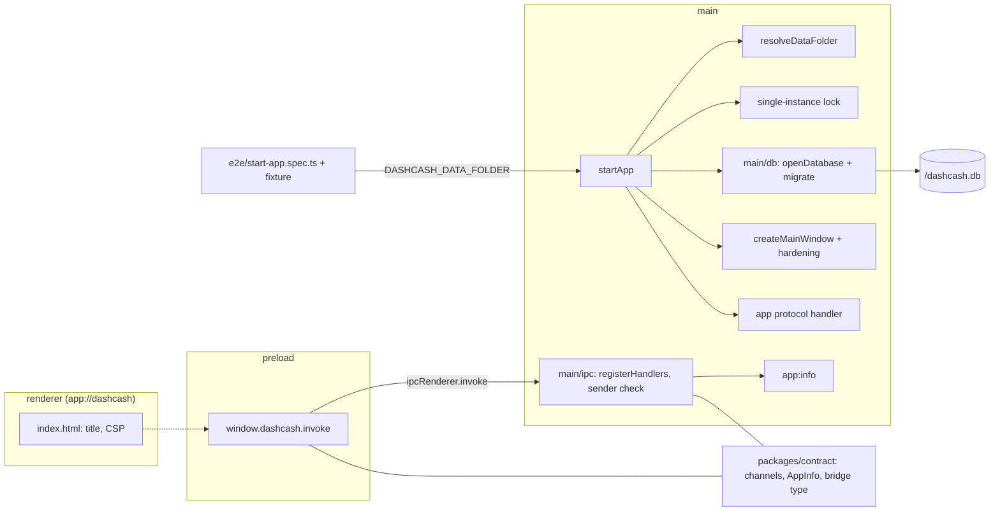

# 04 desktop-shell: design log

## Grill-me, 2026-11-07

### Background

Features 01 to 03 built **Verify** with eleven gates, the push,
pull-request and daily workflows, the supply-chain gates and **Mutation
testing**. The app itself does not exist yet: `apps/desktop/src/` holds
only `.gitkeep` folders (`main/db/`, `main/ipc/`, `main/updater/`,
`main/test-support/`, `preload/`, and the renderer **Layer** folders),
`packages/contract/src/` and `e2e/` likewise, and no member has a
`package.json` (01, Q6: "contract and desktop" get theirs with their first
code). `verify:full` still runs only `verify` (01, Q25: the feature that
brings Playwright adds build and end-to-end tests).

This feature has no prototype part of its own: it is the shell's plumbing.
Its source text is row 04 of `docs/feature-checklist.md` ("Electron main
and preload with secure defaults and CSP, typed IPC bridge, SQLite and
migrations, data folder, single instance, dev-only debug port, Playwright
harness with the first end-to-end test, flaky quarantine"). The
specification is `CLAUDE.md` (Architecture, Tests), `docs/conventions.md`
(Test layers, Folder structure, Module filing, Naming),
`docs/quality-gates.md` (Rollout: "04 desktop-shell: the first end-to-end
test and flaky quarantine, before any test can turn flaky"; Rules that keep
tests trustworthy), the gate table in `README.md` ("End-to-end tests |
Playwright driving the Electron app | CI | 04"; "Flaky tests quarantined
with expiry | quarantine file + expiry check | CI, daily | 04") and the
01 to 03 design logs. The prototype settles the few visible facts the shell
owns: the window title, the data folder and the database file name.

State on 2026-11-07 (checked):

- Prototype facts: `DashCash.dc.html` has `<title>DashCash</title>`;
  `DataSettings.dc.html` and `lib/store.js` put the database at
  `C:\Users\you\AppData\Roaming\DashCash\dashcash.db` (Electron's
  `userData` for an app named DashCash) and say "dashcash.db and the
  imported CSVs live here"; `lib/store.js` holds `version: '2.0.0'`
  (sample data); SPEC header: "Electron, Windows", "1440 × 900 reference
  viewport"; SPEC §1/§3: persisted view state lives in "user settings in
  the DB" in the app.
- Releases (npm, 2026-11-07): `electron` 45.2.3 is newest; 45.0.0
  (2026-10-21) is the newest release at least 14 days old (02, D3).
  `electron-vite` 6.0.0 (2026-10-14; peer `vite` ^6 to ^8), `vite` 8.3.5
  (2026-10-21), `@playwright/test` 1.64.1 (2026-10-14). `electron` brings
  `@electron/get` and `@electron-internal/extract-zip`.
- `node:sqlite`: Electron's main process provides it since the fix in
  electron/electron PR 47756 (36.7.3, 37.2.3, 38); Electron 45 runs Node
  24.22. The tooling runs Node 24.14.0 (`.nvmrc`), which also has it.
- `.gitignore`, `.prettierignore` and `eslint.config.js` already ignore
  `out/`, `dist/`, `playwright-report/` and `test-results/`; `*.db` and
  `*.db-*` are ignored and rejected by `check:data-files`.
- `.dependency-cruiser.js` already forbids the renderer Node built-ins,
  `electron`, `main/` and `preload/`, and keeps the preload to `electron`
  and the contract. 01, Q43 left the rule "SQLite access only in
  `main/db/`" to the feature that picks the driver: this one.

### Problem

Turn the empty `apps/desktop` into an Electron app that starts, opens one
secure window, keeps its data in one folder with a migrated SQLite
database, lets the renderer reach main only through a typed bridge, and
runs once per data folder. Prove the whole path with Playwright against the
built app, run in `verify:full` on every pull request, and give flaky tests
a quarantine with an expiry before the first one can appear.

### Questions and Answers

**Scope and naming**

1. *Feature name and number?* `desktop-shell`, row 04 of
   `docs/feature-checklist.md`; folder `docs/features/04-desktop-shell/`,
   branch `feat/04-desktop-shell`. No description narrows the row.
2. *Which pieces are in, which wait?* In: exactly the row. Out: React,
   tokens, primitives and Storybook (05); AppShell, Sidebar, routing,
   splash, LoadingOverlay, snackbars and the persisted route (06); every
   domain table (07 onward); electron-builder, the installer, Electron
   fuses and the app icon (20); auto-update (21); moving the database
   folder, backup and restore (22).
3. *Does the shell show any UI?* No. The renderer is one `index.html` with
   the title and the CSP and no script; the first renderer code arrives
   with 05 and the first screen with 06. Source: SPEC §1 (the app is
   `App.tsx` with the router, which is 06's row; tokens and primitives are
   05's); translating means not inventing a placeholder screen.
4. *Test layers?* Vitest for every module of main, preload and contract,
   and for the gate scripts and configurations (01, Q3); one Playwright
   flow (Q40); no story (no component); no domain test (no domain code).
   I write both the code's tests and the code through the issue-loop's
   two agents; the PRD says so (`CLAUDE.md`, Tests).

**Workspace members and build tooling**

5. *Which members get a `package.json` now?* `apps/desktop`
   (`@dashcash/desktop`) and `packages/contract` (`@dashcash/contract`),
   private, `"type": "module"` (01, Q6 and Q7). `packages/domain` waits
   for its first module (07): the shell uses no domain code.
6. *Which Electron?* `electron`, exact, the newest release at least 14
   days old on the day of building (45.0.0 on 2026-11-07; 02, D3). It
   is a dev dependency, as Electron requires; the app ships no runtime
   dependency in 04 (Q20).
7. *How are main, preload and renderer built and served in dev?*
   **Assumption:** `electron-vite` (with `vite`) builds all three into
   `apps/desktop/out/` and serves the renderer with hot reload for
   `npm run dev` (`README.md`, Getting started). Reason: no source names a
   build tool; row 20 names electron-builder, which rules out Electron
   Forge's packaging, and electron-vite is one config for the three
   processes with dev hot reload, bundling the workspace members into
   main and preload so no TypeScript runs from `node_modules`.
8. *Where do the Electron tools and their config live?* **Assumption:**
   `electron`, `electron-vite` and `vite` are exact dev dependencies of
   `@dashcash/desktop`, and the build config is
   `apps/desktop/electron.vite.config.ts`; repository-wide tools
   (Playwright, the gates) stay at the root. Reason: the member is the
   Electron app, the tool looks for its config in the app's root, and
   electron-builder (20) reads Electron's version from the app's
   `package.json`; `docs/conventions.md` puts configuration "where the
   tools look for it".
9. *Which scripts?* Root `dev` and `build` run the desktop member's
   `dev` (`electron-vite dev`) and `build` (`electron-vite build`);
   `test:e2e` runs Playwright; `verify:full` becomes `verify`, then
   `build`, then `test:e2e`, chained with `&&` (01, A5; `README.md`:
   "verify + build + end-to-end tests"). `test*` and `verify*` scripts
   are gate files, named by the tickets that change them (`CLAUDE.md`,
   Ask first).
10. *What are the entry files called?* **Assumption:**
    `apps/desktop/src/main/main.ts`, `apps/desktop/src/preload/preload.ts`
    and `apps/desktop/src/renderer/index.html`, configured as
    electron-vite's inputs; each process entry only wires modules, which
    live in camelCase folders beside it (`docs/conventions.md`, Module
    filing). Reason: the conventions forbid an `index.ts` per module, and
    electron-vite's default `index.ts` entries would read as barrels.
11. *How do members import each other?* **Assumption:** by package name
    (`@dashcash/contract`), each member's `package.json` `exports` pointing
    at its TypeScript sources; electron-vite bundles `@dashcash/*` into
    main and preload instead of externalising them; Vitest and
    dependency-cruiser resolve them through the workspace link. Reason:
    relative paths across members are brittle; there is no package build
    step (01, Q12: no emitted JavaScript).
12. *How are the members type-checked?* `npm run typecheck` covers every
    member: each gets a `tsconfig.json` extending `tsconfig.base.json`,
    joined to the root project (01, Q13). The desktop member splits into
    a Node project (main, preload, the build config, with Electron's and
    Node's types) and a DOM project (renderer), because the renderer must
    not see Node types. The root project gains `e2e/` and
    `playwright.config.ts`. The tickets name every `tsconfig*.json` they
    touch.

**Main process: window and secure defaults**

13. *Which window?* One `BrowserWindow`, title "DashCash"
    (`DashCash.dc.html`), content size 1440 × 900 (SPEC header, reference
    viewport), created hidden and shown on `ready-to-show`. **Assumption:**
    when the primary display's work area is smaller, the content size
    shrinks to fit it; no minimum size, no remembered bounds. Reason: the
    prototype adapts to narrow windows (compact rail below 1200 px, tables
    that scroll) and shows no window state; a window larger than a laptop
    screen would hide its own edges.
14. *Menu?* Electron's default menu. Source: `docs/concept.md` (Scope):
    "Out for now: … native menu beyond the defaults".
15. *Which secure defaults?* **Assumption:** the Electron security
    checklist, every item that applies to a local app:
    - `app.enableSandbox()`; per window `contextIsolation: true`,
      `sandbox: true`, `nodeIntegration: false`, `webSecurity: true`,
      `allowRunningInsecureContent: false`, `webviewTag: false`;
    - the renderer is served from a custom protocol, not `file://` (Q16);
    - every navigation away from the app's origin is prevented
      (`will-navigate`, `will-redirect`), every new window is denied
      (`setWindowOpenHandler`), `will-attach-webview` is prevented;
    - every permission request and permission check of the session is
      denied;
    - every IPC handler checks its sender (Q27);
    - `spellcheck: false`.
    Reason: the row says "secure defaults" and names no list; the
    checklist is Electron's own. `spellcheck: false` because on Linux
    Chromium downloads dictionaries, and the app and its tests never touch
    the network (`README.md`: "local-only"; `CLAUDE.md`, Tests: "no
    network"). Electron fuses are a packaging step and arrive with the
    installer (20).
16. *How is the renderer served?* **Assumption:** a privileged custom
    scheme `app` (standard, secure), origin `app://dashcash`, whose
    handler serves only files under the built renderer folder and answers
    404 for any path that resolves outside it; in dev the window loads
    electron-vite's dev server URL instead. Reason: the Electron checklist
    prefers a custom protocol to `file://`, which would let the renderer
    read any local file; a path check is the one piece of the handler
    that can fail open, so it is a pure, tested function.

**Content Security Policy**

17. *Where is the CSP set?* **Assumption:** as a `<meta
    http-equiv="Content-Security-Policy">` in
    `apps/desktop/src/renderer/index.html`, the same policy in dev and in
    the build. Reason: one place, visible in review, independent of how the
    page is served (custom protocol or dev server); main needs no response
    header rewriting.
18. *Which policy?* **Assumption:** `default-src 'none'; script-src
    'self'; style-src 'self'; img-src 'self'; font-src 'self';
    connect-src 'self'; base-uri 'none'; form-action 'none'`. No
    `'unsafe-inline'`, no `'unsafe-eval'`, no remote origin. Reason: allow
    only what the shell and the dev server need (Vite's client script and
    its WebSocket are same-origin); each later feature that needs more
    adds exactly that source with its reason in its own design log. 05
    will need `style-src 'unsafe-inline'` for styled-components' runtime
    styles (SPEC §1) and, in dev, React's refresh preamble; that is 05's
    decision (Trade-offs).

**Typed IPC bridge**

19. *What does `packages/contract` hold?* The channel names, each
    channel's request and response types, the bridge type the preload
    exposes, and a runtime list of the channels with a type guard. It
    imports nothing (the `contract-imports-only-domain` **Layer rule**
    allows only domain, which the contract does not need yet).
20. *Which channels exist in 04?* **Assumption:** one, `app:info`, no
    request, response `AppInfo = { version: string }`, the version being
    Electron's `app.getVersion()`. Reason: the bridge needs one real
    channel for its end-to-end proof; the version is what the prototype
    shows first (Sidebar: "Version 2.0.0", 06; UpdateSettings: current
    version, 21). Channel name per `docs/conventions.md` (Naming:
    `<area>:<action>`). The response is an object so later app-level facts
    join it without a new channel.
21. *What does the preload expose?* **Assumption:** one object on
    `window.dashcash` through `contextBridge.exposeInMainWorld`, with one
    method `invoke(channel, request)` typed from the contract, which
    rejects any channel not in the contract's list before calling
    `ipcRenderer.invoke`. No `ipcRenderer`, no event subscription.
    Reason: the preload "exposes the contract, nothing else"
    (`docs/conventions.md`); an allowlisted `invoke` keeps the preload
    unchanged as channels are added; main-to-renderer events wait for
    their first use (update snackbars, 21).
22. *How does main register handlers?* One registration function takes a
    handler per channel, typed so that a channel without a handler fails
    the type check, and registers each with `ipcMain.handle`. Handlers
    live in `apps/desktop/src/main/ipc/` (`docs/conventions.md`, Folder
    structure).
23. *How are requests validated at runtime?* **Assumption:** each handler
    whose channel takes a request checks it with a hand-written type guard
    from the contract before use and rejects otherwise; `app:info` takes
    none and ignores any argument. Reason: the renderer is untrusted and
    TypeScript types vanish at runtime; a schema library is ruled out
    because the contract imports nothing outside domain (**Layer rule**).
24. *How do errors cross the bridge?* **Assumption:** a handler that
    throws rejects the renderer's promise with Electron's serialised
    message; no error envelope in 04. Reason: no channel in 04 can fail
    for a reason the user can act on; the renderer's error surface
    (snackbars) is 06's, and a result type can be introduced with the
    first channel that needs one.
25. *Where does the renderer's typing of `window.dashcash` live?*
    **Assumption:** it arrives with the first renderer code that calls the
    bridge (06), in `renderer/types/`; in 04 only the end-to-end test
    calls it, typed from the contract. Reason: 04 ships no renderer
    script (Q3).
26. *May main import the contract?* Yes, and the domain (`README.md`,
    Architecture: "main --> domain, main --> contract"). The existing
    rules already allow it.
27. *Which sender is valid?* **Assumption:** a frame whose URL has the
    app's origin (`app://dashcash`, or the dev server's origin in dev);
    any other sender is rejected before the handler runs. Reason: Electron
    checklist ("validate the sender of all IPC messages"); with navigation
    locked (Q15) it is a second line, cheap and testable.

**Data folder and database**

28. *Where is the data folder?* Electron's `app.getPath('userData')`,
    which on Windows is `%APPDATA%\DashCash` once the app's name is
    "DashCash" (`DataSettings.dc.html`: default
    `C:\Users\you\AppData\Roaming\DashCash`). The desktop member sets
    `productName: "DashCash"`, so `app.getName()` is "DashCash", not the
    package name. The folder is created when missing.
29. *How do tests get a fresh data folder?* **Assumption:** main reads
    the environment variable `DASHCASH_DATA_FOLDER`; when set, it is the
    data folder and also becomes `userData` (before the app is ready), so
    Chromium's own files and the single-instance lock (Q35) follow it.
    The override is honoured in every build, not only in dev. Reason:
    `docs/quality-gates.md` ("End-to-end tests start the app with a
    temporary data folder"); moving `userData` keeps parallel test
    instances apart; the installer smoke test (20) will need the same
    seam against a packaged app; a local environment variable gives an
    attacker nothing they lack already.
30. *Database file?* `dashcash.db` in the data folder
    (`DataSettings.dc.html`, `lib/store.js`). The imported CSVs live in
    the same folder; their layout is 14's.
31. *Which SQLite driver?* **Assumption:** Node's built-in `node:sqlite`
    (`DatabaseSync`), one synchronous connection in main. Reason: it runs
    unchanged in Electron's main process (Background) and in Vitest on the
    tooling's Node, so the database modules are tested against real SQLite
    without a native module, an ABI rebuild between Node and Electron, a
    prebuilt-binary download or new packages for the audit and licence
    gates; `better-sqlite3` would need all of these. Its API is marked as
    still in development in Node 24; the wrapper in `main/db/` is the one
    place to change should it move.
32. *Connection settings?* **Assumption:** `PRAGMA foreign_keys = ON` on
    open; SQLite's default rollback journal, not WAL. Reason: later tables
    (transactions to accounts) rely on foreign keys, which SQLite leaves
    off by default; one connection in one process gains nothing from WAL's
    concurrent readers, and one file without `-wal`/`-shm` siblings is
    simpler to move and back up (22). The connection closes on
    `will-quit`.
33. *How do migrations work?* **Assumption:**
    - an ordered list of migrations in
      `apps/desktop/src/main/db/migrations/migrations.ts`, each
      `{ version: number; name: string; up: (db) => void }`, versions
      1, 2, 3 … without gaps;
    - the schema version is SQLite's `PRAGMA user_version`;
    - on open, every migration above the stored version runs in order,
      each inside its own transaction together with its `user_version`
      bump, so a failing migration leaves the previous version intact;
    - the runner refuses (throws) when the list has a gap or a duplicate,
      or when the stored version is higher than the newest migration
      (a database from a newer DashCash);
    - a migration, once merged, is never edited; changes are new
      migrations;
    - 04 ships the runner with an empty list: the first table is the
      first feature's that needs one (06's user settings or 07's
      accounts).
    Reason: no source names a mechanism; `user_version` needs no
    bookkeeping table; migrations as TypeScript keep them typed and
    bundled; an empty list builds nothing the prototype does not need yet,
    and the runner is fully exercised by its Vitest tests with sample
    migrations against an in-memory database.
34. *What happens when the data folder or the database cannot be opened or
    migrated?* **Assumption:** main shows a native error box titled
    "DashCash couldn't start", with the cause and the data folder's path,
    and quits; no window opens and nothing runs on a half-migrated
    database. Reason: the prototype shows no such state (it never fails to
    start); the copy follows its error tone ("Couldn't read
    Kontoauszug_Oktober.pdf"); continuing would risk writing to a database
    the app does not understand.

**Single instance**

35. *What does single instance mean?* `app.requestSingleInstanceLock()`
    before anything else opens; the second process quits at once, and the
    first restores its window if minimised and focuses it
    (`second-instance`). The lock belongs to `userData`, so it is per data
    folder (Q29). Tested with Vitest against a fake `app`, not end to end
    (Q41).

**Dev-only debug port**

36. *What is it, and when is it open?* **Assumption:** Chromium's remote
    debugging port 9222 on 127.0.0.1 (`remote-debugging-port` switch), set
    before the app is ready, only when the app is not packaged and runs
    from electron-vite's dev server (`ELECTRON_RENDERER_URL` set). Never in
    the build Playwright drives, never in a packaged app. Reason: the row
    says "dev-only"; 06 gives the reviewer the DevTools MCP tools, which
    attach to this port; 9222 is the port those tools and Chrome use by
    default; Chromium binds it to loopback.

**Playwright harness and the first end-to-end test**

37. *Which tool and where?* `@playwright/test`, exact, as a root dev
    dependency, newest release at least 14 days old (1.64.1 on
    2026-11-07); `playwright.config.ts` at the root (named in `CLAUDE.md`,
    Ask first); tests in `e2e/` as kebab-case `*.spec.ts`
    (`docs/conventions.md`, Naming). Playwright's `_electron` launches the
    Electron binary from `node_modules`, so no browser download.
38. *Which settings?* **Assumption:** `testDir: 'e2e'`, `retries: 0`,
    `forbidOnly: true`, reporter `list`, traces kept on failure in
    `test-results/` (already ignored), Playwright's default worker count.
    Reason: retries need asking (`CLAUDE.md`, Ask first) and "Flaky equals
    broken" (`docs/quality-gates.md`); `.only` must never pass; each test
    gets its own data folder and so its own instance lock, so tests can run
    in parallel. No CI artifact upload of traces in 04; easy to add when a
    failure needs one.
39. *What does the harness provide?* **Assumption:** a Playwright fixture
    in `e2e/test-support/` that, per test, creates a temporary data folder,
    launches the built app (`apps/desktop`, whose `main` points at the
    built entry) with `DASHCASH_DATA_FOLDER` set, hands the test the app
    and its first window, and closes the app and deletes the folder
    afterwards. It has no Vitest test of its own: every spec exercises it.
    The fixed clock and the seeded database of `docs/quality-gates.md`
    arrive with the first flow that shows a date or needs data (07 or
    later), as a fixed "today" for main and Playwright's clock for the
    renderer, and a seed written through `main/db/`'s open-and-migrate
    function. Reason: 04's flow shows no date and needs no data; a seam
    nothing uses would be untested.
40. *Which flow?* **Assumption:** one test, `e2e/start-app.spec.ts`,
    "Start the app": on a fresh data folder the app opens exactly one
    window titled "DashCash"; its web preferences have context isolation
    and the sandbox on and Node integration off; the page has no
    `require` or `process`; the CSP blocks `eval`;
    `window.dashcash.invoke('app:info')` resolves with the desktop
    member's version; and `dashcash.db` exists in the data folder. Reason:
    `docs/conventions.md` asks for flows "across pages, IPC and the
    database"; starting the app is the only flow the shell has, and it
    crosses window, bridge, main and the data folder.
41. *What stays out of end-to-end?* Single instance, the debug port, the
    protocol's path check, navigation and permission denial, the
    migration runner and the startup error: each is a behaviour of one
    module, tested with Vitest (`docs/conventions.md`: "Aim for a handful
    of end-to-end tests per feature at most; everything else belongs a
    layer lower").
42. *How does CI run it?* The `pull-request` job runs `verify:full`, now
    with build and `test:e2e` (`docs/conventions.md`: PRs into `main` run
    `verify:full`, "end-to-end tests included"); the push job keeps
    `verify` only. **Assumption:** on the Linux runner, a step before it
    allows unprivileged user namespaces
    (`sudo sysctl -w kernel.apparmor_restrict_unprivileged_userns=0`), and
    `verify:full` runs under `xvfb-run --auto-servernum`. Reason: Electron
    needs a display, and Ubuntu 24.04's AppArmor blocks Chromium's sandbox;
    turning the sandbox off with `--no-sandbox` would test a weaker app
    than the one shipped (Q15); `package.json` scripts hold no shell
    syntax (01, Q14), so the wrapping stays in the workflow.

**Flaky quarantine**

43. *Where and in which format?* `quality/flaky-quarantine.json`
    (`docs/conventions.md`, Folder structure: "`quality/` … flaky
    quarantine"), committed as `[]`. **Assumption:** an array of
    `{ "file": "e2e/….spec.ts", "title": "…", "ticket":
    "docs/features/<NN>-<feature>/<nn>-<name>.md", "owner": "…", "added":
    "YYYY-MM-DD", "expires": "YYYY-MM-DD" }`. Reason:
    `docs/quality-gates.md`: "A flaky test goes into quarantine with a
    ticket, an owner and an expiry date"; `added` as in the **Audit
    exception** (02, D2), so the limit of Q45 can be checked.
44. *Which tests can be quarantined?* **Assumption:** Playwright tests
    only, in 04. Reason: end-to-end tests are the layer that arrives now
    and the one at risk (`docs/quality-gates.md`: "before any test can
    turn flaky"); Vitest tests are deterministic by rule; a later feature
    extends the quarantine to another runner when a flaky test there needs
    it.
45. *What does the check fail on?* **Assumption:** a new gate script
    `scripts/checkQuarantine/`, in **Verify** after `check:audit` and in
    the **Daily run**'s `daily` job (`README.md`: "CI, daily"), fails
    closed (01, A1; 03, Q5) when the file is missing or not an array, an
    entry lacks a field or has an empty one, a date is not a real
    `YYYY-MM-DD`, `expires` is more than 30 days after `added`, `expires`
    is before today (UTC; valid through its date, fails the day after,
    02 Q16), the test file does not exist, or the ticket file does not
    exist. One `<subject>: <reason>` line per cause (01, A9). Today is a
    parameter of the core. Reason: "When the date passes, the build fails
    until it is fixed or deleted" (`docs/quality-gates.md`); 30 days
    because a flaky test is a broken test (shorter than an audit
    exception's 90) and the monthly review then sees every entry once.
46. *What does quarantine do to the test?* **Assumption:**
    `playwright.config.ts` reads the file and leaves the quarantined tests
    out of `test:e2e` (by `grepInvert` on their titles); they do not run
    until fixed and removed from the file, or deleted. Reason: CI must stay
    green and binding while a quarantined test is being fixed; a
    non-blocking second run would need retries or ignored failures, which
    the sources rule out; the expiry is what stops the quarantine becoming
    permanent. File parsing is shared between the check and the config in
    one tested module.

**Gates touched**

47. *Which layer rule is new?* "SQLite access only in `main/db/`"
    (`CLAUDE.md`, Architecture; 01, Q43): no file outside
    `apps/desktop/src/main/db/` imports `node:sqlite`, tests included (the
    end-to-end harness goes through `main/db/` should it need the
    database). Tested in `gates/layerRules/` like the others (01, Q44).
48. *Which gate tests change or join?* The gate wiring test: **Verify**
    gains `check:quarantine`, `verify:full` runs `verify`, `build`,
    `test:e2e`, the `pull-request` job gains the sysctl step and the
    `xvfb-run` wrapping, the `daily` job gains `check:quarantine`. A new
    gate test in `gates/endToEnd/` checks `playwright.config.ts` (Q38) and
    that a quarantined entry is left out (Q46).
49. *Supply-chain fallout?* The install of Electron, electron-vite, Vite
    and Playwright follows 03's rules: every licence the lockfile gains is
    listed in the ticket's Notes; a permissive one joins the **License
    allowlist**, any other stops the builder for the human (03, D3); an
    open **Advisory** gets an **Audit exception** with reason and 90-day
    expiry, or stops the builder if a fix exists (02, Q19, D2).
50. *Which gate files will the tickets name?* `package.json`,
    `package-lock.json`, every `tsconfig*.json` touched,
    `eslint.config.js` if the new members need it, `.dependency-cruiser.js`,
    `playwright.config.ts`, `.github/workflows/pull-request.yml`,
    `.github/workflows/daily.yml`, `quality/flaky-quarantine.json`,
    `quality/license-allowlist.json`, `quality/audit-exceptions.json` and
    the tests under `gates/`. So `/feature-pipeline` pauses for the
    human's `go` before the build.
51. *Docs?* `docs/feature-checklist.md` row 04 (Q1). **Assumption:** no
    change to `CLAUDE.md` (its Commands line already names `dev` and
    `test:e2e`) or `README.md` (its rows already name 04). The glossary
    names files that tickets create later only in plain text (02, Q50), so
    the docs-drift check stays green.
52. *Which version does the app carry?* **Assumption:**
    `apps/desktop/package.json` holds `"version": "0.0.0"` until the
    release pipeline (20) sets versions from tags; the end-to-end test
    compares `app:info` with that file, never with a literal. Reason: the
    prototype's "2.0.0" is sample data (`lib/store.js`), and the sources
    disagree on the first release's number (`docs/feature-checklist.md`:
    "Release 1.0"; the design handoff calls the app "DashCash v2"): the
    human's decision, for 20.

### Design



Startup order in main: resolve the data folder and, when overridden, set
`userData` → take the single-instance lock or quit → enable the sandbox,
register the `app` scheme, add the debug-port switch in dev → when ready:
create the data folder, open and migrate the database (error box and quit
on failure) → register the protocol handler, the session's permission
handlers and the IPC handlers → create the window → close the database on
`will-quit`; quit when all windows are closed.

Files (module names verb first, `docs/conventions.md` Naming; the PRD
refines them):

| Path | Purpose |
| --- | --- |
| `packages/contract/package.json` | `@dashcash/contract` ✅ |
| `packages/contract/src/channels/` | `CHANNELS`, `ChannelMap`, `AppInfo`, `DashCashBridge`, `isChannel` ✅ |
| `apps/desktop/package.json` | `@dashcash/desktop`, `productName` DashCash, version, `main`, `dev`/`build` ✅ |
| `apps/desktop/electron.vite.config.ts` | entries, `@dashcash/*` bundled ✅ |
| `apps/desktop/tsconfig*.json` | Node project, DOM project ✅ |
| `apps/desktop/src/main/main.ts` | entry, wiring only ✅ |
| `apps/desktop/src/main/startApp/` | startup order with injected Electron objects ✅ |
| `apps/desktop/src/main/resolveDataFolder/` | env override or `userData` ✅ |
| `apps/desktop/src/main/lockSingleInstance/` | lock, quit, focus on second instance ✅ |
| `apps/desktop/src/main/enableDebugPort/` | 9222 in dev only ✅ |
| `apps/desktop/src/main/createMainWindow/` | size, title, secure web preferences ✅ |
| `apps/desktop/src/main/hardenSession/` | navigation, new windows, webviews, permissions ✅ |
| `apps/desktop/src/main/registerAppProtocol/` | `app://dashcash`, path kept inside the renderer folder ✅ |
| `apps/desktop/src/main/showStartupError/` | error box and quit ✅ |
| `apps/desktop/src/main/db/openDatabase/` | `node:sqlite`, `foreign_keys`, migrate ✅ |
| `apps/desktop/src/main/db/migrateDatabase/` | `user_version` runner ✅ |
| `apps/desktop/src/main/db/migrations/` | ordered list, empty in 04 ✅ |
| `apps/desktop/src/main/ipc/registerIpcHandlers/` | one handler per channel, sender check ✅ |
| `apps/desktop/src/main/ipc/getAppInfo/` | `app:info` ✅ |
| `apps/desktop/src/preload/preload.ts` | `contextBridge` entry ✅ |
| `apps/desktop/src/preload/createBridge/` | allowlisted `invoke` ✅ |
| `apps/desktop/src/renderer/index.html` | title, CSP, no script ✅ |
| `playwright.config.ts` | Q38, quarantine left out ✅ |
| `e2e/test-support/` | per-test data folder and app fixture ✅ |
| `e2e/start-app.spec.ts` | the first flow ✅ |
| `quality/flaky-quarantine.json` | `[]` ✅ |
| `scripts/checkQuarantine/` | expiry and shape check ✅ |
| `.dependency-cruiser.js` | SQLite rule ✅ |
| `.github/workflows/pull-request.yml`, `daily.yml` | e2e on Linux, daily quarantine check ✅ |

Contract shapes, for the PRD to refine:

```ts
export type AppInfo = { version: string };

export type ChannelMap = {
  'app:info': { request: undefined; response: AppInfo };
};
export type Channel = keyof ChannelMap;
export const CHANNELS: readonly Channel[];
export function isChannel(value: unknown): value is Channel;

export type DashCashBridge = {
  invoke<C extends Channel>(
    channel: C,
    request: ChannelMap[C]['request'],
  ): Promise<ChannelMap[C]['response']>;
};

// main
type Handlers = {
  [C in Channel]: (request: unknown) => ChannelMap[C]['response'] | Promise<ChannelMap[C]['response']>;
};

// main/db
type Migration = { version: number; name: string; up: (db: DatabaseSync) => void };

// scripts/checkQuarantine
type QuarantineEntry = { file: string; title: string; ticket: string; owner: string; added: string; expires: string };
function findQuarantineViolations(entries: unknown, today: string, trackedPaths: string[]): Violation[];
```

Alternatives:

- ✅ electron-vite. ❌ Electron Forge: its packaging overlaps
  electron-builder (20). ❌ Hand-wired Vite plus `tsc` for main: three
  builds and a dev launcher to maintain.
- ✅ `node:sqlite`. ❌ `better-sqlite3`: native, needs a rebuild per ABI,
  so the same binary cannot serve Vitest on Node and the app on Electron.
  ❌ `sql.js` (WebAssembly): writes the whole file by hand on every change.
- ✅ `PRAGMA user_version`. ❌ A migrations table: bookkeeping SQLite
  already offers.
- ✅ Custom `app://` protocol. ❌ `file://`: grants the renderer the file
  system's origin.
- ✅ CSP meta tag. ❌ Response header from main: needs both the protocol
  handler and the dev server rewritten, and differs between them.
- ✅ Allowlisted generic `invoke`. ❌ One preload function per channel:
  the preload changes with every feature. ❌ Exposing `ipcRenderer`:
  every channel open to the page.
- ✅ Quarantined tests left out of the run. ❌ Retries: need asking and
  hide flakiness. ❌ A second non-blocking run: CI never fails on it, so
  nothing but the expiry would remain.
- ✅ Sandbox enabled in CI via sysctl. ❌ `--no-sandbox` in tests: the
  tested app would differ from the shipped one.

### Implementation Plan

1. **The app starts, end to end.** Member `@dashcash/desktop`, Electron
   and electron-vite, `main.ts` opening one
   window titled "DashCash" from `index.html`, `dev` and `build`,
   Playwright with its config, the fixture with a temporary data folder,
   `e2e/start-app.spec.ts` asserting one window and its title,
   `test:e2e`, `verify:full` with build and e2e, the Linux steps in the
   `pull-request` job. Thinnest path: `npm run verify:full` builds the app
   and the first flow is green locally and in CI.
2. **Secure window.** Secure web preferences and `app.enableSandbox()`,
   the `app://` protocol, navigation, window, webview and permission
   denial, the CSP meta tag, the window size; the flow asserts the
   preferences, no `require`/`process` and the CSP.
3. **Typed bridge.** Member `@dashcash/contract` with its channels,
   preload `invoke`, handler
   registration with the sender check, `app:info`; the flow asserts the
   version.
4. **Data folder and database.** `DASHCASH_DATA_FOLDER` and `userData`,
   `openDatabase` with `node:sqlite`, the migration runner and empty list,
   the startup error, the SQLite **Layer rule**; the flow asserts
   `dashcash.db` in the data folder.
5. **One instance, dev debug port.** The single-instance lock and focus,
   port 9222 in dev only; Vitest only.
6. **Flaky quarantine.** `quality/flaky-quarantine.json`,
   `scripts/checkQuarantine/` in **Verify** and the `daily` job, the
   config leaving quarantined tests out, their gate tests.

### Trade-offs

- Easier: every later feature plugs into a working app: a migration in
  the list, a channel in the contract and a handler in `main/ipc/`, a
  flow in `e2e/`; the bridge and the window are secure by default and the
  end-to-end flow fails if either loosens; database code is tested against
  real SQLite in plain Vitest.
- Harder: `npm ci` downloads Electron (about 100 MB) in every CI job; the
  `pull-request` job gets slower by a build and an Electron start; the
  CSP and the bridge refuse what later features have not declared, so 05
  must loosen `style-src` (and handle React's dev preamble) with a reason,
  and 21 must add main-to-renderer events; `node:sqlite` is still marked
  experimental in Node 24; the data folder override is a test seam in
  shipping code; a quarantined test does not run at all until fixed.
- Manual steps, recorded for the PRD: none beyond the human's `go` for
  the gate files (Q50); the first `pull-request` run confirms the Linux
  sandbox step.
- Out of scope: the fixed clock and seeded database in the harness (Q39);
  a quarantine for Vitest or Storybook tests (Q44); window state, app
  icon, fuses, installer (20); main-to-renderer events (21); moving the
  data folder (22); any table (06, 07); changes to `CLAUDE.md` and
  `README.md`.

### Assumptions from write-a-prd

- **A1. Only the process entries import Electron at runtime.**
  **Assumption:** `main.ts` and `preload.ts` are the only files that import
  `electron` as a value; every other module of main and preload receives
  the Electron objects it uses (`app`, `BrowserWindow`, `session`,
  `protocol`, `net`, `ipcMain`, `dialog`, `screen`, `contextBridge`,
  `ipcRenderer`) as parameters, typed with `import type`. Reason: in Vitest
  on Node, `electron` resolves to the path of the binary, not to its API;
  Q35 already tests the lock against a fake `app`; the same seam makes every
  module of the startup order testable without a display, inside **Verify**
  and inside the **Mutation run**'s dry run.
- **A2. The preload is bundled as CommonJS.** **Assumption:** electron-vite
  emits the preload as one CommonJS file (`.cjs`) with the contract bundled
  in, while main stays ES modules. Reason: Electron loads a sandboxed
  preload only as CommonJS and lets it `require` nothing but its own
  modules; the desktop member is `"type": "module"` (Q5), whose default
  preload output would be ES modules; the sandbox stays on (Q15).
- **A3. dependency-cruiser skips the App build.** **Assumption:**
  `.dependency-cruiser.js` gains the desktop member's `out/` folder in
  `options.exclude`. Reason: `lint:deps` cruises `apps`, and after a local
  `npm run build` the bundled main imports `node:sqlite` outside `main/db/`
  and would break the new **Layer rule** (Q47); the folder is already
  ignored by git, Prettier and ESLint, and holds no source.
- **A4. Which `DASHCASH_DATA_FOLDER` values count.** **Assumption:** unset
  or empty means Electron's `userData`; an absolute path is the **Data
  folder**; a relative path ends in the **Startup error**, naming the
  variable. Reason: Electron's `app.setPath` takes only absolute paths; the
  **App fixture** always passes one; resolving a relative path against an
  unknown working folder could put a **Database** where nobody looks.
- **A5. The texts of the Startup error and of refused requests.**
  **Assumption:**
  - **Startup error**: title "DashCash couldn't start" (Q34), body the cause,
    a blank line, then `Data folder: <path>`;
  - a **Database** from a newer DashCash: cause `dashcash.db has schema
    version <n>, but this DashCash knows only up to <m>.`;
  - a broken list: cause `The migrations are not numbered 1 to <n> without
    gaps or duplicates.`;
  - a relative override: cause `DASHCASH_DATA_FOLDER must be an absolute
    path.`;
  - the **Bridge** refusing a channel: `Unknown channel: <channel>`;
  - the **Sender check**: `Refused <channel> from <origin>`.
  Reason: the prototype shows none of these states; the copy follows its
  English error tone ("Couldn't read Kontoauszug_Oktober.pdf"); naming the
  channel and origin makes a refusal diagnosable from the log.
- **A6. The Quarantine check's lines.** **Assumption:** every violation's
  subject is `quality/flaky-quarantine.json`, as the **Audit** names its
  file; the reasons follow the audit check:
  `must be an array of quarantine entries`, `cannot be read as JSON: …`,
  and per entry `entry <i>, field <f>: <why>` with `must not be empty`,
  `must be a real YYYY-MM-DD date`, `is later than today` (`added`),
  `is before added` and `is more than 30 days after added` (`expires`),
  `expired on <date>` (`expires`), `must name a tracked e2e/ spec file`
  (`file`: a tracked path under `e2e/` ending in `.spec.ts`), `must name a
  tracked ticket` (`ticket`: a tracked path of the form
  `docs/features/<NN>-<feature>/<nn>-<name>.md`). Reason: Q45 lists the
  causes, not the lines; the audit check (02) is the prior art for an
  expiring entry file; Q44 limits the **Quarantine** to Playwright tests,
  so a `file` elsewhere could never be left out; an `added` in the future
  would stretch the 30 days.
- **A7. Calendar dates are read by one shared module.** **Assumption:** the
  audit check's private reading of a `YYYY-MM-DD` date moves into its own
  module in `scripts/`, used by the audit check and the **Quarantine
  check**; the audit check's behaviour and tests are unchanged. Reason:
  the **Quarantine check** is its second caller; `isRecord` and
  `reportViolations` set the precedent for shared gate helpers, and the
  conventions file one module per folder.
- **A8. The module the check and the Playwright config share.**
  **Assumption:** a module in `scripts/` reads the **Quarantine**: it
  returns the well-formed entries and the shape violations (array, fields,
  dates readable), and turns entries into Playwright's `grepInvert`
  patterns, one regular expression per entry built from its file (relative
  to `e2e/`) and its title, both escaped, so a title matches literally and
  only in its own file. `playwright.config.ts` throws on any shape
  violation and always sets `grepInvert`, an empty list when the
  **Quarantine** is empty; the date and file rules stay in the **Quarantine
  check**. Reason: Q46 asks for one tested module; `scripts/` holds the
  shared gate helpers and is measured by **Mutation testing**; Playwright
  matches `grep` against the test's file name and title together; an
  unreadable **Quarantine** must not silently run every test (**Fail
  closed**).
- **A9. The Playwright config holds exactly six keys.** **Assumption:**
  `testDir`, `retries`, `forbidOnly`, `reporter`, `use` (only
  `trace: 'retain-on-failure'`) and `grepInvert`, and the gate test asserts
  that key set. Reason: Q38 names the settings; a `projects`, `grep`,
  `testIgnore`, `testMatch` or `repeatEach` key would each change which
  tests run, or how, without touching the keys Q38 checks; 03, A1 guards
  the Stryker config the same way.
