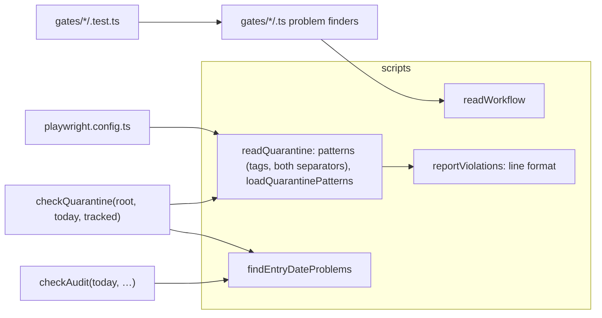

# 05 gate-maintenance: design log

## Grill-me, 2026-11-15

### Background

Features 01 to 04 are merged and refactored. Their reviews and refactor
plans left findings that change behaviour or gate files, so no refactor
step could take them (`docs/features/04-desktop-shell/refactor-plan.md`,
Out of Scope and Further Notes; `14-dev-debug-port.md`, Notes). The human's
description gathers them into this feature, inserted as row 05 before
design-system, in seven parts, most important first.

This feature has no prototype part: it is gate and shell maintenance. Its
source text is the human's description and the new row 05 of
`docs/feature-checklist.md`; the specification is `CLAUDE.md`,
`docs/conventions.md`, `docs/quality-gates.md` and the 01 to 04 design
logs.

State on 2026-11-15 (checked):

- `serveAppProtocol` hands every request to `resolveRendererPath`, which
  checks only the path: `app://other/index.html` is served like
  `app://dashcash/index.html` (04 refactor plan, Out of Scope). The origin
  matcher refuses such a page as a sender or navigation target.
- `buildQuarantinePatterns` builds `(?:^| )<file> <title>$`. Playwright
  matches `grepInvert` against the project name, the file suite's title,
  the describe titles, the test's title and then its tags, joined by
  spaces (`_grepTitleWithTags` in `node_modules/playwright/lib/common/`).
  A tagged test's string ends in its tags, so `$` never matches it and the
  quarantined test runs. The file suite's title is
  `path.relative(rootDir, file)`, which on Windows separates folders with
  `\`; the pattern holds the entry's `/`, so a spec in a subfolder of
  `e2e/` is left out on Linux and run on Windows.
- `renovate.json` sets `commitMessage` and `prTitle` directly in every
  scope. Renovate's option docs (2026-11-15): "We deprecated editing the
  `commitMessage` directly … Instead use config options like
  `commitMessageAction`, `commitMessageExtra`"; "Direct editing of
  `prTitle` is now deprecated". The default `commitMessage` is
  `{{{commitMessagePrefix}}} {{{commitMessageAction}}}
  {{{commitMessageTopic}}} {{{commitMessageExtra}}}
  {{{commitMessageSuffix}}}`, trimmed with inner whitespace collapsed;
  `prTitle` is its first line. A group's default topic is
  `{{{groupName}}}` (option `group`), merged over the rule. With
  `semanticCommits` disabled Renovate neither adds a colon to the prefix
  nor changes case; the default action is `Update`.
- `.nvmrc` holds 24.14.0; `@types/node` is 24.19.2; `typescript` is 6.0.3
  and `typescript-eslint` 8.72.1 declares the peer range
  `>=4.8.4 <6.1.0`.
- `gates/gateWiring/gateWiring.test.ts` has 1368 lines. Its six problem
  finders (`findDailyWiringProblems`, `findSecretScanProblems`,
  `findElectronInstallProblems`, `findMutationWiringProblems`,
  `findPullRequestMutationProblems`, `findPullRequestSandboxProblems`)
  live inside the test file, which Stryker never mutates
  (`stryker.config.js`: `!**/*.test.ts`).
- The audit check already takes today through `checkAudit({ today, … })`;
  the **Quarantine check**'s entry reads `new Date()` inside its
  `import.meta.main` block, and its entry tests place their dates around
  `Date.now()` (`utcDate`). Both checks write out "is later than today",
  "is before added" and "is more than N days after added" (90 and 30
  days) each on their own.
- `playwright.config.ts` loads, reads, throws and builds the patterns
  itself, with its own `throwViolations`.
- Electron 45 downloads its binary on the first `require('electron')`
  (04, D3); CI installs it in its own step, and `README.md` asks the
  developer to run `node_modules/.bin/install-electron` by hand after
  `npm ci`. `.npmrc` does not set `ignore-scripts`; the root `prepare`
  script runs on every `npm ci`.
- `enableDebugPort` appends port 9222; another program held 9222 on the
  developer's machine, so the debug server did not open (04 ticket 14,
  Notes).
- `stryker.config.js` has `thresholds: { high: 80, low: 60, break: 81 }`;
  the last measured **Mutation scores** were 82.94 and 82.97 (04 tickets
  15 and 16, Notes).
- `.claude/hooks/block-dangerous-git.sh` blocks any command that contains
  `git push` and matches `(:| )main( |$)` anywhere, so
  `git push -u origin feat/05-x && gh pr create --base main` is blocked.
  No gate test runs this hook.

### Problem

Close the security gap in the **App protocol**, fix the two ways a
quarantined test still runs, move Renovate off its deprecated options and
hold the majors it must not propose, put the gate wiring's logic where
**Mutation testing** reaches it, give the date rules and today one shape in
both expiring checks, make a fresh checkout test without a download and
the dev **Debug port** movable, raise the **Break threshold**, and hand the
human the hook fix.

### Questions and Answers

**Scope and naming**

1. *Feature name and number?* `gate-maintenance`, row 05 of
   `docs/feature-checklist.md`, inserted before design-system; folder
   `docs/features/05-gate-maintenance/`, branch
   `feat/05-gate-maintenance` (human's description). The planned rows
   05 to 22 become 06 to 23, and "Release 1.0" now reads "through 23".
2. *Which other docs carry feature numbers?* The Feature column of the
   gates table in `README.md` (07 → 08, 05 → 06, 20 → 21) and the Rollout
   list in `docs/quality-gates.md` (same three), as the description says.
   **Assumption:** the glossary's references in its Flagged ambiguities
   (import wizard 10 → 11, coverage threshold 05 → 06, installer 20 → 21,
   data settings 22 → 23) are renumbered too, and the Rollout list gains
   no line for 05. Reason: the glossary is a living doc read by every
   later planner; the Rollout list names the features that bring a gate,
   and this one brings none, it changes existing ones. The design logs,
   PRDs, plans and tickets of 01 to 04 are immutable and keep the old
   numbers; the glossary flags that.
3. *What is in, what is out?* In: exactly the seven parts of the
   description. Out: describe titles and describe-level tags in the
   **Quarantine** (Q9); a gate test that pins "thresholds only go up"
   (Q31); Stryker's `high` and `low` (Q31); moving the `node:sqlite`
   probe (04 refactor plan, Further Notes); the DevTools MCP for the
   reviewer, which follows the port in 07 (Q29).
4. *Test layers?* Vitest for every module and gate; no **End-to-end
   test** is added or changed ("Start the app" stays as it is, each change
   is the behaviour of one module, 04 Q41); no story, no domain code. The
   issue-loop's two agents write both the tests and the code; the PRD
   says so (`CLAUDE.md`, Tests).

**1. Security: the App protocol serves only the host dashcash**

5. *What is refused?* Any request whose URL's host is not exactly
   `dashcash`: another host, the host with a port (`app://dashcash:8080/`)
   and any URL with user info (`app://x@dashcash/`), answered 404 like a
   path outside the renderer folder. Source: the description ("serves only
   the host dashcash"); the user-info rule is the one `readOriginKey`
   already applies to **App origins** (04, I2).
6. *Where is the check?* **Assumption:** in `resolveRendererPath`, which
   then returns `undefined` for such a URL; its comment and the 404 path
   in `serveAppProtocol` stay one. Reason: one pure function decides every
   refusal, and the existing `REFUSED_URLS` table drives both the function
   test and the handler test, so the new cases fail in both. Importing
   `isAppOrigin` from `matchAppOrigin/` would make the two modules import
   each other (`matchAppOrigin` imports `APP_ORIGIN`).
7. *Failing test first?* Yes: this is the first ticket, and its RED commit
   adds the host cases (another host, a port, user info, an upper-case
   host where the parser keeps it) to `REFUSED_URLS` and fails on them
   (description; `docs/conventions.md`, TDD stops at RED).

**2. Gate bugs: quarantined tests that still run**

8. *How does a tagged test get left out?* The pattern accepts the test's
   tags after its title: `(?:^| )<file> <title>(?: @\S+)*$`. Playwright
   requires every tag to start with `@` and appends the test's tags last
   (Background). A title that holds a tag (`Start the app @slow`) keeps it
   in the title and repeats it as a tag, and still matches.
9. *What about describe blocks?* Out of scope. **Assumption:** the entry's
   `title` stays what 04 defined; a test inside a `describe` is matched
   only when its entry's title spells the describe titles and their tags
   as Playwright joins them. Reason: the description names tags and
   subfolders only; no spec uses `describe`.
10. *How does a spec in a subfolder match on both platforms?* Every `/` of
    the entry's file, relative to `e2e/`, becomes `[\\/]` in the pattern,
    so `sub/x.spec.ts` and `sub\x.spec.ts` both match. The entry keeps
    `/` (the **Quarantine check** compares it with git's tracked paths).
11. *How is it proven?* Unit tests in `scripts/readQuarantine/` for both
    separators and for tags; and **Assumption:** a gate test in
    `gates/endToEnd/` that runs the real `playwright test --list` in a
    sample tree (`installGateScripts`) holding the committed
    `playwright.config.ts`, an invented spec in `e2e/sub/` with a tagged
    and an untagged test, and a **Quarantine** naming both, and checks
    that neither is listed while a third test is. Reason: both bugs came
    from a hand-made model of Playwright's string (the gate test's
    `grepTitle`); only Playwright itself can show what it matches, and
    CI's Linux run and the developer's Windows run each prove their own
    separator. `--list` loads the spec files only: no app, no browser, no
    network.
12. *Does the Quarantine check change?* No: `e2e/sub/x.spec.ts` already
    passes its file rule.

**3. Renovate**

13. *How are titles written without `commitMessage` and `prTitle`?*
    **Assumption:**
    - no object in `renovate.json` sets `commitMessage` or `prTitle`;
    - the root sets `commitMessagePrefix: "chore: [supply-chain]"`;
    - every scope that opens a PR sets its own `commitMessageAction`,
      `commitMessageExtra: ""` and `commitMessageSuffix: ""`; a group's
      topic is its `groupName` and its rule sets no
      `commitMessageTopic`; lockfile maintenance and vulnerability alerts
      set `commitMessageTopic`;
    - the five titles stay exactly as they are:
      `chore: [supply-chain] update npm dependencies` (the npm group's
      `groupName` becomes `npm dependencies`), `… update github actions`,
      `… update node`, `… refresh the lockfile`,
      `… fix vulnerable dependencies`.
    Reason: Renovate builds the title from these parts (Background); an
    update type's defaults (`pin`: `Pin`, lockfile maintenance:
    `Lock file maintenance`, the version in `commitMessageExtra`) merge
    over root settings, so a scope that relied on the root would get
    Renovate's wording or a version; the group default overrides a rule's
    topic, so the topic is the `groupName`; with semantic commits disabled
    nothing lowers `Update`, so every action is written in lower case;
    unchanged titles keep 02's format (02, D1) and the **Pull-request
    check**.
14. *How does the gate check the titles?* `gates/renovate/` assembles each
    PR-opening scope's title as Renovate's default template does (root
    prefix, then the scope's action, topic or `groupName`, extra and
    suffix, trimmed, whitespace collapsed) and runs it through commitlint
    and the **Pull-request check**, as today; it fails on `commitMessage`
    or `prTitle` anywhere, on a template (`{{`) in any part, on a scope
    that leaves its action or extra to Renovate, and on a group rule that
    sets `commitMessageTopic`. The rule "a PR title is the same text as its
    commit message" goes, since no title is written any more. It checks our
    decisions, not Renovate's merging (02 ticket 11, Notes: "a gate for a
    third-party tool's config should check our own decisions"); Renovate's
    first PRs after the merge show the real titles (manual step, Q36).
15. *How is `@types/node` capped?* **Assumption:** a packageRule for the
    npm manager and `@types/node` with `allowedVersions: "24.x"`, and the
    gate test requires the major in that value to equal the major in
    `.nvmrc`. Reason: the description ("cap @types/node at the Node major
    in .nvmrc"); Renovate's `allowedVersions` is static, so the test is
    what keeps it in step when `.nvmrc` moves.
16. *How are TypeScript majors held?* **Assumption:** a packageRule for
    the npm manager, `typescript` and `matchUpdateTypes: ["major"]` with
    `enabled: false`; the human removes it in a ticket once a
    `typescript-eslint` release's peer range includes the new major.
    Reason: Renovate cannot read another package's peer range; npm's peer
    check would fail every such PR anyway, so holding it saves a red PR.
    Minors stay open: a minor outside the peer range fails `npm ci` in its
    own **Renovate PR**, which the human then closes.
17. *How are Node majors disabled?* A packageRule for the `nvm` and `npm`
    managers, `node` and `matchUpdateTypes: ["major"]` with
    `enabled: false`, after the Node rule (description: "Node majors
    disabled"). Minors and patches still come in the Node group.
18. *Where do the new rules go, and what of the order check?*
    **Assumption:** the three hold rules come last, after the Node rule;
    the gate's order check becomes "the Node rule comes after every other
    npm rule except the hold rules, and every hold rule comes after the
    Node rule"; the hold rules are recognised by `enabled: false` or
    `allowedVersions`, and none of them may reach lockfile maintenance.
    Reason: later rules win in Renovate (the existing check's comment);
    the Node rule sets `enabled: true`, which the Node hold must override.
19. *Is `renovate.json` a gate file?* No (02, Q49); its gate test is, and
    the ticket names it.

**4. Structure**

20. *How is the gate wiring test split?* **Assumption:** by what it
    checks, one gate folder each (`docs/conventions.md`, Module filing:
    "A test that proves a configuration gate lives in `gates/<gate>/`"),
    and each problem finder becomes the module `<gate>.ts` beside its
    `<gate>.test.ts`, as `gates/renovate/` and `gates/mutationTesting/`
    already are:

    | Folder | Module (finder) | Test covers |
    | --- | --- | --- |
    | `gates/verifyScripts/` | none | the gates of **Verify** in order, `verify:full`, `test:e2e`, `test:mutation`, `check:pr` outside **Verify**, scripts free of shell syntax, `.nvmrc` equal to `engines.node` |
    | `gates/pushWorkflow/` | none | `ci.yml`: triggers, the one job `verify`, its commands |
    | `gates/pullRequestWorkflow/` | none | `pull-request.yml`: trigger, the one job, its commands, `check:pr` after `verify:full`, `PR_TITLE` |
    | `gates/pullRequestSandbox/` | `findPullRequestSandboxProblems` | the sysctl step, `xvfb-run`, no `--no-sandbox` |
    | `gates/pullRequestMutation/` | `findPullRequestMutationProblems` | the **Mutation run** after `check:pr` |
    | `gates/dailyRun/` | `findDailyWiringProblems` | `daily.yml`: triggers, jobs, the `daily` job |
    | `gates/dailyMutation/` | `findMutationWiringProblems` | the `mutation` job and its report |
    | `gates/secretScan/` | `findSecretScanProblems` | gitleaks in the three jobs, no gitleaks config |
    | `gates/electronInstall/` | `findElectronInstallProblems` | the Electron install (Q26 changes it) |
    | `gates/workflows/` | none | rules over every workflow: no `if:`, only CI on push |

    `gateWiring/` is removed. Every assertion moves unchanged. Reason: the
    description asks for both; the conventions file one module per folder;
    "daily", not "nightly" (glossary). The PRD may merge a folder whose
    test is small.
21. *Where do the shared workflow readers go?* **Assumption:** the reading
    helpers (`readWorkflow`, the workflow file list, triggers, job steps,
    job commands, splitting `&&` chains, the jobs running a command) move
    to `scripts/readWorkflow/` with their own tests; workflow edits used
    only by tests stay beside the test that uses them, and one shared by
    two test files goes to `gates/test-support/`. Reason: the finders are
    **Shipping code** and must not import `test-support/` (**Layer
    rule**); `scripts/` holds the shared gate helpers and is mutated (04,
    A8).
22. *Does the Stryker exclude list change?* No. The new test files read
    workflow files from the sandbox copy, as `gateWiring.test.ts` did; none
    reads the state of git (`docs/conventions.md`, Test layers).
23. *What does "take today as a parameter" mean for the two checks?* The
    audit check already does (`checkAudit({ today, … })`). **Assumption:**
    the **Quarantine check** gains the same shape,
    `checkQuarantine({ root, today, listTrackedPaths })`, which loads the
    **Quarantine** and returns the violations; the entry only passes
    `new Date().toISOString().slice(0, 10)`, git's tracked paths and the
    working folder. Its tests use fixed dates; the spawned entry tests
    keep only cases that do not depend on the date (a passing empty
    **Quarantine**, an unreadable file, the exit code and line format).
    Reason: `CLAUDE.md`, Tests ("fixed clock"); 04 refactor plan, Further
    Notes; `checkAudit` is the prior art.
24. *What is the shared date-rules module?* **Assumption:**
    `scripts/findEntryDateProblems/`, exporting
    `findEntryDateProblems(dates: { added: number; expires: number },
    today: number, maxDays: number): EntryDateProblem[]` with
    `EntryDateProblem = { field: 'added' | 'expires'; why: string }`, for
    the three shared rules: `is later than today` (added),
    `is before added` and else `is more than <N> days after added`
    (expires). Each check keeps its own limit (90, 30), its own subject,
    its own expiry line (the audit names the advisory, the **Quarantine
    check** the entry) and its line order. Behaviour, messages and
    existing tests unchanged. Reason: the rules are written twice
    (Background); the expiry lines differ in subject, so they stay with
    their gate; dates arrive already read by `readCalendarDate`.
25. *How does the Playwright config use the shared reader?*
    **Assumption:** `scripts/readQuarantine/` exports
    `loadQuarantinePatterns(root: string): RegExp[]`, which loads and reads
    the **Quarantine**, throws one error whose message holds one
    `<subject>: <reason>` line per violation, and returns the patterns;
    `scripts/reportViolations/` exports the one-line formatting both it and
    `reportViolations` use. The config becomes
    `grepInvert: loadQuarantinePatterns(process.cwd())`, its six keys
    unchanged. Reason: 04 refactor plan, Further Notes ("One exported
    function in the Quarantine reader … would leave the config one call");
    the `endToEnd` gate test's messages stay as they are.

**5. Local setup**

26. *How does `npm ci` install the Electron binary?* **Assumption:** a
    root npm script `postinstall: install-electron`, which `npm ci` and
    `npm install` run everywhere. The three CI steps that run
    `node_modules/.bin/install-electron` go, and the Electron install check
    now requires `postinstall` to be exactly `install-electron` and no
    workflow step to run it. `README.md` drops the manual line from Getting
    started and says that `npm ci` installs it. Reason: the description
    ("npm ci installs the Electron binary locally too, so no test downloads
    it"); `prepare` proves root lifecycle scripts run under `npm ci`;
    once `npm ci` installs it, the CI steps would do nothing (the
    installer exits when the binary is present), and one mechanism is
    checked in one place. This supersedes 04, D3 for the CI steps and the
    README line.
27. *Does a failed download fail the install?* Yes: `install-electron`
    exits non-zero, and so does `npm ci`, before any test (fails loudly,
    01 A1's spirit).
28. *How is the Debug port configured?* **Assumption:** the environment
    variable `DASHCASH_DEBUG_PORT`, read only under the existing dev
    condition (`readDevServerUrl`); unset or empty means 9222; a whole
    number from 1 to 65535 without leading zeros is the port; anything
    else ends in the **Startup error** with the cause
    `DASHCASH_DEBUG_PORT must be a whole number from 1 to 65535.`
    Reason: the name follows `DASHCASH_DATA_FOLDER`; 9222 stays the
    default the DevTools tools expect (04, Q36); a typo must not silently
    give a different port, as a relative data folder does not (04, A4);
    0 would let Chromium pick a random port no tool could find.
29. *Who else learns the port?* `README.md`, Getting started, names the
    variable and its default in one line. The reviewer's DevTools MCP
    (07 app-shell) attaches to 9222 unless configured otherwise; its
    configuration is 07's.

**6. Ratchet**

30. *When and how is the Break threshold raised?* In the last
    issue-loop ticket, after every other change: the builder runs
    `npm run test:mutation`, sets `thresholds.break` to the measured
    **Mutation score** rounded down to a whole number and records the
    score in the ticket's Notes; the `pull-request` job's **Mutation run**
    must clear it (03, Q26 and ticket 06). Reason: the new finder modules,
    the shared modules and their tests change the score; "thresholds only
    go up" (`docs/quality-gates.md`). Should the measured score round down
    to 81, the threshold stays 81 and the Notes say so.
31. *What else changes?* **Assumption:** nothing: `high` 80 and `low` 60
    stay, and `gates/mutationTesting/` keeps checking a whole number from
    1 to 100. Reason: the description names the break threshold only;
    `high` and `low` only colour the **Mutation report** (glossary).

**7. Built by the human**

32. *What changes in the dangerous-git hook?* The `main` rule looks only
    at the `git push` part of a command: the command is split at `&&`,
    `||`, `;`, `|` and line breaks, and only a part that runs `git push`
    is matched against `(:| )main( |$)`. So
    `git push -u origin feat/05-x && gh pr create --base main` passes from
    a feature branch, while `git push origin main`,
    `git push origin HEAD:main` and the same inside a chain stay blocked.
    The branch rule ("only from `feat/*` or `refactor/*`") and every other
    pattern stay.
33. *Who builds it, and how is it tested?* The human: it is under
    `.claude/`, which a ticket never approves (`CLAUDE.md`, Ask first;
    02, Q47). **Assumption:** its ticket also asks for a gate test,
    `gates/dangerousGitGuard/dangerousGitGuard.test.ts`, that runs the
    hook with invented commands in a temporary git repository on a
    `feat/*` branch and on `main`, and pins the cases of Q32 plus one case
    for each existing pattern. Reason: no test runs this hook today, and
    02 gave the **Claude folder guard** its gate test the same way. The
    issue-loop stops at this ticket.

**Gates touched**

34. *Which gate files do the tickets name?* `playwright.config.ts`,
    `stryker.config.js`, `.github/workflows/ci.yml`,
    `.github/workflows/pull-request.yml`, `.github/workflows/daily.yml`,
    `package.json` (the `postinstall` script), every test under `gates/`
    that changes or joins (`endToEnd/`, `renovate/`, the folders of Q20,
    `gateWiring/` removed), and, for the human, `.claude/hooks/` and the
    new hook test. So `/feature-pipeline` pauses for the human's `go`.
35. *Supply-chain fallout?* None: no dependency is added or updated.
36. *Manual steps?* After the merge, the human checks the titles of the
    first **Renovate PRs** of each kind (02, A12: no Renovate validator);
    the human builds the hook ticket; a fresh clone's `npm ci` shows the
    Electron download once.

### Design



| Path | Change |
| --- | --- |
| `apps/desktop/src/main/registerAppProtocol/` | `resolveRendererPath` refuses any host but `dashcash`, a port, user info ✅ |
| `apps/desktop/src/main/enableDebugPort/` | port from `DASHCASH_DEBUG_PORT`, default 9222, invalid → **Startup error** ✅ |
| `apps/desktop/src/main/startApp/` | shows the **Startup error** for an invalid port ✅ |
| `scripts/readQuarantine/` | tags and both separators in the patterns; `loadQuarantinePatterns` ✅ |
| `scripts/reportViolations/` | the shared line format ✅ |
| `scripts/findEntryDateProblems/` | the three shared date rules ✅ |
| `scripts/checkQuarantine/` | `checkQuarantine({ root, today, listTrackedPaths })`, shared rules ✅ |
| `scripts/checkAudit/` | shared rules ✅ |
| `scripts/readWorkflow/` | workflow reading helpers ✅ |
| `playwright.config.ts` | one call ✅ |
| `gates/endToEnd/` | real `playwright test --list` in a sample tree ✅ |
| `renovate.json`, `gates/renovate/` | commit-message parts, three hold rules ✅ |
| `gates/<gate>/` (Q20), `gates/test-support/` | split wiring tests and finders ✅ |
| `package.json` | `postinstall: install-electron` ✅ |
| `.github/workflows/*.yml` | install-electron steps removed ✅ |
| `stryker.config.js` | `thresholds.break` raised ✅ |
| `README.md` | Getting started: no manual install, `DASHCASH_DEBUG_PORT` ✅ |
| `.claude/hooks/block-dangerous-git.sh`, `gates/dangerousGitGuard/` | push part only (human) ✅ |

Renovate, for the PRD to refine:

```json
{
  "commitMessagePrefix": "chore: [supply-chain]",
  "packageRules": [
    { "matchManagers": ["npm"], "matchUpdateTypes": ["major", "minor", "…"],
      "groupName": "npm dependencies", "commitMessageAction": "update",
      "commitMessageExtra": "", "commitMessageSuffix": "" },
    { "matchManagers": ["github-actions"], "groupName": "github actions", "…": "…" },
    { "matchManagers": ["nvm", "npm"], "matchDepNames": ["node"], "enabled": true,
      "groupName": "node", "…": "…" },
    { "matchManagers": ["npm"], "matchDepNames": ["@types/node"], "allowedVersions": "24.x" },
    { "matchManagers": ["npm"], "matchDepNames": ["typescript"],
      "matchUpdateTypes": ["major"], "enabled": false },
    { "matchManagers": ["nvm", "npm"], "matchDepNames": ["node"],
      "matchUpdateTypes": ["major"], "enabled": false }
  ],
  "lockFileMaintenance": { "enabled": true, "commitMessageAction": "refresh",
    "commitMessageTopic": "the lockfile", "commitMessageExtra": "", "commitMessageSuffix": "" },
  "vulnerabilityAlerts": { "commitMessageAction": "fix",
    "commitMessageTopic": "vulnerable dependencies", "commitMessageExtra": "", "commitMessageSuffix": "" }
}
```

Quarantine pattern, for an entry `e2e/sub/start.spec.ts`, title `Start`:

```ts
/(?:^| )sub[\\/]start\.spec\.ts Start(?: @\S+)*$/
```

Alternatives:

- ✅ Host check inside `resolveRendererPath`. ❌ `isAppOrigin` in the
  handler: the two modules would import each other.
- ✅ Proof with Playwright's own `--list`. ❌ Only a hand-made model of
  Playwright's string: it is how both bugs got through.
- ✅ Titles from commit-message parts, topic from `groupName`. ❌
  `group.commitMessageTopic` per rule: one more place the same text
  lives. ❌ Keeping `commitMessage`: deprecated.
- ✅ Hold rules with `enabled: false`. ❌ `allowedVersions` for
  TypeScript: it would need editing on every minor of the held major.
- ✅ `postinstall` and no CI step. ❌ Keeping the CI steps as well: a step
  that does nothing, pinned by a check.
- ✅ An invalid `DASHCASH_DEBUG_PORT` ends in the **Startup error**. ❌
  Falling back to 9222: a typo would hide behind the default.

### Implementation Plan

1. **App protocol host.** Failing host cases in `REFUSED_URLS`, then the
   check in `resolveRendererPath`. Thinnest slice: `app://other/index.html`
   answers 404.
2. **Quarantined tests left out.** Tags and both separators in the
   patterns, the `playwright test --list` gate test in a sample tree.
3. **Renovate.** Commit-message parts, the three hold rules, the gate's
   new checks.
4. **Structure.** The wiring test split with its finders and
   `scripts/readWorkflow/`; `findEntryDateProblems` in both checks;
   `checkQuarantine` with today as a parameter; the config through
   `loadQuarantinePatterns`. The PRD may cut this into several tickets.
5. **Local setup.** `postinstall`, CI steps removed, the install check and
   README; `DASHCASH_DEBUG_PORT`.
6. **Ratchet.** Measure and raise `thresholds.break`.
7. **Dangerous-git hook (built by the human).** Push part only, its gate
   test.

### Trade-offs

- Easier: a page on another `app://` host can no longer read the renderer
  files; a quarantined test leaves the run on both platforms, tagged or
  in a subfolder, proven by Playwright itself; Renovate's config uses
  supported options and never proposes a Node or TypeScript major or an
  `@types/node` ahead of the runtime; the wiring logic is mutated, so
  **Mutation testing** catches an untested finder; a fresh checkout tests
  without a download; a busy 9222 no longer blocks the dev debug server;
  the agent can push and open a PR in one command.
- Harder: the `daily` job, which runs no tests, now downloads Electron in
  `npm ci`; every `npm install` checks the binary; the Renovate gate
  models Renovate's title template, and only the first **Renovate PRs**
  confirm it; a quarantine entry's title also matches the same title with
  extra tags (a second test `Start @slow` beside `Start` in one file would
  be left out too); the TypeScript hold needs a human ticket to lift; the
  gate wiring checks spread over ten folders.
- Out of scope: describe titles in the **Quarantine** (Q9), a pin that
  the **Break threshold** only rises, `high` and `low` (Q31), the
  reviewer's DevTools configuration (Q29), the `node:sqlite` probe's
  place.

### Assumptions from write-a-prd

- **A1. Where an invalid Debug port stops the start.** **Assumption:**
  `enableDebugPort(app, env)` returns `{ cause }` for an invalid
  `DASHCASH_DEBUG_PORT` and appends nothing, `undefined` otherwise;
  `startApp` calls it right after resolving the **Data folder**, before the
  **Single-instance lock**, and a cause shows the **Startup error** with the
  resolved **Data folder** in its last line, then stops. `showStartupError`
  is unchanged. Reason: Q28 makes an invalid port a **Startup error** like a
  relative **Data folder**, which is caught first and touches nothing;
  called where it is today, the error would come after the lock and the
  scheduled **Database** open; one box format for every cause keeps
  `showStartupError` as 04 built it.
- **A2. The workflow readers take the root.** **Assumption:** the readers in
  `scripts/readWorkflow/` that touch the file system (read one workflow,
  list the workflow files) take the repository root as a parameter; the
  rest take a parsed `Workflow`. Reason: a module in `scripts/` is tested
  on invented trees, as the other gate entries are; the gate tests pass the
  root they already compute.
- **A3. How the Renovate gate learns the Node major.** **Assumption:**
  `findRenovateViolations(config, commitConfig, nodeVersion)` gains a third
  parameter, the text of `.nvmrc`, read by the gate test. Reason: the
  module stays free of file reads, as today; Q15's check needs both files.
- **A4. Lifecycle scripts must stay on.** **Assumption:** the Electron
  install check also fails on an `ignore-scripts=true` line in `.npmrc`;
  `findElectronInstallProblems(scripts, workflows, npmrc)` takes the
  scripts of `package.json`, the parsed workflows by file name and the text
  of `.npmrc` (empty when missing). Reason: with Q26 the binary arrives
  only through `postinstall`; `.npmrc` turning scripts off would skip it
  silently and the first test would download it again. The pinned job
  commands already refuse `npm ci --ignore-scripts` in a workflow.
- **A5. A score below 81 at the ratchet.** **Assumption:** should the
  **Mutation run** of the ratchet ticket measure below 81, that ticket adds
  tests for this feature's **Surviving mutants** until it clears 81, then
  raises as Q30 says; it never lowers the **Break threshold**. Reason: the
  finders become mutated in this feature, and **Verify** does not run
  **Mutation testing**, so the ratchet ticket is the first place a drop
  shows; "thresholds only go up" (`docs/quality-gates.md`).
- **A6. Ticket order and the hook last.** **Assumption:** the tickets follow
  the Implementation Plan; the structure part is cut into several thin
  tickets (the workflow readers, the wiring split by folder, the shared date
  rules with `checkQuarantine`, the config through
  `loadQuarantinePatterns`); the ratchet is the last ticket the issue-loop
  builds, and the human's hook ticket comes after it. Reason: Q30 wants the
  ratchet after every change the score measures; the hook ticket adds only
  a test file, which Stryker does not mutate, and the issue-loop stops at
  it (Q33).
- **A7. The hand-made model of Playwright's string goes.**
  **Assumption:** the end-to-end gate test's cases that use its own model of
  Playwright's match string (the same title in another file, a longer title,
  regex characters) move into the `--list` sample tree as invented specs,
  and the model goes. The test that the config's `grepInvert` equals the
  reader's patterns for the committed file stays. Reason: Q11 and the
  Alternatives: the model is how both bugs got through; Playwright's own
  listing proves the same cases.
- **A8. The ten wiring folders stay as Q20 lists them.** **Assumption:**
  no folder of Q20's table is merged into another. Reason: each folder is
  one part of the **Gate wiring** and gives its own ticket a clear edge;
  the smallest (`pushWorkflow`, `workflows`) still check a part no other
  folder checks.

### Assumptions from prd-to-plan

- **P1. Phases thinner than the PRD's ticket order.** **Assumption:** the
  plan cuts Renovate into two phases (titles from the **Commit-message
  parts**, then the **Hold rules**), the **Gate wiring** split into four
  (the workflow readers with the four folders that hold no **Problem
  finder**; `pullRequestSandbox` and `pullRequestMutation`; `dailyRun` and
  `dailyMutation`; `secretScan` and `electronInstall` with `gateWiring/`
  removed), and the date work into two (`checkQuarantine` taking today,
  then the shared **Entry date rules**). Reason: thin slices keep each
  issue-loop step inside its budget; the finder-less folders ride with the
  readers because a bare move of passing assertions has no test that fails
  first (`.claude/skills/tdd/SKILL.md`), while their tests importing the
  not-yet-built readers do.
- **P2. The Electron install check moves before it changes.**
  **Assumption:** the wiring split moves the Electron install finder and
  its assertions unchanged into `gates/electronInstall/` (phase 8), and the
  `postinstall` phase (12) changes it there, together with the pinned job
  commands in `pushWorkflow/`, `pullRequestWorkflow/` and
  `dailyMutation/`. Reason: the PRD's ticket order puts the structure
  before the local setup, and "every assertion moves unchanged" can only be
  checked when the move and the change are separate commits.
- **P3. The ratchet has no failing test.** **Assumption:** the ratchet
  phase writes no new test: `gates/mutationTesting/` stays unchanged (PRD)
  and a floor on the **Break threshold** is out of scope (Q31); its
  evidence is the builder's measured run in the ticket's Notes. If the
  issue-loop's RED step cannot pass a ticket without a failing test, the
  loop stops at the ratchet ticket and the human raises the threshold by
  hand, as the human builds the hook ticket that follows. Reason: no
  source gives this ticket a behaviour a test could pin without the pin
  Q31 rules out; the human sees this at the post-planning pause and can
  overturn it there.
- **P4. Date-free entry tests.** **Assumption:** the spawned
  **Quarantine check** entry tests show the exit code and the
  `<subject>: <reason>` line format with a malformed entry (a missing
  field), not with a date rule. Reason: Q23 keeps "the exit code and line
  format" in the entry tests but only cases that do not depend on the
  date; an entry with a shape problem is judged by that alone
  (`findQuarantineViolations`), so its line never depends on today.

### Assumptions from prd-to-issues

- **I1. The ratchet rides in the debug-port ticket.** **Assumption:** plan
  phases 13 (the **Debug port**) and 14 (the ratchet) become one ticket,
  `13-debug-port-and-ratchet.md`: its RED commit holds the port and
  startup tests, and after they pass the builder measures the **Mutation
  score** and raises `thresholds.break`, a criterion marked "the builder's
  run, no test". This replaces P3's fallback, in which the issue-loop
  stops at a ratchet ticket and the human raises the threshold. Reason:
  every ticket the issue-loop builds must run unattended, and its RED step
  needs a failing test, which the ratchet cannot have (P3, Q31); a
  builder's run beside failing tests is how 03's tickets 04 and 06 and
  04's ticket 16 measured the score. The debug-port ticket is the last the
  issue-loop builds and changes only `apps/desktop/`, which Stryker does
  not mutate, so the measurement still follows every change it counts
  (Q30, A6). To overturn: split the ticket again and let the loop stop at
  the ratchet as P3 says.
- **I2. Which helpers join the shared workflow readers.** **Assumption:**
  besides the readers Q21 lists, `scripts/readWorkflow/` exports
  `stepIndex` (the index of the step that uses an action), which the daily,
  mutation and secret scan finders all use. A helper that only one finder
  uses (`runsVerifyFull`, `isGitleaksStep`, `isInstallElectronStep`) stays
  in that finder's module, and a test that needs it imports it from there.
  Reason: a finder must not import `test-support/` (Q21) and three finders
  must not each carry their own copy; one finder's helper has no second
  user to share with.
- **I3. Where the wiring tests Q20 does not name go.** **Assumption:** the
  `it.each` "checks out full history, then sets up Node from .nvmrc with the
  npm cache, before npm ci in the %s job", which runs over the pull-request
  and the daily job, moves whole into `gates/workflows/`. Every other test
  follows Q20's "Test covers" column as `05-workflow-readers.md` to
  `08-secret-scan-and-electron-install-finders.md` list them. Reason: it is
  the one test that spans two workflows, and `workflows/` holds the rules
  over more than one workflow; splitting it by job would change its
  assertions, which Q20 forbids.

## Implementation Results

Deviations the human set before the build, 2026-11-16. They supersede the
answers named; those answers stay as they were written.

- **D1. Renovate runs all of Monday** (deviates from feature 02's Q37,
  schedule `before 6am on monday`; its timezone `Europe/Berlin` stands).
  `renovate.json`'s `schedule` and the `lockFileMaintenance` schedule are
  widened to all of Monday (`"on monday"`), and the Renovate gate test
  checks both schedules (`04-renovate-hold-rules.md`). Reason: the hosted
  Renovate app runs only every few hours or days, and Renovate's first
  scheduled week showed no run inside the old window (before 6am, and
  before 4am for lockfile maintenance, the default `config:recommended`
  gives it).
- **D2. User info is refused by the path check alone** (deviates from
  Q5–Q7 and the PRD's "App protocol" and Testing Decisions, which put
  `app://x@dashcash/index.html` in the refused-URL table that drives both
  the `resolveRendererPath` and the `serveAppProtocol` test; the refusal
  itself stands). `resolveRendererPath` still returns `undefined` for a URL
  with user info, tested as a pure function; the handler's 404 table keeps
  the other four host cases (`01-app-protocol-host.md`). Reason: the
  handler never receives such a URL, because `Request` refuses to
  construct one ("Request cannot be constructed from a URL that includes
  credentials", checked in Node on 2026-11-16), and the fake's
  `request(url)` builds a `Request` as Electron does, so a handler test
  would throw before its assertion. The ticket's criterion that the
  protocol module imports nothing from `matchAppOrigin/` gets a guard test
  that passes from the start, not a RED test.
- **D3. The dangerous-git hook blocks every chained push** (deviates from
  Q32, Q33 and the PRD's "Dangerous-git hook", which split the command and
  judged only the part that runs `git push`; the branch rule, the `main`
  rule for a lone push and every other pattern stand). A command that runs
  `git push` and holds a shell operator (`&&`, `||`, `;`, `|`, `&`) or a
  line break is blocked, matching `CLAUDE.md`'s rule "Run `git push` as its
  own command" (`14-dangerous-git-hook.md`). Reason: the hook reads the
  current branch when the command arrives, so `git switch main && git push`
  passes a check that judges only the push part, and pushes from `main`.
