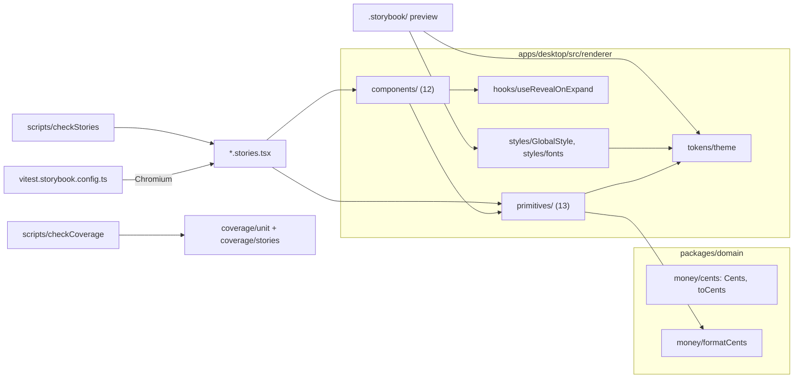

# 06 design-system: design log

## Grill-me, 2026-11-17

### Background

Features 01 to 05 are merged and refactored. The renderer holds only empty
**Layer** folders and an `index.html` with an empty body; there is no
React, no styled-components and no Storybook in the **Workspace**, and
`packages/domain` holds only `.gitkeep` files (no `package.json`, so it is
not yet a **Workspace member**).

Row 06 of `docs/feature-checklist.md`: "Theme and tokens, primitives,
components, Storybook with story tests, accessibility check and MCP, every
component has a story check, coverage on changed lines, reviewer gets the
Storybook MCP tools".

Source text, highest authority first (planner brief): `lib/store.js`,
`docs/design/SPEC.md`, the `.dc.html` files with
`Component Inventory.dc.html`, `docs/concept.md`. Target language:
`CLAUDE.md`, `docs/conventions.md`, `docs/ubiquitous-language.md`,
`docs/quality-gates.md` and the code in `apps/`, `packages/`, `scripts/`
and `gates/`.

State on 2026-11-17 (checked):

- `docs/quality-gates.md` (Rollout) gives 06 "stories as tests, the
  accessibility check, a story for every component, coverage on changed
  lines" and 08 "the `Cents` type and its lint rule"; `README.md`'s gate
  table lists the three 06 gates ("Storybook stories as tests (interaction
  + accessibility)", "script", "Vitest coverage").
- `CLAUDE.md` already lists `npm run storybook` and `npm run test:stories`;
  `.gitignore`, `.prettierignore` and `eslint.config.js` already ignore
  `storybook-static/` and `coverage/`.
- **Verify** runs twelve gates, pinned in order by
  `gates/verifyScripts/` through `gates/test-support/verifyGates/`;
  `postinstall` is exactly `install-electron`, pinned by
  `gates/electronInstall/`.
- `.dependency-cruiser.js` already holds the **Layer** ladder (tokens →
  primitives → components → features → layouts → pages → App) and lets
  the shared folders (`api`, `hooks`, `utils`, `types`, `assets`,
  `styles`) import only each other, `tokens/`, the contract and the
  domain. No rule keeps the renderer from the domain.
- The **CSP** in `index.html` has `style-src 'self'`; 04's PRD (Further
  Notes) expected "05" (now 06) to loosen it for styled-components.
- The **License allowlist** has no `OFL-1.1`; `docs/design/assets/
  typography/fonts.md` names Barlow and Barlow Condensed (SIL Open Font
  License) via `@fontsource/barlow` and `@fontsource/barlow-condensed`.
- npm on 2026-11-17: `storybook`, `@storybook/react-vite`,
  `@storybook/addon-vitest`, `@storybook/addon-a11y`,
  `@storybook/addon-mcp` and `eslint-plugin-storybook` 10.6.7 (MIT,
  published 2026-11-13); `@storybook/addon-vitest` peers
  `vitest ^4 || ^5` and `@vitest/browser-playwright`;
  `@vitest/coverage-v8` and `@vitest/browser-playwright` pin their Vitest
  exactly (the **Workspace** has `vitest` 5.0.5); `react` 19.3.1,
  `styled-components` 6.6.0, `lucide-react` 1.74.0 (ISC),
  `@fontsource/barlow` and `@fontsource/barlow-condensed` 5.3.0
  (`OFL-1.1`), `eslint-plugin-react-hooks` 7.1.1.
- This session's Claude Code already has an MCP server named `storybook`
  configured (it failed to connect: no Storybook is running), so the
  client side of the Storybook MCP exists outside the repository.

### Problem

Turn the prototype's tokens, primitives and components into typed React
components with styled-components, 1:1, each with stories that run as
tests in a real browser and pass an accessibility check, and add the three
gates that keep later features honest: every component has a story, every
story is a test, and changed lines are covered. Give agents the Storybook
MCP, and the reviewer its tools.

### Questions and Answers

**Scope and naming**

1. *Feature name and number?* `design-system`, row 06 of
   `docs/feature-checklist.md`; folder `docs/features/06-design-system/`,
   branch `feat/06-design-system`; the row's status becomes `in-progress`
   (`grill-me` skill, wrap-up).
2. *Which tokens, primitives and components are in?* Every piece SPEC §1
   puts in the tokens, primitives and components **Layers**, plus the ones
   SPEC §3 adds to them:
   - tokens: `tokens/dashcash-dark.css` over Industry's `styles.css`
     (SPEC §1, §2, Control sizing, Card fill, Category colours);
   - primitives (13): Icon, Button, Amount, Tag, Input, Select, Segmented,
     Swatch, Checkbox, Meter, Chip (SPEC §1), Switch (SPEC §3, "Switch
     (primitive)") and Loader (Q6);
   - components (12): Card, Modal, FormField, PageHeader, NavItem, Stepper,
     Accordion, StatTile, Logo, Sparkline, YearTable (SPEC §1) and Snackbar
     (SPEC §3, "Snackbar (component)");
   - the hook `useRevealOnExpand` that Accordion and YearTable use (SPEC,
     "Auto-scroll on expand": `lib/reveal.js` → a hook in code).
3. *What is out, and where does it go?*
   - SnackbarHost, LoadingOverlay and the splash (row 07 names them),
     Sidebar, AppShell, PageLayout (SPEC §1 layouts; row 07).
   - StreakStrip and HeadroomMeter: `Component Inventory.dc.html` shows
     them among the components, but SPEC §1 puts them in
     `features/saving/` ("domain UI of saving"), and SPEC outranks the
     inventory; row 18.
   - `PageId` and `AccountType` (SPEC §1 shared types) arrive with the
     first code that uses them (07, 08).
   - The prototype tweaks (`headroomScenario`, `chartRange`,
     `demoSnackbar`, `cardFill`): SPEC's header lists them as "Prototype
     tweaks" on `DashCash.dc.html`, not as product behaviour; the code
     builds the defaults, so cards are always filled (`cardFill:
     'surface'`).
   - `Logo Options.dc.html` and `Loader Options.dc.html` are explorations:
     7c and 8a are final (`docs/design/README.md`). The Loader keeps its
     four variants, because SPEC (Loaders) keeps the others "as documented
     alternatives".
   - The `Cents` lint rule (08, `docs/quality-gates.md` Rollout; Q17), the
     **CSP** (Q41), visual regression (21).
4. *Which test layers?* Domain tests (Vitest) for `Cents` and the money
   formatter; Vitest tests for the two new gate scripts and gate tests in
   `gates/` for the wiring; a story with `play` functions and the
   accessibility check for every primitive and component; no
   **End-to-end test**, because nothing here is a **User flow**: no page,
   no IPC, no **Database** (`docs/conventions.md`, Test layers). The
   issue-loop's agents write both the code and its tests; the PRD says so
   (`CLAUDE.md`, Tests).

**Files and Layers**

5. *Where does each `.dc.html` file go?*
   `apps/desktop/src/renderer/<layer>/<Name>/` with `<Name>.tsx`,
   `<Name>.styles.ts` and `<Name>.stories.tsx` (`docs/conventions.md`,
   Module filing), not SPEC §1's flat `renderer/src/primitives/<Name>.tsx`,
   which SPEC calls "suggested target paths". `primitives/`,
   `components/` and `tokens/` get one barrel `index.ts` each
   (conventions, Module filing).
6. *SPEC calls the Loader a component, but the Button, a primitive,
   renders it when `loading`. Which gives?* **Assumption:** the Loader
   lives in `primitives/`; every prop and behaviour stays as SPEC
   (Loaders) and `Loader.dc.html` define them. Reason: the **Layer rule**
   (`renderer-primitives-not-to-higher-layer`) forbids a primitive
   importing a component, and it is enforced; the Loader imports nothing
   but tokens (an SVG of the logo geometry), so it fits the primitives
   without change, while moving the Button up would move the one primitive
   that most components use. Overturn by moving the Loader back and
   splitting the Button's busy state into a component.
7. *Whose props: SPEC §3 or the `.dc.html` file?* SPEC §3 is the API, with
   what SPEC adds elsewhere: `TagTone` includes `milestone` (SPEC §2,
   Milestone; §3 Tag fills), the Button gains `loading`, `loadingLabel`,
   `loaderVariant` (SPEC, Loaders), the Snackbar gains `loading` (SPEC,
   Loaders: "snackbar (18 px replaces the tone icon)"; `Snackbar.dc.html`),
   NavItem gains `compact` (SPEC §3, Layouts). Where a `.dc.html` file has
   more, SPEC wins: the Modal has no `actions` prop (SPEC §3: "actions are
   the last child row, right aligned"; no `.dc.html` caller passes
   `actions`). Where SPEC contradicts itself, the side the prototype
   shares wins: YearTable's payoff row is `--sb-milestone-row`
   (`YearTable.dc.html`, SPEC §2 Milestone and §4), not "accent-200" (SPEC
   §3 YearTable). Further cases:
   - **Assumption:** the Card gets no `actions` slot now. Reason: SPEC §3
     says "add an `actions?: ReactNode` header slot if needed", and no
     prototype file passes one; the first feature that needs it adds it.
   - **Assumption:** Amount with `cents: null` shows "-". Reason: SPEC §3
     says so and outranks `Amount.dc.html`, which shows nothing; store.js's
     `eur` returns `''` for `null` only as a guard, and the domain
     formatter takes `Cents`, never `null` (Q18), so the empty case is
     Amount's own display.
   - **Assumption:** Amount's `tone` is SPEC §3's seven values plus
     `accent` (accent-600). The prototype's `default` is not a value; it
     is `auto` under another name, and callers pass `auto`. Reason:
     StatTile passes its `tone` (`'default' | 'accent' | 'warning' |
     'danger'`, SPEC §3) to Amount (`StatTile.dc.html`), so a money tile
     with `tone="accent"` needs Amount's `accent` to render 1:1; one name
     per concept.
8. *Which icons?* `IconName` is the 41 keys of `lib/icons.js`; SPEC §1's
   union lacks `undo` and `folder`, which SPEC §4 (the reset button's
   `undo`), `lib/icons.js` and `docs/design/assets/icons/` all have. Icon
   renders the matching `lucide-react` component at `strokeWidth` 1.5,
   `aria-hidden` (`docs/design/README.md`, Contents: "use `lucide-react`
   at `strokeWidth={1.5}` with the same names"; `Icon.dc.html`), mapping
   each prototype name to its Lucide component (`dashboard` →
   `LayoutDashboard`, `alert` → `TriangleAlert`, `transfer` →
   `ArrowLeftRight`, …).
9. *What animates?* Exactly SPEC §5's list: accordion and year-row chevron
   160 ms, Meter width 300 ms, the Loader's 1,6 s loop with its 200 ms
   fade-in and reduced-motion breathing (SPEC, Loaders;
   `loader-keyframes.css`), smooth auto-scroll on expand. `Switch.dc.html`'s
   150 ms knob transition is left out: SPEC §5 says "Nothing else
   animates" and outranks the `.dc.html` file.
10. *What about accessibility the prototype does not show?* **Assumption:**
    attributes no one sees, which the accessibility check needs, are
    engineering decisions and are added: the Modal is labelled by its
    title (`aria-labelledby`), FormField ties its label to its control,
    and Input, Select and Meter take an optional `ariaLabel` as SPEC §3
    gives the Switch, for a control no FormField labels. Nothing visible
    changes. Reason: the prototype cannot show accessible names (planner
    brief: "What the prototype cannot show … engineering decisions"); axe
    fails a form control, a dialog or a meter without one.

**Tokens and theme**

11. *What shape has the theme?* **Assumption:** one object `theme` in
    `tokens/theme/theme.ts`, typed as styled-components' `DefaultTheme`
    (declared in `types/`), grouped by kind (`color`, `font`, `fontSize`,
    `space`, `size`, `shadow`, `motion`, `zIndex`); keys follow SPEC §2's
    bracketed names where it gives one (`color.bg`, `color.sunken`,
    `color.text`), otherwise the CSS variable's name in camelCase without
    its `--color-` or `--sb-` prefix (`color.accent[600]`,
    `color.textFaint`, `color.category[1]` … `[40]`,
    `color.account.income`). Values are the final dark values:
    `dashcash-dark.css` over Industry's `styles.css`, `color-mix()`
    strings kept as written. Reason: SPEC §1 maps the token sheets to
    "`theme.ts` (`DefaultTheme`)" and calls its bracket names "suggested";
    one rule names the rest.
12. *What becomes of the prototype's literal sizes?* **Assumption:** every
    colour, size and spacing a component uses comes from the theme
    (`CLAUDE.md`, Design: "Theme tokens only"); a literal of the prototype
    that SPEC §2 does not name (NavItem 38 px, Tag 22 px, a 10 px gap)
    becomes a named theme entry with exactly the prototype's value, never
    rounded to a nearby spacing step (10 px stays 10 px, not
    `--space-3` 10.2 px). The Logo's light variant colours (`#1d1f20`,
    `#416180`, ground `#f2f2f3`, from `Logo.dc.html`) are theme entries
    too. Reason: 1:1 fidelity and tokens only, both from `CLAUDE.md`.
13. *Where do global styles live?* **Assumption:**
    `styles/GlobalStyle/GlobalStyle.ts` (`createGlobalStyle`), holding the
    element-level rules of both sheets: `html`/`body` ground, ink and font,
    headings in Barlow Condensed, links, `:focus-visible` (2 px accent,
    offset 2), `::selection`, scrollbars, `button:disabled` cursor.
    Industry's class rules (`.btn`, `.input`, `.card`, `.tag`, `.seg`,
    `.table`, `.dialog`) become the styles of the components that use
    them; Industry's Google Fonts `@import` is dropped (Q14). Reason:
    `docs/conventions.md` gives the renderer a `styles/` folder beside
    `tokens/`, and tokens are values; SPEC §1 only suggests `GlobalStyle.ts`
    next to `theme.ts`. Overturn by moving the module to `tokens/`.
14. *Fonts?* Barlow 400, 500, 600 and Barlow Condensed 500, 600 from
    `@fontsource/barlow` and `@fontsource/barlow-condensed`
    (`docs/design/assets/typography/fonts.md`: the weights and the
    packages; "self-host in the app", the app is offline), imported once by
    `styles/fonts/fonts.ts`, which Storybook's preview imports now and the
    App later. **Assumption:** `OFL-1.1` joins the **License allowlist**
    in the ticket that adds the fonts. Reason: the allowlist names every
    permitted licence and a new one is "a deliberate gate-file change"
    (02, Q23); the OFL permits bundling the fonts with any software, the
    design names these fonts, and there is no other way to ship them.
15. *Card fill?* Filled: `--sb-card-bg` = surface with the softened
    `--sb-card-border`, inputs on `--sb-input-bg` = ground, Modal and
    Snackbar on `--sb-raised-bg` (SPEC, Card fill). `cardFill: 'none'` is a
    tweak (Q3).

**Money**

16. *Where do `Cents` and the formatter live?* In `packages/domain`, which
    becomes the **Workspace member** `@dashcash/domain` (its own
    `package.json` and `tsconfig.json` like the contract's, and a
    `tsc -p packages/domain/tsconfig.json` in `typecheck`); the desktop
    member depends on it. `CLAUDE.md`, Money: "Format only for display, via
    `domain/src/money/`". The **Layer rules** already let the renderer
    import the domain. **Assumption:** the member exports each module by
    its path (`"./*": "./src/*.ts"`), so the renderer imports
    `@dashcash/domain/money/formatCents/formatCents`. Reason: no `index.ts`
    per module (conventions, Module filing); one export rule serves every
    later module.
17. *`docs/quality-gates.md` gives the `Cents` type to 08. Why now?*
    **Assumption:** 06 brings the `Cents` type (SPEC §1:
    `number & { readonly __brand: 'Cents' }`), a `toCents(value: number):
    Cents` that accepts only safe integers and throws a `RangeError`
    otherwise, and the formatter; the `Cents` lint rule stays with 08.
    Reason: Amount, StatTile, Sparkline and YearTable take `Cents`
    (SPEC §3), and they are in this row; the rule's job, catching money as a
    plain `number` in feature code, starts with the first money in a
    feature (08). `toCents` lets stories and later features make `Cents`
    without a cast.
18. *Which formatting rules?* From store.js's `eur` and `Amount.dc.html`,
    each a domain test of `formatCents(cents: Cents, options?: { whole?:
    boolean; sign?: 'auto' | 'always' | 'none' }): string`:
    - German grouping and decimals with exactly two decimals
      (`1.234,56`), `whole` rounds to whole euros (`30.000`), as
      `Intl.NumberFormat('de-DE')` does;
    - a no-break space (U+00A0) before `€`;
    - a negative amount starts with U+2212 (`−86,40 €`) unless `sign` is
      `none`; `always` puts `+` before a positive amount; zero has no sign;
    - the sign follows the cents, not the rounded figure (store.js: `−40`
      cents `whole` is `−0 €`).
19. *Is the Sparkline's scaling money math?* **Assumption:** no. Mapping a
    series of `Cents` to points of a 200-wide box (`Sparkline.dc.html`) is
    chart geometry and stays in the renderer, in the Sparkline module.
    Reason: it computes pixels, not amounts; nothing it returns is money.
    Overturn by moving it to `packages/domain/src/projection/`.

**Storybook and story tests**

20. *Which tools?* Storybook 10 with `@storybook/react-vite`,
    `@storybook/addon-vitest` (stories run as Vitest tests in browser
    mode), `@storybook/addon-a11y` and `@storybook/addon-mcp`;
    `@vitest/browser-playwright` drives Chromium; `@vitest/coverage-v8`
    measures (Q34). Exact versions (`.npmrc` `save-exact`), each the newest
    release at least 14 days old (02, D3); the Vitest companion packages at
    the installed Vitest's version, which they pin exactly. Reason: SPEC
    §1 names React and styled-components; `docs/quality-gates.md` names
    stories as tests, the accessibility addon and Storybook as the living
    inventory; contrast is only measurable in a real browser.
21. *Where is the Storybook config?* `.storybook/` at the repository root
    (conventions: tool configuration stays at the root), stories from
    `apps/desktop/src/renderer/**/*.stories.tsx`; the preview wraps every
    story in the `ThemeProvider` with the `theme`, `GlobalStyle` and the
    fonts. **Assumption:** telemetry off (`core.disableTelemetry`).
    Reason: tests use no network (`CLAUDE.md`, Tests), and nothing about
    the project leaves the machine.
22. *How do the story tests run?* **Assumption:** a second root config,
    `vitest.storybook.config.ts`, with the Storybook plugin and headless
    Chromium; `npm run test:stories` = `vitest run --config
    vitest.storybook.config.ts`, and `npm test` stays the Node run of
    `vitest.config.ts`. `npm run storybook` = `storybook dev --port 6006
    --no-open`. Reason: `CLAUDE.md` lists `test` and `test:stories` as two
    commands; Stryker's Vitest runner loads `vitest.config.ts` through
    `vitest.stryker.config.ts` and must never meet a browser project.
23. *Where does Chromium come from?* **Assumption:** the root `postinstall`
    becomes `install-electron && playwright install --only-shell chromium`,
    and `gates/electronInstall/` pins the new value. Reason: 05 (Q26) made
    `npm ci` the one place that installs the binaries tests need, checked
    in one place; the Electron binary cannot host Vitest's browser mode;
    `--only-shell` fetches only the headless build the tests use.
24. *What does a component's stories file hold?* One story per state the
    prototype shows: every tile of `Component Inventory.dc.html` and every
    state SPEC §3 to §5 names (disabled, loading, busy, warning, empty, …),
    titled `<Layer>/<Name>` (`Primitives/Button`), with the copy and German
    number formats verbatim and invented data, taken from the inventory's
    demo values (`docs/design/prototype/lib/store.js` data is invented
    too). Where an inventory value contradicts SPEC, SPEC wins: the
    "Paid off" Tag is `milestone`, not the inventory's `accent` (SPEC §2,
    Milestone). Every interaction (click, toggle, Esc, backdrop, a disabled
    control that does nothing) is a `play` function. A Loader story sets
    `delay` 0, except the story that shows the delay.
25. *Does every component get a `<Name>.test.tsx`?* **Assumption:** no;
    a component gets one only for a pure function its module exports
    (the Sparkline's path builder, the Logo's dash end point), run by
    `npm test` in Node. Its behaviour and states are stories. Reason:
    `CLAUDE.md`, Tests: "UI behaviour: story with a `play` function";
    `docs/conventions.md` lists the test file in a component folder but
    enforces only the story. The hook's pure part (`computeRevealScroll`:
    how far to scroll for a header, a block, a scroll box and a margin)
    gets `useRevealOnExpand.test.ts` the same way.
26. *What replaces the inventory's Tokens section?* **Assumption:** a
    `Tokens` story beside the theme (`tokens/theme/theme.stories.tsx`)
    with the inventory's colour tiles, type scale and spacing bars,
    verbatim. Reason: `docs/quality-gates.md` says stories "replace the
    prototype's component inventory as living documentation", and the
    inventory opens with the tokens. The **Story check** does not require
    it (tokens are not a component).
27. *Which lint rules come with React and Storybook?* **Assumption:**
    `eslint-plugin-react-hooks` and `eslint-plugin-storybook`, each with its
    recommended config, in `eslint.config.js`. Reason: 01 (Q18) deferred
    "React and Storybook rules" to the first React code; these two check
    what the sources rely on (hook rules; story files that stay loadable)
    without a style preset nobody asked for.
28. *TypeScript?* `tsconfig.web.json` gains `"jsx": "react-jsx"`;
    `.storybook/` and `vitest.storybook.config.ts` are type-checked and
    linted like every other config; `DefaultTheme` is declared from the
    theme's type in `types/`. The PRD names which project includes which
    file.

**Accessibility check**

29. *How does it run?* `@storybook/addon-a11y` with `parameters.a11y.test
    = 'error'` in the preview: axe runs on every story in its story test,
    and a violation fails the test, so **Verify** and CI fail
    (`docs/quality-gates.md`: "the accessibility addon checks contrast and
    labels"). A gate test pins the setting.
30. *The prototype's faint and muted text is below 4.5:1. What then?*
    `--sb-text-faint` (ink at 42 %) on the ground is about 3.5:1 by my
    calculation, and Amount's `muted` tone (62 % opacity) about 3.7:1 for
    the positive green; FormField hints and future months in the
    YearTable use them. **Assumption:** every axe rule blocks except
    `color-contrast`, which runs with `reviewOnFail: true`: its failures
    show as "needs review" in the a11y panel and through the Storybook MCP,
    but do not fail the story test, until the human decides the
    prototype's contrast. Reason: blocking on it would leave the builder
    two forbidden ways out, redesigning the colours (`CLAUDE.md`: "never
    redesign while building") or disabling the rule ("never by weakening
    the check"); `docs/quality-gates.md` (Rollout) lets a gate start
    informative where it would block existing work, and the prototype's
    colours are that work. Overturn by dropping `reviewOnFail` once the
    colours are decided; the gate test pins this one exception, so it
    cannot widen silently.

**Story check**

31. *What does it check?* `scripts/checkStories/` (`npm run
    check:stories`, in **Verify**): every component module, a
    `<Name>/<Name>.tsx` with a PascalCase `<Name>` directly under
    `primitives/`, `components/` or `features/<feature>/`, has
    `<Name>.stories.tsx` beside it; one line per missing file, in the
    shared violation format (`scripts/reportViolations/`). It reads the
    tracked and the untracked, not ignored files, so a new component fails
    before its first commit. Source: conventions, Module filing ("story
    required for primitives, components and feature components
    (enforced)"); `README.md`: "Every component has a story | script".

**Coverage on changed lines**

32. *How is coverage measured?* `@vitest/coverage-v8` in both Vitest
    configs, LCOV reports in `coverage/unit/` and `coverage/stories/`,
    over **Shipping code** in `apps/`, `packages/`, `scripts/` and `gates/`
    (no tests, stories, `test-support/` or `e2e/`). `vitest.stryker.
    config.ts` turns coverage off. Source: `README.md` ("Vitest
    coverage").
33. *Which lines count?* **Assumption:** the lines added or changed
    between the merge base with `origin/main` and the working tree, plus
    every line of an untracked, not ignored file, in files the coverage
    measures; a line is covered when either report counts a hit on it.
    Reason: `docs/quality-gates.md` says "threshold on changed lines"; the
    issue-loop runs **Verify** before it commits, so committed lines alone
    would let a new file through locally.
34. *Which threshold, and where?* **Assumption:** 80 % of the changed
    coverable lines, all files together, read from a threshold file in
    `quality/` (fail closed when it is missing or malformed), blocking from
    the ticket that adds the gate. The gate `scripts/checkCoverage/`
    (`npm run check:coverage`) fails below it, naming the uncovered changed
    lines by file. Reason: no source names a number; 80 is Stryker's `high`
    mark in this repository; one aggregate tolerates the entry files no
    unit test loads (`main.ts`, `preload.ts`, a script's `import.meta.main`
    block); the file sits where the other gate policies sit and is a gate
    file ("Ask first"); the gate only judges new lines, so it cannot block
    existing work, and per Rollout starts blocking. Thresholds only go up.
35. *Order in Verify?* **Assumption:** `format:check`, `lint`,
    `typecheck`, `lint:deps`, `check:stories`, `test`, `test:stories`,
    `check:coverage`, then the eight gates as today. Reason: the static
    structure checks run before the slow ones; the coverage gate reads the
    two reports the runs just wrote.

**Storybook MCP and the reviewer**

36. *What is "MCP" in this row?* `@storybook/addon-mcp` in
    `.storybook/main.ts`: Storybook's dev server then serves an MCP
    endpoint (`http://localhost:6006/mcp`) that lets agents list
    components and stories and read their documentation and a11y results.
    **Assumption:** no `.mcp.json` is committed; the client registration
    stays the human's existing `storybook` server. Reason: this session
    already has that server configured; a second, project-scoped entry of
    the same name would duplicate it.
37. *How does the reviewer get the tools?* A ticket built by the human, as
    05's **Dangerous-git hook** was (`CLAUDE.md`: a ticket never counts as
    approval for `.claude/`): `.claude/agents/reviewer.md` gains the tools
    of the `storybook` MCP server. **Assumption:** the same ticket makes
    the issue-loop's and pr-review's review prompts tell the reviewer to
    start `npm run storybook` in the background when the diff touches a
    story or a component, and to check the changed stories and their a11y
    results through those tools. Reason: the tools answer only while
    Storybook runs; tools the reviewer cannot reach would not be "gets the
    tools". The human decides the wording.

**Engineering decisions**

38. *Does the CSP change?* **Assumption:** no; 07 (app-shell), which first
    renders React and styled-components in the window, adds the
    `style-src` source styled-components needs and handles React's dev
    preamble, with its reason. Reason: 06 renders only in Storybook, which
    the **CSP** does not govern; 04 (Q18) says each feature adds exactly
    the source it needs, and a source nothing in the window uses cannot be
    tested. This supersedes 04's PRD note that "05" (now 06) loosens it.
39. *Where do the new dependencies go?* **Assumption:** `react`,
    `react-dom`, `styled-components`, `lucide-react`, `@fontsource/barlow`
    and `@fontsource/barlow-condensed` (and `@types/react`,
    `@types/react-dom`) in the desktop member's `devDependencies`, like
    `electron-vite`; Storybook, its addons, the Vitest companions and the
    ESLint plugins at the root. Reason: electron-vite bundles the renderer,
    so nothing reads them from `node_modules` at run time; test and lint
    tools sit at the root with Vitest and ESLint today.
40. *What changes in the docs?* `README.md`'s Getting started says that
    `npm ci` installs Chromium for the story tests too; `docs/quality-
    gates.md` and `README.md` already list the three gates. `CLAUDE.md` is
    unchanged: its command list already has `storybook` and
    `test:stories`. The glossary gains the design-system terms.
41. *Determinism?* No component reads a date, so no clock is needed; fonts
    come from `node_modules`, telemetry is off, story data is fixed
    (`CLAUDE.md`, Tests). A story with a timer (the Loader's `delay`) uses
    the story's own value, and its `play` waits for the result.
42. *Where does the auto-scroll hook live, and what does it do?*
    `hooks/useRevealOnExpand/` (conventions: cross-feature hooks, flat):
    after a block opens, scroll the nearest scroll container just far
    enough to show it with a 24 px margin, never past the header; jump
    instead of smooth scrolling under `prefers-reduced-motion`; nothing on
    collapse or when it fits (SPEC, Auto-scroll on expand; `lib/reveal.js`).
    `overflow-anchor: none` on the main scroll area is the AppShell's (07).

### Design



| Path | Change |
| --- | --- |
| `packages/domain/package.json`, `tsconfig.json` | the `@dashcash/domain` member ✅ |
| `packages/domain/src/money/cents/` | `Cents`, `toCents` ✅ |
| `packages/domain/src/money/formatCents/` | German money formatting ✅ |
| `apps/desktop/src/renderer/tokens/theme/` | `theme`, Tokens story ✅ |
| `apps/desktop/src/renderer/styles/GlobalStyle/`, `styles/fonts/` | global rules, self-hosted fonts ✅ |
| `apps/desktop/src/renderer/types/` | `DefaultTheme` declaration ✅ |
| `apps/desktop/src/renderer/hooks/useRevealOnExpand/` | auto-scroll on expand ✅ |
| `apps/desktop/src/renderer/primitives/<Name>/` | Icon, Button, Amount, Tag, Input, Select, Segmented, Swatch, Checkbox, Meter, Chip, Switch, Loader ✅ |
| `apps/desktop/src/renderer/components/<Name>/` | Card, Modal, FormField, PageHeader, NavItem, Stepper, Accordion, StatTile, Logo, Sparkline, YearTable, Snackbar ✅ |
| `.storybook/main.ts`, `preview.tsx` | Storybook, a11y `error` with contrast for review, MCP, no telemetry ✅ |
| `vitest.storybook.config.ts` | story tests in headless Chromium, coverage ✅ |
| `vitest.config.ts`, `vitest.stryker.config.ts` | coverage on, off for Stryker ✅ |
| `scripts/checkStories/` | **Story check** ✅ |
| `scripts/checkCoverage/`, `quality/` threshold file | changed-lines coverage, 80 % ✅ |
| `package.json` | `storybook`, `test:stories`, `check:stories`, `check:coverage`, **Verify** order, `postinstall` with Chromium ✅ |
| `gates/` | wiring tests: **Verify** order and commands, `postinstall`, a11y setting, story-test config, coverage settings ✅ |
| `eslint.config.js`, `tsconfig.web.json` | React hooks and Storybook rules; JSX ✅ |
| `quality/license-allowlist.json` | `OFL-1.1` ✅ |
| `README.md` | Getting started: Chromium in `npm ci` ✅ |
| `.claude/agents/reviewer.md`, review prompts | Storybook MCP tools (human) ✅ |

Formatter, for the PRD to refine:

```ts
type Cents = number & { readonly __brand: 'Cents' };
function toCents(value: number): Cents; // RangeError unless a safe integer
function formatCents(
  cents: Cents,
  options?: { whole?: boolean; sign?: 'auto' | 'always' | 'none' },
): string; // formatCents(-8640) === '−86,40 €'
```

Alternatives:

- ✅ Loader in primitives. ❌ Button in components: moves the most used
  primitive up a **Layer**. ❌ An exception in the **Layer rule**: weakens
  an enforced check.
- ✅ Story tests in Vitest browser mode (Chromium). ❌ jsdom: no layout,
  so no contrast check. ❌ Storybook's separate test runner: a second test
  tool beside Vitest.
- ✅ A second Vitest config. ❌ One config with projects: Stryker's runner
  would load the browser project.
- ✅ Contrast reported for review. ❌ Blocking now: forces a redesign or a
  disabled rule. ❌ The whole check informative: missing labels would not
  block either.
- ✅ Changed lines from the working tree. ❌ Committed lines only: a new
  file passes locally and fails in CI.
- ✅ `Cents` and the formatter now, the lint rule in 08. ❌ Amount on a
  plain `number` until 08: money as a plain number.

### Implementation Plan

1. **Thinnest slice: one primitive as a story test.** React,
   styled-components, the `theme`, `GlobalStyle`, the fonts, Storybook with
   its preview, `vitest.storybook.config.ts`, Chromium in `postinstall`,
   `test:stories` in **Verify**, the React and Storybook lint rules,
   `OFL-1.1`; the Icon with its stories passing in headless Chromium.
2. **Accessibility check.** The a11y addon, `error` with contrast for
   review, the gate test that pins it.
3. **Story check.** `check:stories` in **Verify**.
4. **Coverage on changed lines.** Coverage in both configs, off for
   Stryker, `check:coverage` with the threshold file.
5. **Money.** The domain member, `Cents`, `toCents`, `formatCents`; the
   Amount on top of it.
6. **Primitives.** Loader, Button, Tag, Input, Select, Segmented, Swatch,
   Checkbox, Switch, Meter, Chip; the PRD may cut this into several
   tickets.
7. **Components.** Card, FormField, Modal, PageHeader, NavItem, Stepper,
   StatTile, Logo, Sparkline, Snackbar; Accordion and YearTable with
   `useRevealOnExpand`; the Tokens story.
8. **Storybook MCP.** The MCP addon; README.
9. **Reviewer tools (built by the human).** `reviewer.md` and the review
   prompts.

### Trade-offs

- Easier: every later feature composes typed, themed, story-tested
  pieces and only adds its feature components; a missing story, a story
  that throws, a missing label or uncovered new lines fail **Verify**; the
  money format lives in one tested function; agents can look components
  up through the Storybook MCP.
- Harder: `npm ci` downloads a Chromium build as well as Electron, in
  every CI job; **Verify** gets slower by a browser test run and coverage;
  a Linux runner may lack a library headless Chromium needs, which only
  the first CI run shows (the fix is a CI step, never a skipped test);
  contrast failures do not block until the human decides the faint and
  muted colours; the coverage gate reads the reports of the last run, so a
  stale local report can mislead until the next `npm test`; every literal
  of the prototype becomes a theme entry, so the theme is long;
  `.storybook/` is not on `CLAUDE.md`'s "Ask first" list (the gate tests
  pin what matters in it; adding it is the human's call).
- Out of scope: SnackbarHost, LoadingOverlay, splash, layouts, routing,
  the **CSP** and the reviewer's DevTools MCP (07); StreakStrip and
  HeadroomMeter (18); the `Cents` lint rule (08); visual regression (21);
  the prototype tweaks and the logo and loader explorations (Q3); a
  `.mcp.json` (Q36); changes to `CLAUDE.md`.

### Assumptions from write-a-prd

- **A1. Which TypeScript project checks the Storybook files.**
  **Assumption:** `.storybook/main.ts` joins the root project, beside the
  root configs it already holds (`vitest.storybook.config.ts` is matched by
  its `*.ts`); `.storybook/preview.tsx` and the a11y parameters module (A5)
  join the renderer's project `tsconfig.web.json`, which gains `"jsx":
  "react-jsx"`. Reason: Q28 left the split to the PRD; `main.ts` runs in
  Node when Storybook starts, while the preview runs in the browser,
  renders JSX and imports the renderer's **Theme** and `GlobalStyle`, so it
  belongs where the DOM types are and Node's are not. ESLint's project
  service needs every linted file in a project, and `.storybook/` is not
  ignored. Overturn by giving `.storybook/` a project of its own.
- **A2. The Coverage threshold file.** **Assumption:**
  `quality/coverage-threshold.json` holds exactly `{ "changedLines": 80 }`.
  `check:coverage` fails closed when the file is missing, is not JSON, is
  not an object, or `changedLines` is not a number from 0 to 100. Reason:
  Q34 puts the threshold in a file in `quality/` and fails closed without
  naming the file or its shape; one named key leaves room for another
  threshold later without a format change, as the other `quality/` files
  are named after what they hold.
- **A3. What the coverage gate cannot judge.** **Assumption:**
  `check:coverage` fails closed when `origin/main` or the merge base cannot
  be found, when either LCOV report is missing or unreadable, and when a
  changed file it measures appears in neither report ("not measured; run
  `npm test` and `npm run test:stories`"). A changed line that neither
  report lists in its line data is not coverable (a type, a blank
  line, a comment) and does not count; with no coverable changed lines the
  gate passes. Reason: Q33 and Q34 say what counts but not what happens
  with input the gate cannot read; every gate here must **Fail closed**,
  and a new file absent from a stale report would otherwise pass without
  ever being measured.
- **A4. The lines the two gates print.** **Assumption:** `check:stories`
  prints `<path of Name.tsx>: has no <Name>.stories.tsx`, one per missing
  file. `check:coverage`, below the threshold, prints first
  `changed lines: <covered> of <coverable> covered (<p> %), below the
  threshold of <t> %`, then one line per file with uncovered changed lines,
  `<path>: lines <a>, <b>–<c> not covered`, ranges joined; at or above it,
  nothing. Both go through `reportViolations` (`<subject>: <reason>`).
  Reason: Q31 and Q34 fix one line per missing file and naming the
  uncovered lines by file, in the shared format, but not the words; the
  summary line tells the reader how far off the threshold the change is.
- **A5. What the new gate tests pin, and where.** **Assumption:** the a11y
  parameters live in a module of their own in `.storybook/`, which the
  preview imports and a gate test imports directly; `gates/storyTests/`
  pins that module (`test: 'error'`, and its rule changes exactly
  `[{ id: 'color-contrast', reviewOnFail: true }]`) and
  `vitest.storybook.config.ts` (the Storybook plugin on `.storybook/`,
  browser mode enabled, the Playwright provider, headless, exactly one
  Chromium instance); `gates/coverage/` pins both Vitest configs' coverage
  settings (on, V8, LCOV, their report folders, the measured and excluded
  paths) and coverage off in `vitest.stryker.config.ts`. The existing
  `gates/verifyScripts/` and `gates/electronInstall/` pin the new
  **Verify** order and `postinstall`. Reason: Q29 and the Design table name
  what is pinned but not how; the preview imports fonts and CSS that Node
  cannot load, so a gate test can only read the setting from a module that
  imports nothing; one gate folder per gate (conventions, Module filing).

### Assumptions from prd-to-plan

- **P1. The Theme grows with the phases that use it.** **Assumption:**
  phase 1 brings the **Theme** with its eight groups, its `DefaultTheme`
  declaration and the **Tokens** the global style and the Icon use; each
  later phase adds the **Tokens** its pieces use, keyed by Q11's rule and
  valued exactly as the token sheet or the prototype gives them (Q12); the
  Tokens phase (plan phase 19) adds every **Token** of the sheet still
  missing and the Tokens **Story**, so the **Theme** is complete before the
  feature merges. Reason: the PRD's ticket order puts the Tokens **Story**
  with the components, and a whole token sheet in the tracer bullet would
  make it the thickest phase; keys and values are fixed by Q11 and Q12, so
  a **Token** added early cannot differ from the one the sheet names.
  Overturn by moving the whole sheet into phase 1.
- **P2. The story-test gate test arrives with the Accessibility check.**
  **Assumption:** `gates/storyTests/` arrives in phase 2 and pins both the
  a11y parameters module and `vitest.storybook.config.ts` (A5); in phase 1
  the **Story tests** are guarded only by the gate wiring test (`test:stories`
  in **Verify**) and `gates/electronInstall/` (`postinstall`). Reason: the
  PRD's ticket order names "The **Accessibility check** and its gate test"
  as one step and A5 gives the two pins one folder; no phase ships on its
  own, the feature merges as one pull request.

### Assumptions from prd-to-issues

- **I1. Some phases become several tickets.** **Assumption:** plan phase 1
  becomes tickets 01 (the Icon as a story test), 02 (global style and
  fonts) and 03 (lint rules); phase 4 becomes 06 (coverage reports), 07
  (the changed-lines core) and 08 (the gate in **Verify**); phase 5 becomes
  09 (money in the domain) and 10 (Amount); phase 10 becomes 15 (Segmented
  and Chip) and 16 (Checkbox and Switch); phase 14 becomes 20 (PageHeader
  and NavItem) and 21 (Stepper). Every other phase is one ticket, and the
  order follows the plan. Reason: one issue-loop step has a budget of 100k
  tokens; phase 1 alone would install twelve packages and write three
  configs, the **Theme**, the global style, the fonts, the lint rules and
  the Icon in one build step. Each part has its own RED and can be checked
  on its own. Overturn by merging tickets back into their phase.
- **I2. The tracer bullet's RED.** **Assumption:** ticket 01's failing
  tests are the **Gate wiring** and `postinstall` pins, which fail at their
  assertions; the Icon's stories file is committed beside them and first
  runs in GREEN. Reason: no **Story test** can run before Storybook is
  installed, which is the ticket's build, and the tdd skill never counts a
  tool that refuses to run as a failure for the right reason. Overturn by
  installing Storybook in a ticket of its own before the Icon.
- **I3. The global style is proven by a story.** **Assumption:** ticket 02
  adds `styles/GlobalStyle/GlobalStyle.stories.tsx`, titled
  `Styles/GlobalStyle`, with a heading, body text, a link, a button and a
  disabled button; its **Play functions** read what the browser computes
  (ground, ink, fonts, link colour, focus ring, disabled cursor) and
  `document.fonts`. Reason: the ticket needs a RED; the global style is
  behaviour the user sees but has no prototype tile and no component;
  stories are the UI test layer (`CLAUDE.md`, Tests); the **Story check**
  does not require it, and `styles/` is no **Layer**, so its title is
  `Styles/`. Overturn by dropping the story and checking the global style
  by review.
- **I4. The lint rules are proven by samples.** **Assumption:** ticket 03
  adds two samples to `gates/lint/lint.test.ts`: a hook called inside a
  condition is reported by `react-hooks/rules-of-hooks`, and a stories file
  without a default export by a `storybook/` rule. Reason: Q27 names the
  configs but no proof; the lint gate test already proves what lint
  catches by samples, and a ticket needs a RED that fails at an assertion.
  Overturn by folding the lint rules back into ticket 01 without a sample.
- **I5. Criteria checked by review.** **Assumption:** criteria marked
  "(review)" in the tickets (props exactly SPEC §3, the **Tokens**' keys
  and values, styles without literals) are checked by the reviewer and
  `npm run typecheck`, not by a test of their own. Reason: a test that
  copied the token sheet or scanned styles for literals would pin source
  text, which the PRD's Testing Decisions rule out; a literal scanner
  would be a new gate no source gives this row; the renderer cannot read
  the sheets from disk (no Node built-ins in the renderer). The Tokens
  **Story** still fails on a **Token** missing from `theme`. Overturn by a
  lint rule against literals in a later ticket.
- **I6. The MCP ticket's RED.** **Assumption:** ticket 27 adds a pin of
  `.storybook/main.ts` to `gates/storyTests/`: its addons are exactly
  `@storybook/addon-vitest`, `@storybook/addon-a11y` and
  `@storybook/addon-mcp`, and telemetry is off. Reason: plan phase 20 has
  no test, and the issue-loop starts every ticket with a RED; the addon is
  what serves the **Storybook MCP**, and telemetry off (Q21) is the
  setting in `main.ts` that keeps the project on the machine. Overturn by
  dropping the pin and checking the MCP by hand only.

## Implementation Results

Deviations the human set before the build, 2026-11-17. They supersede the
answers named; those answers stay as they were written.

- **D1. Colour contrast blocks, and the prototype's text and money colours
  are raised to 4.5:1** (supersedes the assumption in Q30, A5's and the
  tickets' `{ id: 'color-contrast', reviewOnFail: true }`, Q7's "`muted`
  at 62 % opacity", and the prototype's values below; set by the human).
  The **Accessibility check** blocks on every axe rule, `color-contrast`
  included: the a11y module holds `test: 'error'` and no rule changes
  (ticket 04). To make the prototype pass, exactly these values change,
  each by the least that reaches 4.5:1 (WCAG AA, normal text) against every
  ground the text sits on: the ground `#1b2a39`, sunken `#16222f`, surface
  `#213345`, accent-100 `#22384d`, neutral-100 `#243445`, the milestone
  row, and `--sb-hover` over the ground and over the surface. Every other
  **Token** keeps its prototype value, the tints included.
  - `--sb-text-faint` (`color.textFaint`): ink at 42 % → **60 %**,
    `color-mix(in srgb, #e9f1fa 60%, transparent)`. At 42 % it measured
    3.07 to 3.63:1; at 60 % the lowest is 4.59:1 (hover over the surface;
    59 % gives 4.498:1).
  - `--sb-text-muted` (`color.textMuted`) stays at 62 %: it measures at
    least 4.79:1 on every ground above.
  - `--sb-negative` and `--sb-danger` (the same red): `#e8877b` →
    **`#ed8c80`**, OKLCH lightness +0.015 with chroma and hue kept. At
    `#e8877b` it measured 4.25:1 on hover over the surface; `#ed8c80`
    reaches 4.50:1 there. `--sb-negative-tint` and `--sb-danger-tint`
    keep `#e8877b`, since they are grounds, not text.
  - Amount's `muted` tone: 62 % opacity → **100 %**, so `muted` shows the
    **Polarity** colour exactly like `auto`; the `tone` value stays. At
    62 % green measured 3.05 to 3.91:1 and red 2.52 to 3.22:1; with red
    only just at 4.5:1, any opacity below 100 % fails.
- **D2. A projected value is marked by a cue other than colour strength.**
  With D1, `muted` no longer fades an amount, so a projected value must be
  told apart from an actual one without lowering contrast: by a cue such as
  the table's future-row styling below the today marker, or italic. The
  YearTable (ticket 25) keeps the prototype's future-row styling as that
  cue: future month rows below today's accent-100 row, with the month
  label in `--sb-text-muted`. BalanceTable and BalanceChart (feature 17)
  pick their cue when they are planned; the chart's dashed projection line
  already is one. The note stands in ticket 25 and in row 17 of
  `docs/feature-checklist.md`.
- **D3. A `package.json` script may install headless Chromium** (deviates
  from feature 04's end-to-end gate test "downloads no browser from a
  script of package.json"; Q23 stands; set by the human, 2026-11-17).
  `gates/endToEnd/endToEnd.test.ts` lets a `package.json` script run
  exactly `playwright install --only-shell chromium`, Q23's command, and
  nothing else: any other `playwright install` (another browser, without
  `--only-shell`, with more arguments) still fails. Reason: Q23's
  `postinstall` installs the headless Chromium the **Story tests** run in,
  and the old pin rejected every `playwright install` (ticket 01).
- **D4. `.storybook/` has a TypeScript project of its own** (A1 named
  this way to overturn it; set by the human, 2026-11-17).
  `.storybook/tsconfig.json` holds the Storybook files, so ESLint's
  project service finds `.storybook/preview.tsx`, which it could not reach
  through the root `tsconfig.json` (ticket 01).
- **D5. Every Storybook package is on 10.5.3** (deviates from Q39 and the
  tickets' "the newest release at least 14 days old"; set by the human,
  2026-11-17). `@storybook/react` 10.6.0 to 10.6.7 ship a misplaced
  `@ts-expect-error`: in `dist/chunk-ojHmM-yX.d.ts` the directive sits on
  the same line as the error, so `npm run typecheck` fails with TS2578
  (unused directive) and TS2344 at lines 1026 and 1072, and no compiler
  option removes it. 10.5.3 writes the directive correctly and satisfies
  the 14-day rule. `storybook`, `@storybook/react-vite`,
  `@storybook/addon-vitest` and every later Storybook addon (`addon-a11y`,
  `addon-mcp`) stay on 10.5.3, all on the same version, until a fixed
  release is at least 14 days old (ticket 01).
- **D6. The renderer and Storybook projects resolve modules like a
  bundler** (set by the human, 2026-11-17). `apps/desktop/tsconfig.web.json`
  and `.storybook/tsconfig.json` set `module: esnext` and
  `moduleResolution: bundler`, because Vite bundles both; under `nodenext`
  the default import of the CommonJS
  `@joshwooding/vite-plugin-react-docgen-typescript` that
  `@storybook/react-vite`'s types use is not callable (TS2344). Main and
  preload stay on `nodenext`. Both projects also list `"chai"` in `types`,
  so `@vitest/expect`'s types find the global `Chai` namespace (ticket 01).
- **D7. One npm override lets Storybook 10.5.3 run on Vitest 5** (follows
  from D5; set by the human, 2026-11-17). `@storybook/addon-vitest` 10.5.3
  declares the peer `@vitest/browser-playwright@^4.0.0`, so `npm install`
  and `npm ci` fail with ERESOLVE against the installed 5.0.5. The root
  `package.json` gains exactly
  `"overrides": { "@storybook/addon-vitest": { "@vitest/browser-playwright": "$@vitest/browser-playwright" } }`,
  scoped to that one package; no `legacy-peer-deps`, so every other peer
  check stands. The story tests prove the addon works on 5.0.5. Removal:
  together with D5, when a fixed Storybook 10.6.x is at least 14 days old
  and accepts Vitest 5 (ticket 01).
- **D8. Storybook stays on 10.6.5, and the two projects that load its
  types skip library checks** (supersedes D5 and D7, which are withdrawn;
  set by the human, 2026-11-17). D5's 10.5.3 does not accept Vitest 5:
  `@storybook/addon-vitest` 10.5.3 declares the peers
  `@vitest/browser-playwright@^4.0.0` and `vitest@^3.0.0 || ^4.0.0`, so a
  plain `npm install` fails with ERESOLVE, and D7's override did not cover
  the second peer. Storybook returns to 10.6.5, which installs cleanly with
  Vitest 5.0.5, and the root `package.json` has no `overrides`. Every
  10.6.x release (10.6.0 to 10.6.7) ships a misplaced `@ts-expect-error`
  in `@storybook/react`'s `dist/chunk-ojHmM-yX.d.ts`: the directive sits
  on the same line as the error, so `tsc` reports TS2578 (unused
  directive) and TS2344 at lines 1026 and 1072, and no compiler option
  removes it. So `"skipLibCheck": true` is set in exactly
  `apps/desktop/tsconfig.web.json` and `.storybook/tsconfig.json`, the
  two projects that load Storybook's types; the root `tsconfig.json`
  stays without it, and `apps/desktop/tsconfig.node.json` (main, preload)
  is unchanged. Precedent: `tsconfig.node.json` already sets
  `skipLibCheck` for electron-vite's types. D6 stands. Removal: drop
  `skipLibCheck` from both projects once a Storybook release at least 14
  days old fixes the comments (ticket 01, Notes).
- **D9. The coverage ignores are anchored at the root** (set by the human,
  2026-11-18). `.gitignore` and `.prettierignore` held `coverage/` and
  `eslint.config.js` held `'**/coverage/'`, which match any folder named
  `coverage/` anywhere, so A5's `gates/coverage/` was silently skipped by
  git, Prettier and ESLint: its tests could be committed only with
  `git add -f`, and the formatting and lint gates never saw them. Both
  ignore files now hold `/coverage/` and `eslint.config.js` holds
  `'coverage/'`, so only the root report folder is ignored.
  `gates/formatting/formatting.test.ts` and `gates/lint/lint.test.ts`
  each gain a case that a file under `gates/coverage/` is not ignored, so
  the narrowing itself is tested (ticket 06).
- **D10. The small Input is 28 px, the shared small control height**
  (deviates from the SPEC §3 table's `'sm' 30`, which ticket 14, plan
  Phase 9 and PRD user story 46 repeated; set by the human, 2026-11-19).
  The SPEC contradicted itself: its §3 table gave the Input `sm` 30 px,
  while its Control sizing section ("sm 28 px: … Input/Select
  `size="sm"`") and `Input.dc.html` give 28 px. The shared control height
  wins: the Input `sm` uses `size.controlHeight.sm` (28 px) with no new
  **Token**, so it matches the Select `sm`. The SPEC §3 table now reads
  `'sm' 28` (ticket 14).
